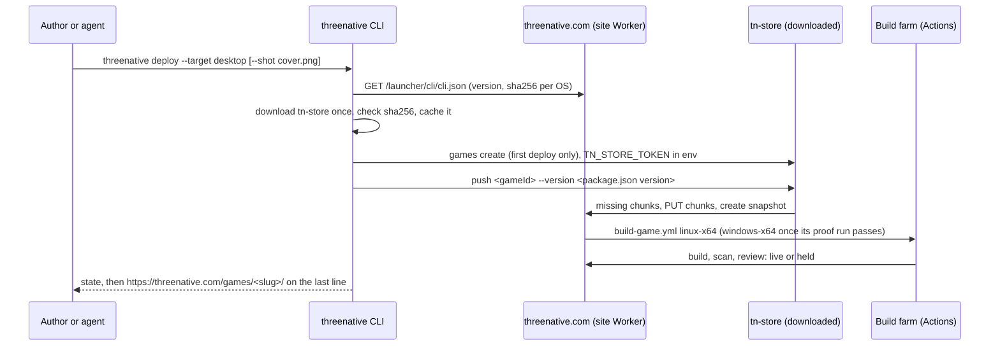

# PRD-924 — `threenative deploy --target desktop`: publish a native game to the store from the terminal, Midway first

**Status:** IN PROGRESS (AC-1 to AC-3 done; AC-4 and AC-5 open)
**Priority:** P1 — AC-4 and AC-5 are open: a ThreeNative game deploys to the web from the terminal, but its native build reaches players only through Studio or a hand-built `tn-store` (owner, 2026-11-26).
**Complexity:** 8 (HIGH) — 1-5 files (+1), new module (+2), crosses the engine/store/site release boundaries (+2), external API: the store API and the build farm (+1), a downloaded executable runs on the author's machine (+2, risk override: binary integrity).
**Owner:** João
**Depends on:** PRD-904 (done: `threenative login` and the device token)
**Repo:** this repo (`packages/create-threenative`); `ThreeNativeHQ/threenative-store` (CLI binary release, local farm run); `ThreeNativeHQ/threenative-sandbox` (Midway, the proof subject, no game edits expected)

## Context

Owner, 2026-11-26: "currently im able to deploy a web game to cloudfare thorugh the TN lib. I need to be able to do the same, but a native game. Do it with midway."

What exists:

- ✅ **Web deploy** (PRD-904): `threenative deploy` runs `build:web`, packs `dist/` and PUTs it to Studio's `/api/cli/share`. Studio stores it in R2 and returns a share link (`packages/create-threenative/src/deploy.ts:173`). Web only.
- ✅ **Native distribution is the store**, on Cloudflare (site Worker + D1 + R2). An author pushes **source** (`tn-store push`). `build-game.yml` builds `linux-x64` and `windows-x64` on Actions, then the scan and the review run, and the release goes live. The launcher installs and starts it (store PRD-790 to PRD-797, `threenative-store/DECISIONS.md` rows 3 to 6). The store builds from source by rule, and a native game is the engine player plus game data only (store PRD-815). So a native deploy must push source, not upload a local binary.
- ✅ **The token already fits.** `threenative login` device tokens have scope `push` (site `worker/store-device.ts:123`), the scope the store push API takes.
- ❌ **No public store client.** `tn-store` (Rust, `threenative-store/crates/tn-store-cli`) is not published. The store's `release.yml` and `scripts/release-local.mjs` ship only the launcher. Studio spawns `tn-store` from its own image with `TN_STORE_TOKEN` in the environment. It keeps the game id in `.threenative/store.json` (`threenative-live-studio/src/server/release/publish.ts:36,68`).
- ⚠️ **Windows native is not proven yet**: the win32-x64 engine player crash (threenative-engine#614) is fixed on develop by #615 (`v8_main.cpp:1737`, `setvbuf` `_IOLBF` fails fast on MSVC). Engine run 45942019774 (`clean-consumer-windows`) passed `--check-game` on windows-2025. The store builder drops the `.cmd` launcher (store branch `fix/614-windows-launch-entry`). The Windows proof run (store run 45952889024) waits on the store repo's GitHub Actions billing, which has refused every store job since 2026-11-21.
- **Midway**: `~/projects/threenative/sandbox/midway-open-pacific` (`ThreeNativeHQ/threenative-sandbox`). It has `@threenative/core` 0.3.21 and a `build:desktop` script. Its source is 751 MB without `node_modules/` and `.git/`, under the 2 GiB snapshot limit. Unverified: whether its pnpm lockfile passes the builder's registry integrity check (PRD-805), and whether it runs on the small engine player that PRD-815 allows.

## Solution

- **Reuse the proven client instead of a port.** `tn-store` already does ignore rules, the secret scan, chunking, upload, `games create` and release polling. It is the one Studio uses. A TypeScript port would be a second copy of about 400 lines of Rust that can drift. The engine CLI downloads the binary and runs it the way Studio does.
- **Binary release** (store repo): `scripts/release-local.mjs` also builds `tn-store` for `linux-x64` and `windows-x64`. It uploads them and a `cli.json` (`{version, files:[{os, name, size, sha256}]}`) to the site media bucket under `launcher/cli/`. This is the same bucket and shape as `launcher/downloads.json`.
- **Engine CLI** (`packages/create-threenative/src/deploy.ts`, one new `store-cli.ts`):
  - `--target desktop` selects the store path. Without it, deploy keeps the web path unchanged. The vocabulary matches `threenative build --target desktop` and `doctor --target`.
  - It fetches `cli.json`, downloads the file for this OS and refuses a sha256 mismatch (exit 4). It caches the file in `$XDG_CACHE_HOME/threenative/bin/tn-store-<version>`, mode `0755`. The download and the hash check follow `packages/runtime-native/scripts/install-prebuilt.mjs:88-126`.
  - The token comes from `requireToken()` (PRD-904) and goes in the child's environment as `TN_STORE_TOKEN`, never in argv.
  - **First deploy** (no `.threenative/store.json`): `games create` with the `package.json` name, genre "Game", the store entry as play URL (Studio's defaults, `publish.ts:31-33`) and `--shot <png>`. Without `--shot` the command exits 2 and names the flag. Then it writes `.threenative/store.json` `{ "gameId" }`, the file Studio already reads, so Studio and the terminal publish to one game.
  - Every deploy: `push <gameId> --version <package.json version>`. It prints the release state (`building`, `live`, `held` …) and ends with the store page URL on its own line. Exit codes are the same as web deploy: 0, 2, 3 (sign in again), 4 (refused), 5 (network).
- **Risks:** ⚠️ a downloaded executable runs on the author's machine. HTTPS plus a sha256 from the same origin protects it the same way as the launcher download. A signed `cli.json` waits for PRD-817's signing key. ⚠️ Farm minutes: Midway is a large snapshot, but chunk dedupe sends only changed chunks after the first push.

## Non-Goals

- A Windows native build of Midway: it waits for the store's Windows proof run (see Blocked on). Refs #614. The deploy path itself is OS-independent.
- macOS: the store has no macOS build or launcher (`DECISIONS.md` row 9). On macOS the command exits 2 with that reason.
- Uploading a locally built binary: the store builds from source by rule (PRD-815).
- Changes to the store page or the install flow: those are PRD-925.

## Acceptance Criteria

- [x] AC-1 [local]: The Midway source passes the store's own build for `linux-x64` on this machine (tag, registry integrity, engine-player shape). The packed player runs Midway 300 frames with a non-blank screenshot. proof: `node scripts/local-farm.mjs` in the store repo on the Midway folder, then `threenative-playtest --target desktop` on the packed player — Evidence: Midway (`git archive` of sandbox HEAD, p924a, 2026-11-27) passes `tn-store-builder` tag, install, build (`unshare -rn`, offline) and verify-output for `linux-x64` after store fixes 3b2a2bc, 2487136 and 574ceae on store branch `prd-924-cli-release`. The pack is 338 MB in 9 files, all sha256 match. The packed player runs 300 frames on an RTX 2080 via `node packages/playtest/dist/runner/cli.js <wait-300> --target desktop --executable <dir>/tn-native-engine-player-v8 --host-arg <dir>/game.js`. Screenshot `~/Downloads/prd-924/ac1-packed-player.png`.
- [x] AC-2 [local]: `threenative deploy --target desktop` on a game without `store.json` downloads `tn-store`, refuses a wrong sha256 and runs `games create` then `push` with the token only in the environment. It writes `store.json` once and prints the store URL last. A second run pushes onto the same game id. proof: `pnpm exec vitest run packages/create-threenative/__tests__/deploy-native.spec.ts` (fake site, fake `tn-store`) — Evidence: `pnpm exec vitest run packages/create-threenative/__tests__/deploy-native.spec.ts` passes 10 tests (fake site serves `cli.json` and a binary, fake `tn-store`): download once, mode 0755, wrong sha256 exits 4 with no cached file, a tampered cache is replaced and never run, a malformed `cli.json` exits 4, faked win32 x64 picks the `.exe` under LOCALAPPDATA, arm64 exits 2, token only in the child env, `games create` then `push` then `games show`, `store.json` written once, second run reuses the game id, missing `--shot` exits 2, store exit 3 passes through. The web specs `deploy.spec.ts` and `deploy-nolink.spec.ts` stay green.
- [x] AC-3 [local]: The real flow with a local site `wrangler dev` and a `tn-store` built from source: deploy Midway, the snapshot lands, and the second deploy sends only changed chunks. proof: run log in the PR — Evidence: local `wrangler dev` (isolated D1/R2 state, port 4291) and a release `tn-store` built from the store repo; `git archive` copy of Midway, `THREENATIVE_STORE_CLI=<tn-store> threenative deploy --target desktop --shot cover.png`. Run 1: listing created, `Pushed 509 files, 621 of 621 chunks uploaded`, local D1 holds the snapshot (game bound, version `0.0.0`, 201,536,129 bytes, 621 chunks). Run 2 after a one-line README change: `Pushed 509 files, 1 of 621 chunks uploaded`, same game id from `store.json`, same store URL. The release is `held` with `TN_API_NO_DISPATCH_TOKEN` because no farm runs locally (farm is AC-1/AC-5). Run log in the PR comment.
- [x] AC-4 [shared]: `release-local.mjs` publishes `tn-store` for Linux and Windows, plus `launcher/cli/cli.json`, and `https://threenative.com/launcher/cli/cli.json` serves hashes that match the files. proof: release run log + `curl` + `sha256sum` — Evidence (2026-11-27): `pnpm release:local 0.1.6 --publish` from store main adde0ff published launcher 0.1.6 and the client. `https://threenative.com/launcher/cli/cli.json` lists `tn-store-0.1.6-linux-x64` (8,266,824 B, sha256 `cf6cbf54…5d279`) and `tn-store-0.1.6-windows-x64.exe` (5,139,456 B, `f0e256da…d9cb`). `curl` of both files plus `sha256sum` and `stat` match exactly. The Linux file is an ELF that runs `--version`, and the Windows file is a PE32+ console executable. On the production Midway deploy, `threenative deploy --target desktop` downloaded and cached `~/.cache/threenative/bin/tn-store-0.1.6` (mode 0755).
- [ ] AC-5 [shared]: From the Midway checkout, `npx threenative deploy --target desktop` against production. The farm builds `linux-x64`, the release goes live, and the launcher on this machine installs Midway from the store and starts it from the library, the way Steam does. proof: deploy log, the `build-game.yml` run link, a launcher screenshot in `~/Downloads/prd-924/` — Evidence: pending.

## Blocked on

- Windows native Midway: the store's Windows proof run (store run 45952889024) waits on the store repo's GitHub Actions billing — unblocked by João. The #614 crash itself is fixed (#615); the engine side is locked by the win32 packaging test and the `.cmd` check in `native-release.yml`. The deploy path needs no change. Refs #614, not `Fixes`, until the store run passes.
- AC-5 only if the release gate holds Midway: an admin approves it in `/admin` (PRD-814) — unblocked by João.

## Integration Ledger

| Capability | Reachable consumer/trigger | Replaces / disposition | Evidence |
| --- | --- | --- | --- |
| Native deploy | `threenative deploy --target desktop` → `deploy.ts` → `store-cli.ts` → `tn-store` | New path beside the web deploy, which is unchanged | AC-2, AC-3, AC-5 |
| Store client distribution | `release-local.mjs` → site media `launcher/cli/` → `GET /launcher/cli/cli.json` | New; the launcher release is unchanged | AC-4 |

## Decisions

- 2026-11-26 (agent): run the published `tn-store` binary, not a TypeScript port. It reuses the client that Studio already runs in production, its secret scan included, and keeps one implementation of the store protocol.
- 2026-11-26 (agent): `THREENATIVE_STORE_CLI=<path>` makes the command use a local `tn-store` instead of the download. AC-2 and AC-3 need it to test a source-built client before AC-4 publishes one. It is also how Studio's image can keep its own copy.
- 2026-11-26 (agent): the release version is the `package.json` `version`, else `app.version` from `threenative.config.ts` (Midway: 1.0.0), so the label matches the version the native app is built with. The config loader fills `0.1.13` when `app.version` is unset, so a game with neither deploys as `0.1.13`; the loader gives no way to tell it from a set value. The store takes any 1 to 40 printable ASCII label, so a value outside that range exits 2, as does a config that does not load.
- 2026-11-26 (agent): the store page URL comes from `tn-store games show <id> --json`, whose `slug` the owner's listing carries before it is live. If that call fails, the last line falls back to `/games/game/?id=<id>`, which the site redirects once the game is live.
- 2026-11-26 (agent): the first deploy needs `--shot`. The store listing requires a picture, and running the game to capture one costs more than the flag.

## Execution Phases

#### Phase 1: Midway builds the way the farm builds it
**Status:** DONE (AC-1)
**Files:** none expected. A builder or engine refusal is fixed at its layer: a Midway lockfile problem in the sandbox repo, an engine-player gap in `packages/runtime-native`.
**Implementation:** run the store's `local-farm.mjs` (the `build-game.yml` steps without Actions) on a clean Midway clone. Then run the packed player under the desktop playtest. Each refusal becomes a fix with its own test before Phase 3.
- [x] Midway packs for `linux-x64` and the packed player runs 300 frames — proof: AC-1 — covers AC-1 and the PRD-805 and PRD-815 risks.

#### Phase 2: `threenative deploy --target desktop`
**Status:** DONE (AC-2, AC-3)
**Files:** `packages/create-threenative/src/deploy.ts` (target switch), `src/store-cli.ts` (fetch, verify, cache, spawn), `src/threenative.ts` (help text), `__tests__/deploy-native.spec.ts`.
**Implementation:** as in Solution. The web path keeps its tests green, unchanged.
- [x] The unit contract passes — proof: AC-2 — covers AC-2.
- [x] The local end-to-end deploy of Midway works — proof: AC-3 — covers AC-3.

#### Phase 3: Published client, live Midway
**Status:** NOT STARTED (AC-4, AC-5)
**Files:** `threenative-store/scripts/release-local.mjs` (CLI binaries + `cli.json`).
**Implementation:** publish the client, release the engine cohort with the new command, then deploy Midway against production and install it with the launcher.
- [x] `cli.json` and the binaries are live and match — proof: AC-4 — covers AC-4.
- [ ] Midway is live on the store and plays from the launcher — proof: AC-5 — covers AC-5.
