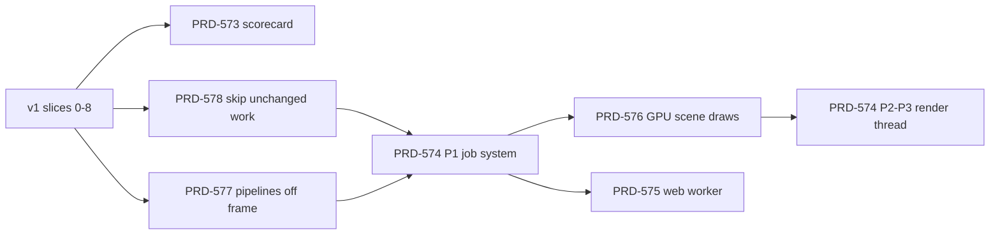

# Epic — Unreal-class performance, in release cycles

**Status: OPEN — rewritten 2026-10-11 as five release cycles (owner-approved cycle plan, 2026-10-12).
Engine code is cited at `origin/feat/native-engine` `68f4b1f7b`; develop at `d0ce8686d`. No cycle has
started.**

## The route

- **One owned C++ engine behind the three.js API.** It runs native on Dawn or wgpu and as Wasm
  (`tn-native-engine-web`) on the web. Game code runs on V8 (native) or browser JS (web).
- **Opt-in per game first, then default.** A game selects the engine with `engine: "native"` in
  `threenative.config.ts`. The legacy host stays the default until the v1 KPI passes. Then the
  native engine becomes the default. The legacy engine is deleted after one clean release
  ([PRD-535](../native-engine/PRD-535-n21-the-js-engine-is-deleted.md)).
- **Charter amendment accepted 2026-10-12.** It permits the owned engine on the terms above. Slice 0
  of v1 lands the charter text and the root `AGENTS.md` rule 5 change.
- **Perry is parked (owner, 2026-10-11).** PRD-579 left this epic. It, PRD-581 and PRD-582 stay on
  `origin/feat/native-engine` and do not land on develop.

Where Midway web stood when the epic opened (native Wasm page against the three.js page): steady CPU
busy per frame 2.32x faster, frame p50 0.24x, first frame 0.48–0.62x, `enter` 0.96–1.09x, `ready`
0.73–1.05x. Inside the engine: animation about 13%, cull and project about 11%, `Renderer::render`
21% inclusive, transforms about 8%, `weak_ptr::lock()` 2.9% (since removed from the binding path).

## How a cycle works

Each cycle is a few small PRs to develop, one headline KPI and one stability gate. The next cycle
starts only when the KPI passes as a same-run ratio and the gate is green. PRs inside a cycle merge
as they finish.

**Stability gate S** (every cycle): `pnpm test:templates` and `pnpm test:playtest` green on web;
`pnpm native:verify:desktop` green; an 1800+ frame soak with no crash and no RSS growth
([PRD-573](./PRD-573-the-performance-bar-is-a-scorecard-on-named-scenes.md) Phase 2 adds the soak
command); while the engine is opt-in, default (`engine: "legacy"`) build output is byte-identical
to the base commit.

| Cycle | PRDs and slices | Headline KPI (benchmark that proves it) | Size |
| --- | --- | --- | --- |
| v1 Land the engine | Slices 0–8 below; [PRD-573](./PRD-573-the-performance-bar-is-a-scorecard-on-named-scenes.md) | Native engine steady frame CPU at least 2x legacy: R5 on desktop (`pnpm bench:engines`, `tn-desktop` against `native-v8` in one invocation, PRD-573 Phase 3) and Midway web (`pnpm profile:wasm-page -- --url A --control B --cpu-work`). Pass: native becomes the default | 2–3 wk |
| v2 Stop wasted work | [PRD-578](./PRD-578-the-engine-skips-work-that-did-not-change.md), [PRD-577](./PRD-577-engine-pipelines-compile-off-frame-and-survive-relaunch.md), slice 9 (Android player) | R5 frame p50 on the native engine at least equal to Godot desktop (`pnpm bench:scoreboard`, Godot ratio column); Android first-launch pipeline compiles cut (counter) | 3 wk |
| v3 All cores and the GPU scene | [PRD-574](./PRD-574-native-frames-overlap-game-and-render-work-on-threads.md) Phase 1 (job system), [PRD-576](./PRD-576-the-engine-renderer-draws-from-the-gpu-scene.md), then PRD-574 Phases 2–3 | Native R5 faster than Godot by a margin the owner sets; frame CPU scales sub-linearly with object count (`bench:engines --objects` sweep) | 5–6 wk |
| v4 Cull and load | New PRDs from the v4 candidates below, filed at the start of v4 | Bigger scenes at the same frame rate; load time (`ready`, first frame) on the scorecard | 4–6 wk |
| v5 Web worker | [PRD-575](./PRD-575-the-web-engine-renders-from-a-worker-on-wasm-threads.md) | Web main-thread busy time and frame p50 (`profile:wasm-page`, worker arm against main-thread arm) | 4+ wk |

S adds the Android emulator journey from v2 and a ThreadSanitizer run of the engine tests from v3.

### v1 slices (each one PR to develop, branched from `origin/develop`, Perry stripped)

| # | Slice | Inert because | Gate beyond S |
| --- | --- | --- | --- |
| 0 | Charter and root `AGENTS.md` rule 5; `NATIVE-ENGINE-DECISION.md`; a `native-engine` CI scope with its own job and cache | docs and CI only | prose lane, `ci-structure.spec.ts`, `ci-needs.spec.ts` |
| 1 | Core fixes that need no engine (foot-plant, `pose-measure`, grounding, loop freeze settle) | bug and perf fixes with named tests | red-green specs; `pnpm bench:scoreboard` before and after; judge if pixels move |
| 2a | `three-native` catalog, generators, reference oracle, goldens | private package, no consumer | `run-reference.ts --check --no-renders` |
| 2b | CPU engine core: foundation, scene, animation, math, C ABI | `EXCLUDE_FROM_ALL` targets | ctest `-L native-engine`, ASan/UBSan, Wasm under node |
| 3 | Shader IR and WGSL, packages, TNPK writer | engine targets; `assets.nativePackage` off | ctest shader and package; Tint and naga validation |
| 4 | Shared host services (`src/webgpu/context.cpp`, `presentation.cpp` split) | behaviour-neutral refactor of legacy code | full legacy board, emulator parity |
| 5 | Renderer, materials, graph, world, visibility, GPU scene (2–3 PRs) | engine targets | ctest on a software GPU; render fixtures against browser frames |
| 6 | V8 adapter, desktop player, measurement harness | separate executables | `native-engine-world-*` playtests; first native-against-legacy figure |
| 7 | Wasm engine and `engine: "native"`, `profile:wasm-page` | default `engine: "legacy"` | `wasm-engine-boot` playtests; web A/B |
| 8 | Template post-node imports | pixel-neutral claim | visual judge BEFORE/AFTER |
| 9 | Android engine player (v2) | manual dispatch | emulator run |

### v4 candidates (from the Unreal gap review; not filed yet)

Checked on develop and `origin/feat/native-engine` on 2026-10-11 before listing.

| Candidate | TN has | v4 action |
| --- | --- | --- |
| HZB occlusion | `core/src/render/depth-pyramid.ts`; [PRD-489](../done/PRD-489-gpu-scene-occlusion-culling.md) closed it (median would-cull share 0.013); the working cull is on `feat/prd489-cull` | refile only for a denser named scene; nothing in the engine |
| Distance culling | `WorldCells` `maxDistance` cull (`core/src/world-cells.ts`); engine `ProjectedCull` is a projected-size gate only | port a per-object max draw distance into the engine |
| Mesh LOD | core `model-lod`, `instanced-batch-lod`; engine `renderer/lod/model_lod` (selection only, PRD-519) | measure; fill engine gaps only |
| HLOD / merged proxies | `WorldCells` merged chunk groups (core) | engine port if the scorecard shows draw cost |
| Terrain LOD | engine `world/tiles/terrain_tiles`; [PRD-566](../unreal-source-borrowing/PRD-566-terrain-lod-morphs-on-the-gpu-and-picks-by-screen-error.md) NOT STARTED | fold into PRD-566 |
| World streaming | core `world-cells`, `world-tiles`; engine `world/cells`, `world/tiles` (CPU decisions only) | measure load and RSS on a streamed scene |
| Async loading | engine `world/admission/package_loads` worker set | score decode and upload order on the scorecard |
| Texture streaming | none in code; [PRD-VQ-10](../performance/PRD-VQ-10-texture-mip-residency.md) PROPOSED | file under PRD-VQ-10 |
| Frame allocator (MemStack-like) | none on either branch | measure allocations per frame first |
| Dynamic resolution | core `resolution-scaler.ts`; [PRD-564](../unreal-source-borrowing/PRD-564-the-resolution-scale-changes-without-reallocating-a-target.md) NOT STARTED | engine path in PRD-564 |
| Instancing | core `InstancedMesh`/`BatchedMesh` paths, `clustered-batch`; engine `renderer/projection/instanced_batch` | covered |
| Render target pool, async compute | none on either branch | not before v4 data asks for it |

## Rules for every PRD in this folder

- **One phase, one small PR to develop**, under the owner-approved cycle plan. A phase that edits
  engine files starts after the v1 slice that lands those files. No PR targets
  `feat/native-engine`.
- **Same-run ratio.** Subject and control run in one command and one load window
  (`pnpm profile:wasm-page -- --url A --control B`, or several `bench:engines` arms in one
  invocation). Each report records the one-minute load average. Prefer a counter gate (calls,
  compositions, evaluations, compiles) to a timing gate: a counter does not move with host load.
- **Tails, not only medians.** A timing box reports p95, p99 and the hitch count beside p50. A
  median win with a worse p99 does not pass.
- **Visual judge** for a change that can alter a pixel, per the root `AGENTS.md`.
- **Red-green** for every behaviour change.
- **Bindings.** A public binding change regenerates `packages/three-native/api/` in the same commit.
- **Unreal licence.** Unreal source is under the Epic Games EULA. Read the design, write new code,
  copy nothing. A `UE 5.8.3: <path>` citation names a design reference (UE `release` `396c9f059`).

## Dependency order

## The PRDs

| PRD | Cycle | Outcome | Status |
| --- | --- | --- | --- |
| [PRD-573](./PRD-573-the-performance-bar-is-a-scorecard-on-named-scenes.md) | v1 | One scorecard reports tails, counters, memory and Godot ratios on both engines | NOT STARTED |
| [PRD-578](./PRD-578-the-engine-skips-work-that-did-not-change.md) | v2 | No per-bone lock, one view block per frame, hidden rigs update less with safeguards | PARTIAL |
| [PRD-577](./PRD-577-engine-pipelines-compile-off-frame-and-survive-relaunch.md) | v2 | No draw waits on a compile; pipelines ship and persist on Dawn and wgpu | PARTIAL |
| [PRD-574](./PRD-574-native-frames-overlap-game-and-render-work-on-threads.md) | v3 | Jobs on all cores, then an opt-in render thread one frame behind | NOT STARTED |
| [PRD-576](./PRD-576-the-engine-renderer-draws-from-the-gpu-scene.md) | v3 | Recorded passes survive camera motion; visibility is data | NOT STARTED |
| [PRD-575](./PRD-575-the-web-engine-renders-from-a-worker-on-wasm-threads.md) | v5 | The web engine and game run in a worker; threads are measured | NOT STARTED |

## Owned elsewhere — link, do not file again

- **JS-to-Wasm calls and upload bytes:** PRD-553 (`docs/PRDs/native-engine/` on
  `origin/feat/native-engine`; it lands with the v1 slices).
- **Engine batching, visibility, LOD and the GPU-scene kernel:** [PRD-519](../native-engine/PRD-519-n12-native-batching-visibility-lod-gpu-scene.md).
- **Animation rate policy in core TypeScript:** [PRD-570](../unreal-source-borrowing/PRD-570-a-character-costs-what-the-camera-sees-of-it.md).
- **Pipelines on the legacy host:** [PRD-327](../performance/critical/PRD-327-first-use-pipeline-compilation-leaves-the-main-loop.md),
  [PRD-387](../performance/critical/PRD-387-shader-variants-are-prepared-off-frame-and-bounded.md),
  [PRD-540](../performance/critical/PRD-540-the-compile-walk-leaves-the-main-thread.md) and
  [PRD-368](../assets/PRD-368-compiled-pipelines-survive-a-relaunch.md).
- **Texture residency and compression:** [PRD-VQ-10](../performance/PRD-VQ-10-texture-mip-residency.md), [PRD-568](../unreal-source-borrowing/PRD-568-mobile-builds-ship-gpu-ready-astc.md).
- **Frame-rate floors per platform:** [PRD-222](../performance/critical/PRD-222-performance-targets-per-platform.md).
- **Default promotion and legacy deletion:** [PRD-533](../native-engine/PRD-533-n20-platform-qualification-performance-default-promotion.md), [PRD-535](../native-engine/PRD-535-n21-the-js-engine-is-deleted.md).
