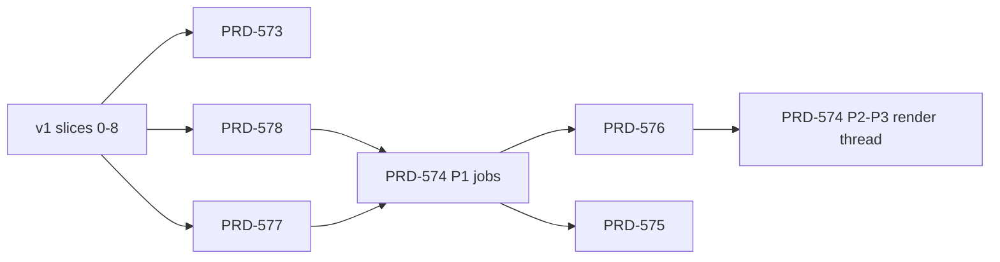

# Roadmap — Unreal-class performance

**Update rule:** every PR that lands a v1 slice or a PRD phase updates its row here in the same
commit (status, and the PR link for a slice). A cycle's status changes only when its KPI passes as a
same-run ratio and stability gate S is green. Engine code is cited at `origin/feat/native-engine`
`68f4b1f7b`.

## Goal and route

**Goal:** frame cost and load time of an established engine, with Godot as the measurable bar.
**Route:** one owned C++ engine behind the three.js API, native on Dawn or wgpu and Wasm on the web;
game code on V8 or browser JS. Opt-in per game, then the default, then the legacy engine is deleted.

## Decisions log

| Date | Decision | By |
| --- | --- | --- |
| 2026-10-11 | Perry is parked. PRD-579, PRD-581, PRD-582 and `tools/native-typescript` stay on `feat/native-engine` and do not land. | owner |
| 2026-10-11 | The goal is established-engine performance; Godot desktop is the measurable bar (no Unreal binary runs here). | owner |
| 2026-10-12 | Charter amendment accepted: the owned engine is permitted, opt-in per game first. Slice 0 lands the text. | owner |
| 2026-10-12 | Work ships in release cycles: a few small PRs, one headline KPI and one stability gate per cycle. | owner |
| 2026-10-12 | Native is opt-in (`engine: "native"`), becomes the default when the v1 KPI passes, and the legacy engine is deleted after one clean release (PRD-535). | owner |
| 2026-10-11 | One PR per PRD, as `docs/PRDs/AGENTS.md` requires; each v1 slice is its own PR. | repo rule |

## Cycles

**Stability gate S:** `pnpm test:templates` and `pnpm test:playtest` green on web;
`pnpm native:verify:desktop` green; an 1800+ frame soak with no crash and no RSS growth (PRD-573
Phase 2 adds the command); while the engine is opt-in, default build output byte-identical to the
base commit. From v2 S adds the Android emulator journey; from v3, a ThreadSanitizer engine run.

| Cycle | Contents | KPI (benchmark) | Gate | Size | Status |
| --- | --- | --- | --- | --- | --- |
| v1 Land the engine | Slices 0–8, PRD-573 | Native steady frame CPU at least 2x legacy: R5 desktop (`pnpm bench:engines`, `tn-desktop` and `native-v8` in one invocation) and Midway web (`pnpm profile:wasm-page -- --url A --control B --cpu-work`). Pass: native becomes the default | S | 2–3 wk | NOT STARTED |
| v2 Stop wasted work | PRD-578, PRD-577, slice 9 | Native R5 frame p50 at least equal to Godot desktop (`pnpm bench:scoreboard`, `godotRatio`); Android first-launch pipeline compiles cut (counter) | S + emulator | 3 wk | NOT STARTED |
| v3 All cores and the GPU scene | PRD-574 Phase 1, PRD-576, PRD-574 Phases 2–3 | Native R5 faster than Godot by an owner-set margin; sub-linear frame CPU over object count (`bench:engines --objects` sweep) | S + TSan | 5–6 wk | NOT STARTED |
| v4 Cull and load | PRDs filed from the v4 candidates below | Bigger scenes at the same frame rate; `ready` and first frame on the scorecard | S | 4–6 wk | NOT STARTED |
| v5 Web worker | PRD-575 | Web main-thread busy and frame p50 (`profile:wasm-page`, worker arm against main-thread arm) | S | 4+ wk | NOT STARTED |

## v1 engine-landing slices

Each slice is one PR to develop, branched from `origin/develop`, with Perry stripped.

| # | Slice | Inert because | Gate beyond S | Status | PR |
| --- | --- | --- | --- | --- | --- |
| 0 | Charter and root `AGENTS.md` rule 5; `NATIVE-ENGINE-DECISION.md`; a `native-engine` CI scope with its own job and cache | docs and CI only | prose lane, `ci-structure.spec.ts`, `ci-needs.spec.ts` | NOT STARTED | |
| 1 | Core fixes that need no engine (foot-plant, `pose-measure`, grounding, loop freeze settle) | bug and perf fixes with named tests | red-green specs; `pnpm bench:scoreboard` before and after; judge if pixels move | NOT STARTED | |
| 2a | `three-native` catalog, generators, reference oracle, goldens | private package, no consumer | `run-reference.ts --check --no-renders` | NOT STARTED | |
| 2b | CPU engine core: foundation, scene, animation, math, C ABI | `EXCLUDE_FROM_ALL` targets | ctest `-L native-engine`, ASan/UBSan, Wasm under node | NOT STARTED | |
| 3 | Shader IR and WGSL, packages, TNPK writer | engine targets; `assets.nativePackage` off | ctest shader and package; Tint and naga validation | NOT STARTED | |
| 4 | Shared host services (`src/webgpu/context.cpp`, `presentation.cpp` split) | behaviour-neutral refactor of legacy code | full legacy board, emulator parity | NOT STARTED | |
| 5 | Renderer, materials, graph, world, visibility, GPU scene (2–3 PRs) | engine targets | ctest on a software GPU; render fixtures against browser frames | NOT STARTED | |
| 6 | V8 adapter, desktop player, measurement harness | separate executables | `native-engine-world-*` playtests; first native-against-legacy figure | NOT STARTED | |
| 7 | Wasm engine and `engine: "native"`, `profile:wasm-page` | default `engine: "legacy"` | `wasm-engine-boot` playtests; web A/B | NOT STARTED | |
| 8 | Template post-node imports | pixel-neutral claim | visual judge BEFORE/AFTER | NOT STARTED | |
| 9 | Android engine player (v2) | manual dispatch | emulator run | NOT STARTED | |

## PRDs

| PRD | Cycle | Phases | Status |
| --- | --- | --- | --- |
| [PRD-573](./PRD-573-the-performance-bar-is-a-scorecard-on-named-scenes.md) scorecard | v1 | 3 (0/3 done) | NOT STARTED |
| [PRD-578](./PRD-578-the-engine-skips-work-that-did-not-change.md) skip unchanged work | v2 | 3 (0/3 done) | PARTIAL (binding lock done on the engine branch) |
| [PRD-577](./PRD-577-engine-pipelines-compile-off-frame-and-survive-relaunch.md) pipelines off frame | v2 | 3 (0/3 done) | PARTIAL (native `compileAsync` done on the engine branch) |
| [PRD-574](./PRD-574-native-frames-overlap-game-and-render-work-on-threads.md) jobs, then render thread | v3 | 3 (0/3 done) | NOT STARTED |
| [PRD-576](./PRD-576-the-engine-renderer-draws-from-the-gpu-scene.md) GPU scene draws | v3 | 3 (0/3 done) | NOT STARTED |
| [PRD-575](./PRD-575-the-web-engine-renders-from-a-worker-on-wasm-threads.md) web worker | v5 | 3 (0/3 done) | NOT STARTED |
| v4 PRDs | v4 | — | NOT FILED (candidates below) |

## v4 candidates

Checked on develop and `origin/feat/native-engine` on 2026-10-11. Filed as PRDs at the start of v4.

| Candidate | TN has | v4 action |
| --- | --- | --- |
| HZB occlusion | `core/src/render/depth-pyramid.ts`; [PRD-489](../done/PRD-489-gpu-scene-occlusion-culling.md) closed it (median would-cull share 0.013); the working cull is on `feat/prd489-cull` | refile only for a denser named scene |
| Distance culling | `WorldCells` `maxDistance` cull (core); engine `ProjectedCull` is a projected-size gate only | port a per-object max draw distance into the engine |
| Mesh LOD | core `model-lod`, `instanced-batch-lod`; engine `renderer/lod/model_lod` (selection only, PRD-519) | measure; fill engine gaps only |
| HLOD / merged proxies | `WorldCells` merged chunk groups (core) | engine port if the scorecard shows draw cost |
| Terrain LOD | engine `world/tiles/terrain_tiles`; [PRD-566](../unreal-source-borrowing/PRD-566-terrain-lod-morphs-on-the-gpu-and-picks-by-screen-error.md) NOT STARTED | fold into PRD-566 |
| World streaming | core `world-cells`, `world-tiles`; engine `world/cells`, `world/tiles` (CPU decisions only) | measure load and RSS on a streamed scene |
| Async loading | engine `world/admission/package_loads` worker set | score decode and upload order |
| Texture streaming | none in code; [PRD-VQ-10](../performance/PRD-VQ-10-texture-mip-residency.md) PROPOSED | file under PRD-VQ-10 |
| Frame allocator (MemStack-like) | none on either branch | measure allocations per frame first |
| Dynamic resolution | core `resolution-scaler.ts`; [PRD-564](../unreal-source-borrowing/PRD-564-the-resolution-scale-changes-without-reallocating-a-target.md) NOT STARTED | engine path in PRD-564 |
| Instancing | core `InstancedMesh`/`BatchedMesh` paths, `clustered-batch`; engine `renderer/projection/instanced_batch` | covered |
| Render target pool, async compute | none on either branch | not before v4 data asks for it |
| Projection reuse, SIMD world matrices, compose skip | deferred from PRD-578 | refile if the scorecard shows transforms, cull and project at 10% or more |
