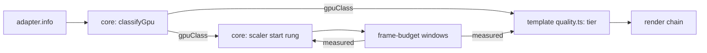

# PRD-563 — The first frame starts at the tier the GPU family can hold

**Status:** IN PROGRESS
**Priority:** P2 — Live-adapter boxes are open: a phone or a laptop iGPU starts at a tier picked by one `mobile` flag, then spends measured windows stepping to the tier it can hold.
**Complexity:** 5 (MEDIUM) — 11+ files, because each template's generated `quality.ts` takes the new input (3); new core module (+2); risk override: none
**Owner:** João (tier mapping in the templates), agent (implementation)
**Depends on:** None. Related: [PRD-549](../performance/PRD-549-the-engine-holds-60-fps-on-a-weak-gpu.md) (it fixes how fast the scaler reacts on a weak GPU; this PRD fixes where it starts, and duplicates none of its boxes), [PRD-294](../useful-defaults/PRD-294-a-software-rasteriser-should-not-run-the-high-tier-chain.md) (its software-adapter floor becomes one class of this table), [PRD-287](../useful-defaults/PRD-287-the-default-look-holds-the-phones-budget.md) (the measured ladder that refines the start).

## Context

Today the start point of the look and of the pixel count is a guess with two inputs:

- Each template's generated `src/render/quality.ts` picks the tier from `{ mobile, software, tier }`.
  The starter returns `low` for `software`, `low` for `mobile`, and `high` for everything else
  (`packages/create-threenative/templates/starter/src/render/quality.ts:52-71`).
- `RenderChain` with `tier: "auto"` starts at `high` and steps down on measured windows
  (`packages/core/src/render/chain.ts:304-306`).
- `ResolutionScaler` starts at rung 0, scale 1.0 (`packages/core/src/resolution-scaler.ts`, `RESOLUTION_SCALER.rungs`).
- The renderer already reads `adapter.info` (`architecture`, `description`, `device`, `vendor`)
  into an identity string and a software flag (`packages/core/src/renderer.ts:1074-1145`). Only
  the software flag reaches a template.

Effect: a Mali-G52 phone and a Mali-G715 phone get the same `low` look. A laptop with an Intel
iGPU gets the same `high` look and scale 1.0 as an RTX desktop. PRD-549 measured that case on
the LAN laptop's Iris Xe: Machinefall started at scale 1.0 with 4× MSAA, its main pass took
43–110 ms, and the scaler needed several windows after readiness to reach the 0.61 floor. Each wrong start costs measured
windows to correct, and each tier step can compile new pipelines.

**What Unreal does (UE 5.8.3, ideas only, no code copied):**

- `Engine/Config/BaseDeviceProfiles.ini:923-937` matches the Android GPU family string with a
  regular expression (for example "Adreno (TM) 7xx", "Mali-G71") to a device profile.
- Each family profile inherits one bucket: Adreno 5xx → Mid, Adreno 6xx → High, Adreno 7xx and
  8xx → Epic (`:1172-1211`); Mali-G710, G7xx and G9xx → Epic, an unknown newer Mali "Gx" → High
  (`:1374-1406`).
- Each bucket sets the scalability group levels and a content scale factor. `Android_Low` sets
  `r.MobileContentScaleFactor=0.8` and all groups to 0 (`:1033-1041`); `Android_Mid` sets 1.0 and
  groups to 1 (`:1049-1057`); `Android_High` sets groups to 2 (`:1065-1073`).
- On desktop, a short synthetic benchmark gives a CPU and a GPU performance index. Each group
  level comes from thresholds on the GPU index or on the smaller of the two
  (`Engine/Source/Runtime/Engine/Private/Scalability.cpp:205-222`,
  `Engine/Config/BaseScalability.ini:24-33`, thresholds 18 / 42 / 115).

We take the first idea (a family table for the start point) and skip the benchmark: our measured
ladder already does that job after the first window, at no startup cost.

## Solution

1. **Core classifies the adapter (mechanism).** A new `gpu-class.ts` maps the four `adapter.info`
   fields to one class: `software`, `mobile-low`, `mobile-mid`, `mobile-high`, `integrated`,
   `discrete` or `unknown`. One table, ordered rules, first match wins. The software rule is the
   existing `SOFTWARE_ADAPTER` test. The renderer reports `TN_GPU_CLASS` with the class, the
   matched rule and the raw fields. An adapter that no rule matches is `unknown`, and `unknown`
   keeps today's behaviour exactly.
2. **The template maps class to tier (look).** `resolveQualityTier` receives `gpuClass` beside
   `mobile` and `software`. The generated table is game source. The starter's first mapping:
   `software` and `mobile-low` → `low`, `mobile-mid` → `low`, `mobile-high` and `integrated` →
   `medium`, `discrete` → `high`, `unknown` → today's `mobile` rule.
3. **Core picks the starting scale (mechanism).** `ResolutionScaler` starts at a rung chosen
   from the class: `mobile-low` starts one rung down (0.85, near Unreal's 0.8 for its Low
   bucket), every other class starts at rung 0. The source reads `auto`. The first eligible window
   moves it either way, so measurement always wins over the table.
4. **Browsers may coarsen the fields.** Chrome reports `vendor` and `architecture` and can leave
   `description` empty. Each rule names the field it reads. A rule that needs a field the platform
   does not report never matches, so the result is `unknown`, never a wrong class.

Risk: a wrong rule caps a strong GPU. Phase 2 pins `discrete` and `unknown` to today's start
with a test, the same failure mode that PRD-294 names.

## Acceptance Criteria

- [x] AC-1 [local]: A desktop RTX 2080 in browser WebGPU still starts at `high` and scale 1.0, and reports `TN_GPU_CLASS` `discrete`. proof: starter playtest `--browser-recipe webgpu`, `TN_GPU_CLASS` and `TN_RENDER_CHAIN` lines. — Evidence: 2026-10-09, desktop RTX 2080, Chrome WebGPU headed, scaffolded starter built from this branch: exit 0, pass true. Console `TN_GPU_CLASS:{"class":"discrete","fields":{"architecture":"turing","description":"","device":"","vendor":"nvidia"},"rule":"nvidia"}`, `TN_QUALITY_TIER high mobile=false software=false source=platform`, `renderChain.tier` pass at `high`, surface `resolutionScale` 1 with `scaleSource` auto.
- [x] AC-3 [local]: On the LAN laptop's Iris Xe (Chrome WebGPU), the starter reports `TN_GPU_CLASS` `integrated` and starts at the `medium` tier. proof: starter playtest `--browser-recipe webgpu` on the laptop lane. — Evidence: 2026-10-09, LAN laptop, Intel Iris Xe (`architecture: gen-12lp`, `vendor: intel`), Chrome WebGPU headed on the real display, scaffolded starter built from this branch, two runs: `TN_GPU_CLASS` `integrated` (rule `intel`) and `TN_QUALITY_TIER medium mobile=false software=false source=platform` both runs; the control arm (same build, the `gpuClass` line removed from `Play.ts`) reported `high` both runs. Visual judge (fresh read-only subagent, 2 runs per arm, same pose and tick, BEFORE/AFTER burned in): NEUTRAL on both pairs and NEUTRAL overall, which is the intended effect of a perf-only start tier (no visible change). Frame time is not claimed as a win: p95 was 80.8 and 90.2 ms (after) against 94.7 and 92.6 ms (before) on a laptop at 92 to 100 C, and both arms miss the starter `maxFrameMsP95` 33 ms bound. The starter's flat `renderChain.tier: "high"` assertion fails on this adapter (observed `medium`, `adapterClass: hardware`); see Decisions. First-frame re-judge, same lane and build, `warmupFrames: 0` with a capture at the first and second frame after startup-ready and one 1200 ticks later, two runs per arm: NEUTRAL on all six pairs and NEUTRAL overall. No IMPROVEMENT is claimed: the old arm never leaves `high` in the run (every `TN_QUALITY_TIER` line and render-chain sample reads `high`), so there is no tier pop on this adapter for the new start to remove, and `medium` differs from `high` only in `gtaoSamples` and static grain. The pose that carries the effect is a phone, where the old start drops `high` to `low`; that needs the Pixel 8 (see Blocked on), and the emulator reports `discrete`.
- [ ] AC-2 [local]: The Android emulator native host reports its adapter fields and a class, and the starter runs to steady state. proof: starter playtest `--target android` on `emulator-5554`. — Evidence: PARTIAL, left open. 2026-10-09, `emulator-5554` (x86_64, passes the host GPU through), starter built from this branch and swapped into the installed runtime APK: the host reports `TN_GPU_CLASS:{"class":"discrete","fields":{"architecture":"unknown","description":"615.71.09","device":"NVIDIA GeForce RTX 2080","vendor":"NVIDIA"},"rule":"nvidia"}` before the scene loads, so the fields and the class are proven on the native host. The starter does not reach steady state: `TN_NATIVE_START_FAILED:TN_ASSETS_UNRESOLVED 'native-proof.glb' ... setMeshoptDecoder must be called before loading compressed files`, with or without `--decoders ktx2,meshopt`. The staged `native-proof.glb` carries `EXT_meshopt_compression` and the installed runtime library (`mystral-native@0.3.3`) cannot decode it. That path runs before anything this change touches. Not proven on a source-built runtime, so no control arm was run.

## Blocked on

- AC-2 steady state on `emulator-5554`: needs an Android runtime built from this checkout (`THREENATIVE_RUNTIME_SOURCE`, JDK 17, `third_party`) that can decode the starter's meshopt `native-proof.glb`; the installed runtime APK cannot. The class and fields are already proven (AC-2 evidence). — unblocked by a source-built Android runtime on a lane, or by the starter's native proof asset shipping decoder-free.
- The phone win (fewer tier and scale changes before the first steady window on a Mali or Adreno phone) needs a physical device on the device lane. Only `emulator-5554` was attached on 2026-10-09. The exact capture: on the Pixel 8 (Mali or Adreno phone), the starter's first frames after startup-ready and a settled frame, BEFORE (the `gpuClass` line removed, old start `high`, drops to `low`) against AFTER (class start), two runs per arm, same pose, `adapter.info` checked, BEFORE/AFTER burned in, then a fresh read-only visual judge per frame. Nothing in this PRD earns a merge claim until that verdict is IMPROVEMENT: the two judges on the Intel and desktop lanes returned NEUTRAL and no frame-time win is measured. — unblocked by João attaching the Pixel 8.

## Integration Ledger

| Capability | Reachable consumer/trigger | Replaces / disposition | Evidence |
|---|---|---|---|
| GPU class | `createRenderer` adapter read (`renderer.ts:1115-1145`) → `classifyGpu` → `TN_GPU_CLASS` | Software flag stays; it becomes the `software` class | AC-1 |
| Starting tier | template `resolveQualityTier({ gpuClass })` | `mobile` flag stays as the `unknown` fallback | Phase 2 |
| Starting scale | `ResolutionScaler` construction (`game.ts:1394`) | rung 0 stays for every class except `mobile-low` | Phase 2 |

## Execution Phases

#### Phase 1: Classify the adapter
**Status:** COMPLETE
**Files:** `packages/core/src/gpu-class.ts` (new), `packages/core/src/renderer.ts`; `packages/core/__tests__/gpu-class.spec.ts`
- [x] `classifyGpu` maps recorded `adapter.info` fixtures to classes: nvidia/turing → `discrete`, SwiftShader → `software`, an Intel iGPU → `integrated`, Mali-G715 → `mobile-high`, Mali-G52 → `mobile-low`, Adreno 5xx → `mobile-mid`, empty fields → `unknown`. proof: red-green `pnpm exec vitest run packages/core/__tests__/gpu-class.spec.ts`. — Evidence: 2026-10-09, 23 cases pass (19 fixtures, rule/field shape, `none` rule, software-before-vendor, Tegra).
- [x] The renderer prints `TN_GPU_CLASS` with class, rule and raw fields once per launch. proof: renderer spec with a stubbed adapter; the live lines are AC-1 and AC-2. — Evidence: 2026-10-09, `renderer.spec.ts` prints one `TN_GPU_CLASS:{json}` for a stubbed Mali-G52 (`mobile-low`, rule `mali-model`) and no `gpuClass` on the WebGL2 fallback.

#### Phase 2: Start from the class
**Status:** COMPLETE
**Files:** `packages/core/src/resolution-scaler.ts`, `packages/core/src/game.ts`, `packages/create-threenative/templates/*/src/render/quality.ts`; scaler and template specs
- [x] Every template's `resolveQualityTier` takes `gpuClass`, and `unknown` returns exactly today's tier. proof: create-threenative template spec over all 13 generated `quality.ts` files. — Evidence: 2026-10-09, `template-quality.spec.ts` 42 pass; `unknown` and absent equal today's answer for five request shapes in every template, and each `setupPost` reports the family tier. Red: removing one `gpuClass` line from `sailing/postprocessing.ts` failed `sailing: iGPU`.
- [x] `ResolutionScaler` starts at the class rung, and the first measured down or up window still moves it. proof: red-green `pnpm exec vitest run packages/core/__tests__/resolution-scaler.spec.ts`. — Evidence: 2026-10-09, three cases: the table names `mobile-low` at 0.85 only; the first miss window steps down; four clean windows climb back to 1.0 (a down move needs one window, an up move needs `upWindows`). `game-gpu-class-start.spec.ts` shows `game.ts` applies the rung to the renderer (red when `game.ts` is reverted).
- [x] `discrete` and `unknown` start at `high` and scale 1.0. proof: same specs, one case each. — Evidence: 2026-10-09, `game-gpu-class-start.spec.ts` (8 pass): `discrete`, `integrated`, `mobile-high`, `unknown` and a missing `gpuClass` start at scale 1; a pinned scale is never overruled. Template side: `template-quality.spec.ts` `discrete` is `high` in all 13.

## Decisions

- 2026-10-09 (João, via the Unreal review request): take Unreal's family table, not its startup benchmark. Our frame-budget windows already measure the real game after the first window, and a benchmark would add startup time.
- 2026-10-09 (lane agent): the harness's `perAdapter` classes stay `hardware|software`. `classifyAdapter` is independent of the game and of core by design, so it does not read `TN_GPU_CLASS`. Consequence, measured on the Iris Xe laptop: the flat `renderChain.tier: "high"` hardware assertion in the 17 template scenario files that carry `perAdapter` now reads `medium` on an Intel integrated GPU and fails. The desktop RTX 2080 (`discrete`) and software lanes keep their answer; no CI lane on an Intel iGPU was checked. Follow-up, not done here: an `integrated` adapter class in `packages/playtest` plus the matching `perAdapter` rows in the template scenarios.
- 2026-10-09 (lane agent): `mobile-high` (Mali-G710 and newer, Adreno 63x and newer) starts at `medium`, as this PRD's table says. A Pixel 8 (Mali-G715) therefore moves from `low` to `medium` on its first frame. Device-unverified until the Pixel lane is available (see Blocked on).
- 2026-10-09 (lane agent): an AMD adapter that names no `Radeon Graphics` / `Radeon <n>M` description is `discrete`, so an unnamed Ryzen iGPU keeps today's start rather than being capped.
