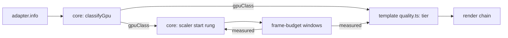

# PRD-563 — The first frame starts at the tier the GPU family can hold

**Status:** IN PROGRESS
**Priority:** P2 — Live-adapter boxes are open: a phone or a laptop iGPU starts at a tier picked by one `mobile` flag, then spends measured windows stepping to the tier it can hold.
**Complexity:** 5 (MEDIUM) — 11+ files, because each template's generated `quality.ts` takes the new input (3); new core module (+2); risk override: none
**Owner:** João (tier mapping in the templates), agent (implementation)
**Depends on:** None. Related: [PRD-549](../performance/PRD-549-the-engine-holds-60-fps-on-a-weak-gpu.md) (it fixes how fast the scaler reacts on a weak GPU; this PRD fixes where it starts, and duplicates none of its boxes), [PRD-294](../useful-defaults/PRD-294-a-software-rasteriser-should-not-run-the-high-tier-chain.md) (its software-adapter floor becomes one class of this table), [PRD-287](../useful-defaults/PRD-287-the-default-look-holds-the-phones-budget.md) (the measured ladder that refines the start).

## Context

Today the start point of the look and of the pixel count is a guess with two inputs:

- Each template's generated `src/render/quality.ts` picks the tier from `{ mobile, software, tier }`.
  The starter returns `low` for `software`, `low` for `mobile`, and `high` for everything else
  (`packages/create-threenative/templates/starter/src/render/quality.ts:52-71`).
- `RenderChain` with `tier: "auto"` starts at `high` and steps down on measured windows
  (`packages/core/src/render/chain.ts:304-306`).
- `ResolutionScaler` starts at rung 0, scale 1.0 (`packages/core/src/resolution-scaler.ts`, `RESOLUTION_SCALER.rungs`).
- The renderer already reads `adapter.info` (`architecture`, `description`, `device`, `vendor`)
  into an identity string and a software flag (`packages/core/src/renderer.ts:1074-1145`). Only
  the software flag reaches a template.

Effect: a Mali-G52 phone and a Mali-G715 phone get the same `low` look. A laptop with an Intel
iGPU gets the same `high` look and scale 1.0 as an RTX desktop. PRD-549 measured that case on
the LAN laptop's Iris Xe: Machinefall started at scale 1.0 with 4× MSAA, its main pass took
43–110 ms, and the scaler needed several windows after readiness to reach the 0.61 floor. Each wrong start costs measured
windows to correct, and each tier step can compile new pipelines.

**What Unreal does (UE 5.8.3, ideas only, no code copied):**

- `Engine/Config/BaseDeviceProfiles.ini:923-937` matches the Android GPU family string with a
  regular expression (for example "Adreno (TM) 7xx", "Mali-G71") to a device profile.
- Each family profile inherits one bucket: Adreno 5xx → Mid, Adreno 6xx → High, Adreno 7xx and
  8xx → Epic (`:1172-1211`); Mali-G710, G7xx and G9xx → Epic, an unknown newer Mali "Gx" → High
  (`:1374-1406`).
- Each bucket sets the scalability group levels and a content scale factor. `Android_Low` sets
  `r.MobileContentScaleFactor=0.8` and all groups to 0 (`:1033-1041`); `Android_Mid` sets 1.0 and
  groups to 1 (`:1049-1057`); `Android_High` sets groups to 2 (`:1065-1073`).
- On desktop, a short synthetic benchmark gives a CPU and a GPU performance index. Each group
  level comes from thresholds on the GPU index or on the smaller of the two
  (`Engine/Source/Runtime/Engine/Private/Scalability.cpp:205-222`,
  `Engine/Config/BaseScalability.ini:24-33`, thresholds 18 / 42 / 115).

We take the first idea (a family table for the start point) and skip the benchmark: our measured
ladder already does that job after the first window, at no startup cost.

## Solution

1. **Core classifies the adapter (mechanism).** A new `gpu-class.ts` maps the four `adapter.info`
   fields to one class: `software`, `mobile-low`, `mobile-mid`, `mobile-high`, `integrated`,
   `discrete` or `unknown`. One table, ordered rules, first match wins. The software rule is the
   existing `SOFTWARE_ADAPTER` test. The renderer reports `TN_GPU_CLASS` with the class, the
   matched rule and the raw fields. An adapter that no rule matches is `unknown`, and `unknown`
   keeps today's behaviour exactly.
2. **The template maps class to tier (look).** `resolveQualityTier` receives `gpuClass` beside
   `mobile` and `software`. The generated table is game source. The starter's first mapping:
   `software` and `mobile-low` → `low`, `mobile-mid` → `low`, `mobile-high` and `integrated` →
   `medium`, `discrete` → `high`, `unknown` → today's `mobile` rule.
3. **Core picks the starting scale (mechanism).** `ResolutionScaler` starts at a rung chosen
   from the class: `mobile-low` starts one rung down (0.85, near Unreal's 0.8 for its Low
   bucket), every other class starts at rung 0. The source reads `auto`. The first eligible window
   moves it either way, so measurement always wins over the table.
4. **Browsers may coarsen the fields.** Chrome reports `vendor` and `architecture` and can leave
   `description` empty. Each rule names the field it reads. A rule that needs a field the platform
   does not report never matches, so the result is `unknown`, never a wrong class.

Risk: a wrong rule caps a strong GPU. Phase 2 pins `discrete` and `unknown` to today's start
with a test, the same failure mode that PRD-294 names.

## Acceptance Criteria

- [x] AC-1 [local]: A desktop RTX 2080 in browser WebGPU still starts at `high` and scale 1.0, and reports `TN_GPU_CLASS` `discrete`. proof: starter playtest `--browser-recipe webgpu`, `TN_GPU_CLASS` and `TN_RENDER_CHAIN` lines. — Evidence: 2026-10-09, desktop RTX 2080, Chrome WebGPU headed, scaffolded starter built from this branch: exit 0, pass true. Console `TN_GPU_CLASS:{"class":"discrete","fields":{"architecture":"turing","description":"","device":"","vendor":"nvidia"},"rule":"nvidia"}`, `TN_QUALITY_TIER high mobile=false software=false source=platform`, `renderChain.tier` pass at `high`, surface `resolutionScale` 1 with `scaleSource` auto.
- [x] AC-3 [local]: On the LAN laptop's Iris Xe (Chrome WebGPU), the starter reports `TN_GPU_CLASS` `integrated` and starts at the `medium` tier. proof: starter playtest `--browser-recipe webgpu` on the laptop lane. — Evidence: 2026-10-09, LAN laptop, Intel Iris Xe (`architecture: gen-12lp`, `vendor: intel`), Chrome WebGPU headed on the real display, scaffolded starter built from this branch, two runs: `TN_GPU_CLASS` `integrated` (rule `intel`) and `TN_QUALITY_TIER medium mobile=false software=false source=platform` both runs; the control arm (same build, the `gpuClass` line removed from `Play.ts`) reported `high` both runs. Visual judge (fresh read-only subagent, 2 runs per arm, same pose and tick, BEFORE/AFTER burned in): NEUTRAL on both pairs and NEUTRAL overall, which is the intended effect of a perf-only start tier (no visible change). Frame time is not claimed as a win: p95 was 80.8 and 90.2 ms (after) against 94.7 and 92.6 ms (before) on a laptop at 92 to 100 C, and both arms miss the starter `maxFrameMsP95` 33 ms bound. The starter's flat `renderChain.tier: "high"` assertion failed on this adapter before Phase 3 (observed `medium`, `adapterClass: hardware`); Phase 3 adds the `integrated` row. First-frame re-judge, same lane and build, `warmupFrames: 0` with a capture at the first and second frame after startup-ready and one 1200 ticks later, two runs per arm: NEUTRAL on all six pairs and NEUTRAL overall. No IMPROVEMENT is claimed: the old arm never leaves `high` in the run (every `TN_QUALITY_TIER` line and render-chain sample reads `high`), so there is no tier pop on this adapter for the new start to remove, and `medium` differs from `high` only in `gtaoSamples` and static grain. The pose that carries the effect is a phone: a Pixel 8 (Mali-G715, `mobile-high`) starts at `low` before this change (the starter's `mobile` rule) and at `medium` after it, with scale 1.0 in both arms. The capture therefore compares `low` against `medium`, not a drop from `high`; it needs the Pixel 8 (see Blocked on), and the emulator reports `discrete`. The NEUTRAL verdicts cover the starter only: its `medium` preset already requested the medium chain, and ten other kits' did not until Phase 3 (see Decisions, 2026-10-11).
- [x] AC-2 [local]: The Android emulator native host reports its adapter fields and a class, and the starter runs to steady state. proof: starter native `render-chain.playtest.json --target android --device emulator-5554 --allow-software`. — Evidence: 2026-10-11, source-built runtime from this checkout, Android x86_64, explicit QuickJS rollback, SwiftShader. The normal QuickJS asset cook removed `EXT_meshopt_compression` (the proof GLB requires only `KHR_mesh_quantization`), fixing the previous installed-runtime startup blocker without changing the engine. `TN_GPU_CLASS` reports `software`, rule `software`, vendor `SwiftShader driver`, device `SwiftShader Device (Subzero)`, architecture `unknown`; `TN_QUALITY_TIER low`. Exit 0, pass true: all seven assertions pass, startup ready and compile settled, 660 fixed ticks, odometer 0.0098 → 2.029, low stages include bloom/vignette/grade and exclude ambientOcclusion/grain, grade changes the graph output. Startup warmup timed out with zero pending compilations and subsequently reached ready; no warmup-complete, hardware performance or V8 claim. The software adapter is accepted explicitly for this emulator proof; the same run without that flag correctly refused software evidence. Log: `/tmp/pr481-android-playtest-software.log` (local, untracked).

## Blocked on

- The phone win (a richer first frame on a `mobile-high` phone, held without stepping back, and p95 not worse) needs a physical device on the device lane. Only `emulator-5554` was attached on 2026-10-09. The exact capture: on the Pixel 8 (Mali-G715), the starter's first frames after startup-ready and a settled frame, BEFORE (the `gpuClass` line removed: the starter's `mobile` rule starts at `low`) against AFTER (class start: `mobile-high` starts at `medium`), two runs per arm, same pose, `adapter.info` checked, BEFORE/AFTER burned in, then a fresh read-only visual judge per frame. Also record whether the AFTER chain steps back to `low`; if it does, the `mobile-high` row of the template tables becomes `low`. Nothing in this PRD earns a merge claim until that verdict is IMPROVEMENT: the two judges on the Intel and desktop lanes returned NEUTRAL and no frame-time win is measured. — Pixel 8 is now attached through Wi-Fi ADB at `192.168.1.192:5555`; capture and judgment are in progress.
- Fresh visual proof for the ten kits whose `medium` preset now requests the medium chain (action-rpg, minimal, platformer, puzzle, racing, rts, runner, sailing, shooter, tower-defense). Their `medium` preset used to leave the chain on `high`, so `medium` looked like `high` there and the starter's NEUTRAL does not carry over. The exact capture: BEFORE (the preset without `renderChainTier`) against AFTER (this branch) on an `integrated` or `mobile-high` adapter, same pose and tick, `adapter.info` checked, BEFORE/AFTER burned in, then a fresh read-only visual judge per kit. — unblocked by laptop capacity (its load was above 32 on 2026-10-11 and the coordinator owns live jobs) and by João attaching the Pixel 8.

## Integration Ledger

| Capability | Reachable consumer/trigger | Replaces / disposition | Evidence |
|---|---|---|---|
| GPU class | `createRenderer` adapter read (`renderer.ts:1115-1145`) → `classifyGpu` → `TN_GPU_CLASS` | Software flag stays; it becomes the `software` class | AC-1 |
| Starting tier | template `resolveQualityTier({ gpuClass })` | `mobile` flag stays as the `unknown` fallback | Phase 2 |
| Starting scale | `ResolutionScaler` construction (`game.ts:1394`) | rung 0 stays for every class except `mobile-low` | Phase 2 |

## Execution Phases

#### Phase 1: Classify the adapter
**Status:** COMPLETE
**Files:** `packages/core/src/gpu-class.ts` (new), `packages/core/src/renderer.ts`; `packages/core/__tests__/gpu-class.spec.ts`
- [x] `classifyGpu` maps recorded `adapter.info` fixtures to classes: nvidia/turing → `discrete`, SwiftShader → `software`, an Intel iGPU → `integrated`, Mali-G715 → `mobile-high`, Mali-G52 → `mobile-low`, Adreno 5xx → `mobile-mid`, empty fields → `unknown`. proof: red-green `pnpm exec vitest run packages/core/__tests__/gpu-class.spec.ts`. — Evidence: 2026-10-09, 23 cases pass (19 fixtures, rule/field shape, `none` rule, software-before-vendor, Tegra).
- [x] The renderer prints `TN_GPU_CLASS` with class, rule and raw fields once per launch. proof: renderer spec with a stubbed adapter; the live lines are AC-1 and AC-2. — Evidence: 2026-10-09, `renderer.spec.ts` prints one `TN_GPU_CLASS:{json}` for a stubbed Mali-G52 (`mobile-low`, rule `mali-model`) and no `gpuClass` on the WebGL2 fallback.

#### Phase 2: Start from the class
**Status:** COMPLETE
**Files:** `packages/core/src/resolution-scaler.ts`, `packages/core/src/game.ts`, `packages/create-threenative/templates/*/src/render/quality.ts`; scaler and template specs
- [x] Every template's `resolveQualityTier` takes `gpuClass`, and `unknown` returns exactly today's tier. proof: create-threenative template spec over all 13 generated `quality.ts` files. — Evidence: 2026-10-09, `template-quality.spec.ts` 42 pass; `unknown` and absent equal today's answer for five request shapes in every template, and each `setupPost` reports the family tier. Red: removing one `gpuClass` line from `sailing/postprocessing.ts` failed `sailing: iGPU`.
- [x] `ResolutionScaler` starts at the class rung, and the first measured down or up window still moves it. proof: red-green `pnpm exec vitest run packages/core/__tests__/resolution-scaler.spec.ts`. — Evidence: 2026-10-09, three cases: the table names `mobile-low` at 0.85 only; the first miss window steps down; four clean windows climb back to 1.0 (a down move needs one window, an up move needs `upWindows`). `game-gpu-class-start.spec.ts` shows `game.ts` applies the rung to the renderer (red when `game.ts` is reverted).
- [x] `discrete` and `unknown` start at `high` and scale 1.0. proof: same specs, one case each. — Evidence: 2026-10-09, `game-gpu-class-start.spec.ts` (8 pass): `discrete`, `integrated`, `mobile-high`, `unknown` and a missing `gpuClass` start at scale 1; a pinned scale is never overruled. Template side: `template-quality.spec.ts` `discrete` is `high` in all 13.

#### Phase 3: The harness and the templates hold the family start
**Status:** IN PROGRESS
**Layer:** engine (`packages/playtest`) for the classifier and the row selection: a template scenario cannot assert a class the harness cannot classify, and a game-side workaround would leave every other scenario red on the same adapter. Game (the templates) for the `medium` preset and the scenario rows: the template decides which chain tier each quality tier requests, and ten kits left the `medium` preset on the `high` default.
**Files:** `packages/playtest/src/evaluators/adapter-class.ts`, `.../evaluators/render-chain.ts`, `.../scenario/schema-base.ts`, `.../scenario/schema-accessors.ts`, `.../assertion-schema.ts`; `packages/create-threenative/templates/*/src/render/quality.ts` (ten `medium` presets gain `renderChainTier: "medium"`); the 22 shipped template scenarios that assert `renderChain` (under `packages/create-threenative/templates/*/playtests/`, `.../templates/*/native-playtests/` and `packages/create-threenative/template-playtests/starter/look.playtest.json`); `packages/playtest/__tests__/render-chain-adapter.spec.ts`, `packages/create-threenative/__tests__/template-quality.spec.ts`, `packages/create-threenative/__tests__/scaffold.spec.ts` (scaffold fingerprints)
**Scope:** `perAdapter` keeps `hardware` and `software` and gains `discrete`, `integrated`, `mobile-high`, `mobile-mid` and `mobile-low`. `classifyAdapter` proves a family from the four observed `adapter.info` fields with its own copy of core's family rules (the package takes no `@threenative/core` dependency; a spec compares the copy with `classifyGpu`). A family row overrides `hardware` only when the observed fields prove that family. Software, an unnamed adapter and an unknown family keep today's selection, so a scenario with no family row behaves exactly as before, and a missing field never proves a family. The expected tier is written in the scenario from the template table, never read from the game's output. Every kit's `medium` preset requests the medium chain, so the tier a family starts at is the tier the chain runs at. Every shipped template scenario that asserts `renderChain` carries family rows, the four that once asserted a flat `high` included (starter native `render-chain`, sailing native `survives`, rain native `boot`, rain `performance`): rain and sailing pass `gpuClass` into `setupPost`, so an integrated or phone start changes their chain tier like any other kit. Their `medium` and `low` rows keep the original `stages` and `contributions` assertions, because those prove the mechanism on every platform, Android included. Out of scope: `packages/create-threenative/__tests__/fixtures/backlight-defaults/` (fixtures for the backlight spec, not shipped scenarios), `examples/strata-terrain-preview` (its chain assertion names no tier), the Pixel 8 capture and AC-2.
- [x] `classifyAdapter` returns the family the observed fields prove, equal to core's `classifyGpu` on every shared fixture; Intel Arc stays `discrete`; empty or unrecognised fields return no family. proof: red-green `pnpm exec vitest run packages/playtest/__tests__/render-chain-adapter.spec.ts` — Evidence: 2026-10-11, red before the change (35 failed | 44 passed of 79), green after (95 pass): a parity table of 21 adapters against core's `classifyGpu`, the Arc A770 stays `discrete`, and empty, partial or malformed provenance returns no family.
- [x] A `perAdapter` family row beats `hardware` only when proven, a scenario with only `hardware` and `software` rows is selected exactly as before, and an unknown row key throws at load. proof: same spec, red before the change — Evidence: 2026-10-11, red message `Unknown key 'integrated' at assert.renderChain.perAdapter.integrated. Supported keys: hardware, software.`, green after. The focused set (render-chain-adapter, render-chain-assertion, scenario, scenario-load, schema-boundaries, runner, cli-classify, native-smoke-scenarios) is 291 pass in 8 files, so hardware and software scenarios, the schema boundaries and the runner keep their answers.
- [x] Every kit's `medium` preset requests the medium chain, and `low` and `high` request theirs. proof: red-green `pnpm exec vitest run packages/create-threenative/__tests__/template-quality.spec.ts` — Evidence: 2026-10-11, red for action-rpg, minimal, platformer, puzzle, racing, rts, runner, sailing, shooter and tower-defense (effective tier `high` at `medium`); green after `renderChainTier: "medium"` on those ten presets only. 43 pass over all 13 kits and all three tiers; starter, rain and snow already requested it. No file under `packages/core` changed.
- [x] Every shipped template scenario that asserts `renderChain` names the start tier of the integrated, phone and software adapters, and the four formerly flat scenarios keep their stage assertions in those rows. proof: `pnpm exec vitest run packages/create-threenative/__tests__/template-quality.spec.ts packages/playtest/__tests__/render-chain-adapter.spec.ts` — Evidence: 2026-10-11, the drift guard in `template-quality.spec.ts` scans `templates/` and `template-playtests/` and fails closed on a scenario without a row (red on a flat-only rain native boot, green with the rows restored); `render-chain-adapter.spec.ts` runs the shipped blocks of the starter `play`, `look` and native `render-chain`, sailing `survives` and rain `boot` and `performance` against Iris Xe, Mali-G715, Mali-G78, Mali-G52, SwiftShader and Turing observations, and a low-tier chain that still runs `ambientOcclusion` fails the starter's `excludes`. A one-off loader pass (not committed) read all 169 shipped template scenarios through the real loader: 22 assert `renderChain`, 0 flat-only, 0 load failures. The scaffold fingerprints were recomputed through the actual-tree test: `pnpm exec vitest run packages/create-threenative/__tests__/scaffold.spec.ts` 66 pass.
- [x] The starter family assertion selects `medium` on the LAN laptop's Iris Xe, and the native `render-chain.playtest.json` asserts its stages and contributions through browser WebGPU. proof: both scenarios on the laptop lane with `--browser-recipe webgpu --headed`. — Evidence: 2026-10-11, real display `:1`, adapter vendor `intel`, architecture `gen-12lp`. `play.playtest.json` correctly selects `gpuFamily: integrated` and passes `renderChain.tier` at `medium`; its whole-run result remains FAIL solely on the pre-existing frame-time ceiling (83.9 ms p95 against 33 ms). No performance pass is claimed and its bound is unchanged. The native render-chain scenario, run with `--target browser`, exits 0, pass true, all assertions pass: medium tier, ambientOcclusion/bloom/vignette/grade/grain stages in order and grade/grain graph contributions. This proves the repaired family selection live; it is browser evidence on Iris Xe, not Linux native host evidence.

#### Phase 4: Physical visual acceptance
**Status:** IN PROGRESS
- [ ] Pixel 8 native raw adapter reports the proven family; two BEFORE/AFTER runs at the same first-ready, second-ready and settled poses receive a fresh read-only visual judge IMPROVEMENT verdict, with no tier drop and p95 not worse. Post labeled images on the PR. proof: physical Android playtests and a fresh read-only judge over labeled capture pairs. — Evidence: 2026-10-11, Pixel 8 source-built arm64 QuickJS. Native reports Mali-G715 and `mobile-high`; AFTER starts medium in both runs, BEFORE (only the `gpuClass` input removed) starts low. All six paired captures are NEUTRAL, overall NEUTRAL, from fresh Sonnet 5.5 high judge: contact grounding improves, but pink halos and coarser noise cancel the gain. Not a passing visual result; grade/grain ablations are in progress. Capture runs were stationary; an inherited odometer >=1 assertion failed on the AFTER capture configuration because no movement was requested, while all tier/stage/contribution/diagnostic assertions passed. The actual shipped native scenario was then run unchanged on the AFTER APK and passed with no diagnostics. Pixel Chrome reports only ARM Valhall, correctly yielding mobile-mid/low; that coarse browser lane cannot prove this native mobile-high outcome. Device still charging over USB, so no discharging performance comparison is claimed.
- [ ] Fresh visual review covers the ten corrected medium presets before merge; retain actual verdicts and limitations here. proof: same-pose captures of affected presets and a fresh read-only judge.

## Decisions

- 2026-10-09 (João, via the Unreal review request): take Unreal's family table, not its startup benchmark. Our frame-budget windows already measure the real game after the first window, and a benchmark would add startup time.
- 2026-10-09 (lane agent), superseded by the 2026-10-11 entries below: `classifyAdapter` is independent of the game and of core by design, so it does not read `TN_GPU_CLASS`. That part stands. Measured on the Iris Xe laptop: the flat `renderChain.tier: "high"` hardware assertion in the template scenarios that carry `perAdapter` read `medium` on an Intel integrated GPU and failed. This entry first left `perAdapter` at `hardware|software` and named the `integrated` class and rows as a follow-up; Phase 3 does that work.
- 2026-10-11 (lane agent): the harness holds its own copy of core's family rules, and `perAdapter` gains `discrete`, `integrated`, `mobile-high`, `mobile-mid` and `mobile-low`. A family row replaces the flat expectation only when the observed `adapter.info` fields prove the family. Software never takes a family row. A scenario that names no family selects exactly as before. An unclassified adapter still fails `renderChain.adapterClass`. The expected tier in each row comes from the template start table, never from the game's output. A spec compares the copy with core's `classifyGpu` over 21 adapters, so the two tables cannot drift unseen. Intel Arc stays `discrete`, so it keeps `high`.
- 2026-10-11 (coordinator review, gap 1): ten kits' `medium` preset (action-rpg, minimal, platformer, puzzle, racing, rts, runner, sailing, shooter, tower-defense) resolved `medium` and left the chain on its `high` default, because `renderChainTier` was absent. An `integrated` or `mobile-high` start therefore reported `medium` and rendered the high chain. Each of the ten now carries `renderChainTier: "medium"`; starter, rain and snow already did. The appearance stays in the templates, no package graphics code changed, and the chain was not left at `high` to make a scenario pass.
- 2026-10-11 (coordinator review, gap 2): the scope line that left rain, sailing and the starter native `render-chain` flat at `high` "by design" was false. Rain and sailing pass `gpuClass` into `setupPost`, so an integrated or phone start changes their chain tier. The four scenarios (starter native `render-chain`, sailing native `survives`, rain native `boot`, rain `performance`) now carry `integrated` and `mobile-high` rows at `medium`, `mobile-mid`, `mobile-low` and `software` rows at `low`, and the flat expectation still serves `discrete` and `unknown`. Checked against each template: the starter drops `ambientOcclusion` and `grain` at `low` and keeps bloom, vignette, antialias and grade, where only grade changes the output; sailing's bloom and rain's `stormPost` apply at every tier. The rows keep the original `stages` and `contributions` assertions, and these assertions apply on Android.
- 2026-10-11 (lane agent): left unchanged on purpose. `packages/create-threenative/__tests__/fixtures/backlight-defaults/` asserts a flat `high` in fixtures for the backlight spec, and `examples/strata-terrain-preview/playtests/terrain.playtest.json` names stages and contributions with no tier. Neither is a shipped template scenario.
- 2026-10-11 (coordinator review): fresh visual proof stays required before merge. In ten kits `medium` ran the high chain until now, so the starter's NEUTRAL verdicts do not cover them, and no "no visual change" claim is made. The Pixel 8 IMPROVEMENT requirement stands as written.
- 2026-10-09 (lane agent): `mobile-high` (Mali-G710 and newer, Adreno 63x and newer) starts at `medium`, as this PRD's table says. A Pixel 8 (Mali-G715) therefore moves from `low` to `medium` on its first frame. Device-unverified until the Pixel lane is available (see Blocked on).
- 2026-10-09 (lane agent): an AMD adapter that names no `Radeon Graphics` / `Radeon <n>M` description is `discrete`, so an unnamed Ryzen iGPU keeps today's start rather than being capped.

- 2026-10-11 (coordinator review): Haiku independently reviewed the final harness/template diff. Unknown hardware on an unnamed mobile GPU retains the pre-existing flat expectation and can fail a high-tier scenario although the game's unknown/mobile fallback is low; this change neither guesses a mobile family nor relaxes that failure. The scenario drift guard now checks the generic `hardware` fallback as the evaluator does.

- 2026-10-11 (coordinator checks): focused harness/template tests pass (291 harness cases; 109 template/scaffold cases; subsequent final adapter/template run 138 pass), playtest package build/publint and typecheck pass, root typecheck passes after building core/terrain and baking the existing terrain preview, root lint exits 0 with 1,395 existing warnings. Root `pnpm test` built the workspace but failed its native package-test phase: 24 native tests fail on missing desktop host/test executables and stale copied native-dependency SBOM receipts. No full-board pass is claimed; root Vitest is being run separately. No gate was weakened.
