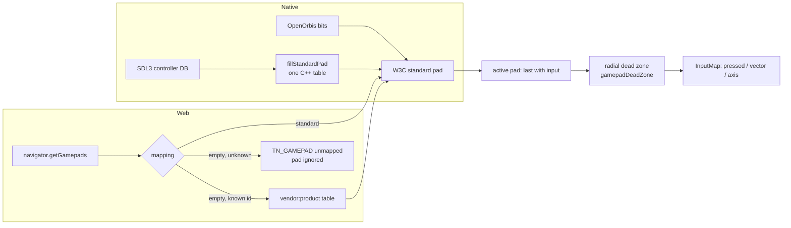

# PRD-880 — Every controller reads as the standard gamepad: Xbox, 8BitDo, Steam Deck

**Status:** NOT STARTED
**Priority:** P2 — no box is done: an idle stick still drifts a character, a phantom pad still steals input, and a non-standard browser pad still fires the wrong action (AC-1 to AC-8).
**Complexity:** 4 (MEDIUM)
**Owner:** João (owner); an agent executes
**Depends on:** None

Complexity: 2 (about 7 implementation files) + 2 (crosses the web and native build boundaries) = 4 → MEDIUM; risk override: none.

## Context

The owner asked (2026-11-11) for abstractions so ThreeNative works with Xbox controllers (official and generic XInput clones), the 8BitDo Ultimate C 2.4G wireless pad, the Steam Deck and similar pads, DRY, "maybe adapter pattern".

The contract already exists: a game reads every pad through `navigator.getGamepads()` in the W3C "standard" mapping, and `InputMap` binds standard indices (`buttons: [0]` is the south face button on every pad). Kits rely on it: `templates/kart/src/game.ts:13`, `platformer/src/game.ts:19`, `collectathon/src/game.ts:18`. The gaps are where a pad does not arrive in that mapping, or arrives with defects the engine leaves to the game.

Current behaviour, inspected 2026-11-11:

- **No dead zone anywhere.** `packages/runtime-native/src/engine/player/gamepads.h:10` says "No dead zone: core owns that", but `packages/core/src/input.ts` applies none. `vector("move")` adds raw axes 0 and 1 (`input.ts:314`), so a worn or cheap stick resting at 0.08 walks the character.
- **First pad wins.** `InputMap.tick` (`input.ts:430`) reads the first non-null slot. A Steam Deck under Steam can expose its built-in pad and a Steam Input virtual pad. A 2.4G dongle with no pad paired, or a wheel at slot 0, takes the slot from the pad the player holds.
- **`mapping` is ignored.** `IInputGamepad` (`input.ts:81`) has no `mapping` or `id`. A browser returns `mapping: ""` for a pad its own table does not know, for example some pads in Firefox on Linux. Raw button 0 then fires `jump` on whatever button the device numbered 0, with no warning.
- **Two native copies of one table.** The SDL3 → standard table exists twice: `packages/runtime-native/src/engine/player/gamepads.cpp:140` (owned V8 player, 4 axes, 16 buttons) and `packages/runtime-native/src/platform/input.cpp:786` (legacy mystral host, which Android still runs: 6 axes with the triggers at 4 and 5, 17 buttons with guide at 16). A binding such as `gamepadAxes: [4]` reads a trigger on Android and nothing on desktop or web.
- **Native already has the device database.** Both native paths open pads through SDL3 `SDL_OpenGamepad`, which applies SDL's controller database (Xbox, XInput clones, 8BitDo, Steam Deck, DualShock, DualSense). The native gap is the duplicate table, not missing devices.
- **Search does not find it.** The `InputMap` row in `packages/core/capabilities.json` has no gamepad, controller, Xbox or Steam Deck words. An agent asked to "add Xbox controller support" finds nothing and writes its own `getGamepads` loop.
- The playtest runner has no way to inject a pad (`packages/playtest/src/runner/steps.ts` drives keys and pointers only), so no scenario proves a controller moves a kit.

## Solution

**Decision: no class-per-device adapter hierarchy.** The W3C standard mapping is the one interface. Each backend has one normalizer that turns its raw pad into that mapping, and each normalizer is data, not a class:

| Backend | Normalizer | Covers |
| --- | --- | --- |
| Native (desktop, Android, iOS) | SDL3's controller database, then one shared `fillStandardPad` table | Every pad SDL knows: Xbox, clones, 8BitDo, Steam Deck |
| Web, `mapping === "standard"` | Pass through | Xbox and most pads in Chromium |
| Web, `mapping === ""` | A small vendor:product → standard-index table in core, one row per measured device | 8BitDo or Steam Deck where the browser has no mapping |
| PS4 (OpenOrbis) | The existing bit table, unchanged | DualShock 4 |

Above the normalizers, `InputMap` owns the two pad conventions every game repeats: a radial dead zone and choosing the active pad. A game keeps binding standard indices and changes nothing.

Conventions (on by default, each with a named override on the same object, reported):

- **Dead zone:** radial, rescaled so output still reaches 1. Default 0.2, the stock Enhanced Input dead zone: `UInputModifierDeadZone` defaults to `LowerThreshold = 0.2`, `UpperThreshold = 1` and `EDeadZoneType::Radial` (`UE release: Engine/Plugins/EnhancedInput/Source/EnhancedInput/Public/InputModifiers.h:182,190,193`, read 2026-11-11 through `gh api`). Override: `input.gamepadDeadZone = 0` for raw axes.
- **Active pad:** the pad that last moved past the dead zone or pressed a button. It becomes active and stays active until another pad does.
- **Report:** one `TN_GAMEPAD` line per connect, naming `id`, normalizer (`standard`, `table`, `unmapped`) and dead zone. An unmapped pad is ignored, never read with raw indices.

Out of scope, each a later PRD when a kit asks: back paddles (Steam Deck L4/R4/L5/R5, 8BitDo back buttons), gyro, touchpads, rumble, analog triggers through `axis()`, and named button constants.

Risks:

- The web table rows for the 8BitDo and the Steam Deck come from SDL_GameControllerDB Linux entries (evdev order, which Firefox on Linux also uses). That is an assumption until a physical device confirms it (see Blocked on).
- Unifying the native table changes the legacy host from 6 axes and 17 buttons to 4 and 16. Grep every kit and example for `gamepadAxes: [4` or `[5` and `buttons: [16` before the change lands.

## Acceptance criteria

The phase boxes below carry the unit and native proofs. This box is the consumer proof: a real kit, driven through `navigator.getGamepads`, using the Phase 3 `gamepad` playtest step.

- [ ] AC-1 [local]: In the platformer kit, a scripted standard pad with the left stick at 1 moves the player right, button 0 jumps it, and a stick at 0.1 leaves it still. proof: `node packages/playtest/dist/runner/cli.js <platformer gamepad scenario> --browser-recipe webgpu` — Evidence: pending.

## Blocked on

- Physical-device confirmation of the web table rows and of native reads: the owner holds an official Xbox pad, an 8BitDo Ultimate C 2.4G and a Steam Deck, opens a kit in Chromium and Firefox and in the native desktop player, and confirms that the left stick moves and the south button jumps. Record each `TN_GAMEPAD` line. — unblocked by João with the three devices.

## Integration Ledger

| Capability | Reachable consumer/trigger | Replaces / disposition | Evidence |
| --- | --- | --- | --- |
| Web pad normalization, dead zone, active pad | Kit `game.ts` → `InputMap.tick` (`packages/core/src/input.ts:430`) → `navigator.getGamepads` | First-non-null pick and raw axes are deleted | Phase 1 boxes, Phase 3 playtest |
| Native standard pad | Game JS → `navigator.getGamepads` (`v8_main.cpp:177`; `runtime.cpp:3868`) → `fillStandardPad` | Both duplicate tables delegate to one function | Phase 2 box |
| Capability search | Agent → `engine_search_capabilities` → `InputMap` row | New `@situation`, `@alias`, `@constraint` and `@override` tags on the existing row | Phase 3 box |

## Decisions

- 2026-11-11 (Claude, on the owner's "your call"): the adapter is data per backend (SDL's controller database natively, a vendor:product table on the web), not a class per device. SDL already maintains about 2 000 device mappings, and a class hierarchy would duplicate them in TypeScript. The existing `InputPlatformSource` seam stays the single injection point.
- 2026-11-11 (Claude): an unmapped non-standard pad is ignored and reported. Reading it with raw indices fires the wrong action, which is worse than no input.

## Execution Phases

#### Phase 1: Core reads any standard pad cleanly

**Status:** NOT STARTED
**Files:** `packages/core/src/input.ts` (dead zone, active pad, `mapping`/`id` on `IInputGamepad`), `packages/core/src/gamepad-mappings.ts` (new: the web vendor:product table and `toStandardPad`), `packages/core/__tests__/input.spec.ts`.
**Implementation:** parse vendor and product from the browser `id` (Chromium `Vendor: 045e Product: 028e`, Firefox `045e-028e-…`). Normalize into the reused buffers, with no per-tick allocation (PRD-189). Apply the radial dead zone before `vector`, `axis` and `raw.gamepad.axes`.
**Verification:** `pnpm exec vitest run packages/core/__tests__/input.spec.ts`, red first on each new test.

- [ ] A stick resting at 0.1 gives `vector("move")` zero, a stick at 0.6 gives 0.5 ((0.6 - 0.2) / 0.8), and `gamepadDeadZone = 0` returns the raw 0.1. proof: `input.spec.ts` dead-zone test — Evidence: pending.
- [ ] An idle pad in slot 0 does not take input from a pad in slot 1 whose button is pressed, and the slot 1 pad stays active after release. proof: `input.spec.ts` active-pad test — Evidence: pending.
- [ ] Fixtures for an Xbox pad (`standard`), an 8BitDo Ultimate C 2.4G and a Steam Deck (both `mapping: ""`, rows from SDL_GameControllerDB) all fire `jump` on the south button, and an unknown `mapping: ""` pad fires nothing and logs `TN_GAMEPAD … unmapped` once. proof: `input.spec.ts` mapping tests — Evidence: pending.

#### Phase 2: One native table for every host

**Status:** NOT STARTED
**Files:** `packages/runtime-native/src/engine/player/gamepads.cpp` (exports `fillStandardPad`), `packages/runtime-native/src/platform/input.cpp` (`getGamepadState` calls it), `packages/runtime-native/src/engine/player/gamepads.h`, one test under `packages/runtime-native/tests/`.
**Implementation:** move the SDL branch's per-pad body into `fillStandardPad(SDL_Gamepad*, GamepadState&)`. Point the legacy host at it, so both report 4 axes and 16 buttons with the triggers as buttons 6 and 7. Leave the PS4 branch as it is.
**Verification:** a C++ test attaches an SDL3 virtual gamepad (`SDL_AttachVirtualJoystick`), sets the stick, the trigger and the south button, and compares both entry points field by field. `pnpm native:build` compiles.

- [ ] `tnPollGamepads` and `platform::getGamepadState` return identical state for one virtual pad: the left stick on axes 0 and 1, the right trigger on button 7, the south button on button 0. proof: the new `tests/gamepad_standard_test.cpp` through `ctest -R gamepad_standard` — Evidence: pending.

#### Phase 3: Agents find it, kits prove it

**Status:** NOT STARTED
**Files:** `packages/core/src/input.ts` (TSDoc tags on `InputMap`), `packages/create-threenative/conventions.json` (row `gamepad`), `packages/engine-mcp/__tests__/search.spec.ts`, `packages/playtest/src/runner/steps.ts` (a `gamepad` step that installs a fake standard pad through an init script), one kit scenario.
**Implementation:** add `@alias gamepad`, `controller`, `joypad`, `xbox`, `8bitdo`, `steam deck`. Add `@situation` lines for "support an Xbox or generic controller", "the character drifts while the stick is idle", "the controller does nothing in Firefox" and "a second pad steals input". Add `@constraint` lines for standard indices, the dead zone and the active pad, and `@override gamepadDeadZone`. The convention row names the default, the override and the `TN_GAMEPAD` marker, so `pnpm build` renders it into every kit `AGENTS.md`.

- [ ] `engine_search_capabilities` returns `InputMap` as the first row for "xbox controller", "steam deck" and "stick drift". proof: `pnpm exec vitest run packages/engine-mcp/__tests__/search.spec.ts` after `pnpm build` — Evidence: pending.
- [ ] The `gamepad` convention row renders into each kit `AGENTS.md`, and the convention-index check passes. proof: `pnpm build && pnpm exec vitest run packages/create-threenative/__tests__` (the conventions spec) — Evidence: pending.
