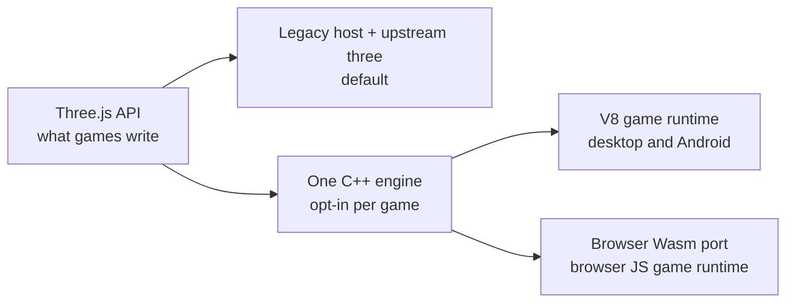

# Native engine — architecture decision record (N00)

**Status:** binding. The owner took the decision on 2026-10-04 (interview) and accepted the agent
calls below the same day. On 2026-10-12 the owner accepted the charter amendment: ThreeNative owns
one C++ engine (renderer plus internal shader IR) behind the Three.js API, **opt-in per game**, and
the legacy host stays the default until the engine proves itself.

**Amended 2026-10-15 (owner):** the engine is now the default for web and desktop. A game that sets
nothing runs on it, and `engine: "threejs"` in `threenative.config.ts` is the named override. Android
and iOS still run the legacy host. The legacy engine stays until one clean release has passed (item
10). The earlier "switch at 2x" rule is superseded. PRD-610 ships PARTIAL: its open boxes stay open.

**What it changes today:** the rule text of [`CHARTER.md`](CHARTER.md) §2, §7 and §11.1 and of root
`AGENTS.md` rule 5 admits the engine. [`NATIVE-RUNTIME.md`](NATIVE-RUNTIME.md) and
[`packages/runtime-native/AGENTS.md`](../../packages/runtime-native/AGENTS.md) keep describing the
shipped host. They change in the commit that ships the first native-engine artifact, because primary
docs name only shipped things.

**Work package:** N00 of the native-engine batch (source PRD-497). The engine reaches `develop` in
small slices. Each slice is inert or opt-in until the next one lands.

---

## 1. What is decided

ThreeNative adds an owned engine underneath the Three.js API, in C++. Every engine system of that
engine runs in native code on every target; game code keeps its JavaScript VM. A game selects the
engine; a game that does not select it runs on the legacy host exactly as before. The compatibility
denominator is measured from what games actually import, not asserted as a percentage.

## 2. The charter rules this amends, in plain words

The charter outranks every `AGENTS.md`, so the reversal is quoted here rather than paraphrased.

- **"A second *renderer*."** The charter's closed list of things that killed v1 names a second
  renderer: the moment the host starts drawing instead of running Three.js, it has become v1.
  **Amended:** ThreeNative owns one C++ engine behind the Three.js API, opt-in per game. The row's
  objection — 32% of v1's commits went to a runtime no benchmark ever measured — is answered by
  measurement instead of by a ban: the CP1 checkpoint (PRD-534) can stop the program, and the
  engine becomes the default only on measured evidence. Any renderer beyond that one engine stays
  closed.
- **"The runtime is a host, not a renderer."** The charter's platform section says the runtime must
  not own Three's renderer, fork Three.js, or replace the JavaScript `GLTFLoader`. **Amended:** the
  rule stays for the default host. The opt-in engine *is* the renderer, and native glTF replaces the
  JavaScript loader inside it.
- **"An IR, a compiler, a serialized scene format."** The ban is kept exactly where it was aimed: no
  authored IR, no scene format, and no compiler of game code as a **required authoring step**. The
  engine's shader IR is internal and never authored.

Everything else in the charter stands, including the kill switch, "never own the look", and the
rule that the supported API is the measured denominator.

## 3. The decisions

Owner decisions, João, 2026-10-04 (interview):

1. **The engine runs in C++.** Every system of the native engine runs in C++: traversal,
   transforms, animation, batching, materials and TSL, visibility, streaming and rendering. No JS
   implementation of an engine system ships inside the native engine on any target. Gate E is
   mandatory.
2. **Speed first; game code stays on a JS VM.** Game code runs on a JS VM (V8 on desktop and
   Android, the browser's own engine on web) through generated bindings. The V8 game runtime
   adapter (PRD-531, N18) is the shipping game runtime. Compiling game code to native is not part
   of this decision.
3. **An early perf checkpoint can stop the program.** CP1 (PRD-534) measures the native engine
   against current ThreeNative after N06 + N09. With no CPU win in the engine hot paths, N11–N15 do
   not start until the owner re-plans.
4. **One engine everywhere.** The web runs the same C++ core in Wasm (PRD-532, N19, is mandatory).
   The core is Wasm-safe from day one: single-thread fallback, retained views that survive memory
   growth, no blocking waits.

Calls made from the code by the agent, accepted by the owner ("go with what you think will be
best"), 2026-10-04:

5. **Charter amendment, in plain words:** "a second renderer" and "the runtime is a host, not a
   renderer" admit one owned C++ engine behind the Three.js API. The closed list keeps banning an
   authored IR, a scene format and a compiler of game code *as a required authoring step*. The
   shader IR is internal and never authored.
6. **The game API stays vanilla Three.js.** The charter's training-data thesis is the reason. The
   supported surface is the measured denominator (§7), published in
   `packages/create-threenative/capabilities.json`. An unsupported symbol fails at build, or at
   scene preparation, with a named diagnostic. A game that selected the engine gets no silent
   fallback to the legacy host.
7. **`ctx.renderer.raw` survives as the compatible `WebGPURenderer`.** Templates read only public
   renderer fields through it (`toneMapping`, `toneMappingExposure`, `shadowMap`, and setup passed
   to `setupLighting`), so it returns the engine's Three-compatible renderer object.
   Renderer-private fields and the raw GPU device are unsupported and named as such.
8. **Bindings are generated from one catalog for several VMs:** V8 first (N18), browser JS over
   Wasm next (N19), JSC when iOS returns. iOS is out of the first program but not designed out.
9. **Binding crossing cost:** the per-object API stays Three-compatible. Bulk typed-array paths,
   shaped like the existing physics ABI, are added only where CP1 shows that crossings cost real
   frame time.
10. **The legacy JS-owned engine stays the default until the native engine proves itself.**
    Promotion to default (PRD-533, N20) needs the owner's call on measured evidence. The legacy
    engine is deleted (PRD-535, N21) only one release after that promotion. **Amended 2026-10-15:**
    the owner promoted the engine to the default for web and desktop on this date, ahead of the 2x
    bar, and `engine: "threejs"` is the override.

Fixed by the proposal: C++20 for the engine, Dawn and wgpu-native retained, no upstream Three.js
bundle inside the native engine.

11. **The web build: Wasm engine, JavaScript game code (owner decision, 2026-10-05).** On the web
    the C++ engine compiles to WebAssembly with Emscripten and renders through the browser's WebGPU
    (PRD-532, N19); the game's TypeScript stays ordinary JavaScript run by the browser's JIT. A page
    starts from JavaScript, and Wasm reaches WebGPU, input and the DOM through JS glue, so the
    engine replaces only the three.js engine code in JS. Rules:
    - **The GPU-side design comes first:** the engine owns scene state in Wasm memory; static draws
      are recorded once as render bundles; culled instances draw indirectly; uniforms share one
      buffer with dynamic offsets; the renderer runs in a Web Worker on an `OffscreenCanvas`;
      animation, culling and decode use Wasm threads over `SharedArrayBuffer` where the host serves
      cross-origin isolation (COOP/COEP).
    - **The game-to-engine API is bulk by default:** typed-array views into Wasm memory and dirty
      flags, not per-property calls every frame. Per-object calls stay available for authoring and
      tooling.

## 4. The gate

**E — native engine.** A native application creates a scene, runs engine systems and renders with
no dependency on V8, QuickJS, JavaScriptCore, Hermes, an engine JavaScript bundle or a WebView. A
C++ test driver can establish it. **Mandatory**, per decision 1.

Gate E is proved from the build dependency graph, linker and symbol inspection, the packaged
resource inventory and runtime module inspection together — a filename scan for `.js` proves
nothing, since a binary can embed a VM.

## 5. Definitions

| Term | Means |
| --- | --- |
| **Native engine** | The C++ implementation of scene state, traversal, transforms, animation, materials and TSL, visibility, streaming and rendering, behind the Three.js API. One engine, every platform, including web in Wasm. |
| **Legacy host** | The shipped default: the game and upstream Three.js run on a JS VM, and the host maps WebGPU calls onto Dawn or wgpu. |
| **Game runtime** | Whatever executes the game's own code: V8 on desktop and Android, the browser's own engine on web, JSC when iOS returns. |
| **Native-engine artifact** | A game build that selected the engine: the engine runs in C++ and the game code runs on a VM. |
| **WebView-UI labelling** | A WebView UI carries its own browser runtime, so a native-engine artifact shipping one is labelled as such. |

Gate E's "no JavaScript engine" is scoped to the engine: no JavaScript engine executes an engine
system. Build tools, binding generation, asset cooking and test drivers may use Node.js or
TypeScript.

**Non-goals.** No new Vulkan/Metal/D3D12 backend, no universal ECMAScript compiler, no mandatory ECS
programming model, no replacement physics engine, no complete browser/DOM implementation, no editor
rewrite. No iOS qualification in the first program. No Unreal-level visuals from changing the
implementation language.

## 6. Configuration dimensions and rejected combinations

Three dimensions are configured separately: **engine implementation** × **game runtime** × **UI**.
Contradictory combinations are rejected at packaging time, not tolerated at runtime.

| Engine | Game runtime | UI | Artifact |
| --- | --- | --- | --- |
| Legacy host | VM | WebView or native | the default |
| Native C++ | VM (V8, browser JS, JSC) | WebView or native | **native-engine artifact**, opt-in |
| Native C++ | VM | WebView | allowed, labelled per §5 |

Two rules follow. **There is no automatic fallback** from a native-engine artifact to the legacy
host; the legacy host is a separately selected build, preserved until N21. And a target that claims
native-engine independence must be inspected and proved as one, not assumed from a build flag.

## 7. The pinned reference

**`three@0.187.0` plus the ThreeNative patch
[`packages/core/patches/three@0.187.0.patch`](../../packages/core/patches/three@0.187.0.patch) is
the behavioural oracle.** Every compatibility claim — object semantics, numerics, animation,
materials, shader packages — is measured against that exact pair, resolved through the workspace
`catalog:` in [`pnpm-workspace.yaml`](../../pnpm-workspace.yaml).

**Upgrading it is a deliberate batch, never drift.** TSL's API changes between three releases with no
deprecation cycle, so a bump re-opens the measured denominator, the reference outputs and the
baseline it was measured against; it is its own change with its own evidence, and never rides along
with engine work.

The compatibility denominator lands with the API catalog slice: every module reachable from
`packages/core/src` is classified, and every `three*` symbol that templates and examples import
becomes a row of the catalog.
