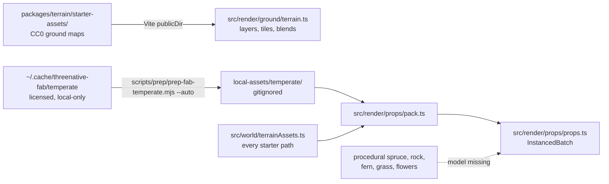

# Strata preview: assets

How the preview gets its ground maps and forest models. Read [`../AGENTS.md`](../AGENTS.md) first.

- The ground's PBR maps are the CC0 starter sets in `packages/terrain/starter-assets/`, served
  through this example's Vite `publicDir` and loaded by `ctx.assets`; provenance is that folder's
  `credits.json`, and `src/render/ground/terrain.ts` owns the layer, tile-size and blend choices.
- The forest uses the owner's licensed Project Nature Spruce Forest, Grass Library, Ground Foliage,
  Meadow Flowers and Fern Collection, plus Epic Kite Demo photoscanned rocks. `src/render/props/pack.ts`
  loads this example's gitignored `local-assets/temperate/`; `scripts/prep/prep-fab-temperate.mjs`
  repairs atlas/opacity bindings and calls the installed asset cook. `pnpm dev` runs it with `--auto`:
  the library defaults to the asset MCP's import folder `~/.cache/threenative-fab/temperate`
  (`FAB_TEMPERATE` overrides), a machine without it skips, and an unchanged library skips on a stamp. Licensed bytes are LOCAL-ONLY and never committed; provenance is in `CREDITS.md`.
  Missing models keep the procedural spruce, rock, fern, grass and flower fallback drawing.
  Cutout vegetation draws with its imported albedo, normal map and cutoff, lit by the CC0
  Kloofendal HDRI as each material's `envMap` (`local-assets/prepared/kloofendal_48d_2k.hdr`,
  local-only); without it core prints `TN_UNLIT_FOLIAGE`. Never tint or flatten foliage to fix light.
  All model sections share one whole-model scale/base. `src/render/props/props.ts` uses `InstancedBatch`
  with cooked reduced full-spruce geometry at distance and culls small cover beyond its readable range.
  `src/render/ground/scatter.ts` plants noise-masked stands, clearings, edge saplings, and grass over the
  entire grass field, with denser cover at the walking/benchmark eyes.
- The live editor also takes environment, model, surface-image and sky-image edits (`src/render/props/imports.ts`, `surfaces.ts`, `environmentImages.ts`; inputs `bark.*`, `stone.*`); a mapping swaps the image inside a texture a material already samples, so it adds no sampler.
- Every starter path lives in `src/world/terrainAssets.ts`. Replace art by editing that table only;
  `pnpm --filter strata-terrain-preview test:terrain:custom` proves the swap.
