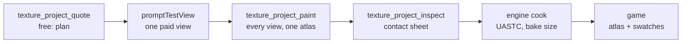

# Texture projection — real surfaces on a gray blockout level

An image model paints a gray blockout level or environment from camera views, the views are
projected into the level's UV atlas, and a GLB with one baked base-colour atlas comes back, plus
true-scale swatches beside it for close range. The geometry does not change, and the guards below
keep it that way. The level must be UV-unwrapped: a mesh without `TEXCOORD_0` fails with
`TEXTURE_PROJECT_MISSING_UV` before anything is bought. `outputPath` must be under the project's
`assets/`; every other path is project-relative.



## Two MCP modes: lean (default) vs detailed

`threenative-assets` exposes two operating modes selectable via `--mode lean|detailed` or
`THREENATIVE_TEXTURE_MODE=lean|detailed`:

- **`lean` (authoring default, keyless):** uses only CC0 Poly Haven PBR textures and 3D models
  matched against the reference image(s) (`polyhaven_search_assets`, `asset_download_file`, and
  `texture_project_match_materials`), with neutral tint/procedural fallback when
  unmatched. When the server starts in `lean` mode, `texture_project_quote`,
  `texture_project_paint`, and `texture_project_inspect` are omitted from `tools/list` so agents
  never spend OpenRouter credits or ask for `OPENROUTER_API_KEY`.
- **`detailed` (opt-in, requires `OPENROUTER_API_KEY` at paint time):** matches repeating surfaces
  and props to Poly Haven first, then runs `texture_project_quote` → `promptTestView` →
  `texture_project_paint` → `texture_project_inspect` for remaining blockout views.

Stay in `lean` mode unless the user explicitly asks for `detailed` AI texture projection.

## Quote first — it is free and it needs no key

`texture_project_quote` reads the GLB and plans the views. No network call, no key, no charge. It
reports the planned view count, the model and its price, the atlas the bake would pick,
`estimatedBlurredTexelPercent` and `uvStretch`. `views`, `aerial`, `roofs` and `holes` decide how
many cameras the plan gets; the price is the views plus the hole pass. `atlas: "auto"` (the
default) picks the smallest power of two the views resolve, and an explicit number overrides it.
`uvStretch.p95` is the level's 95th-percentile texel coarseness against its own median, and
`worstMaterial` names the mesh to fix: above 4 the atlas cannot be sharp there. Quote again when
the blockout moves.

## The key, and the model it buys

`texture_project_paint` spends your own OpenRouter credit. Put `OPENROUTER_API_KEY` in the
environment the asset server was launched from. The server reads it, and it never reaches browser
globals, a log, `run.json` or the GLB. A paint with no key fails `TEXTURE_PROJECT_MISSING_API_KEY`
and writes nothing; a resume that reuses stored images needs no key.

| `model` | price per view | when |
| --- | --- | --- |
| `or-klein` (default) | $0.009 | FLUX 3 Klein; keeps the clay silhouette and the materials you name |
| `muse-image` | $0.01 | a second look on the same clay; test one view first |
| `or:<model id>` | the provider's price | any OpenRouter image model, one the author names |

A 40-view run at $0.009 is about $0.36. A resume reads the stored images and buys nothing.

## The style is materials, never objects

`style` describes surfaces, in words: weathered limestone, faded ochre lime plaster, terracotta
roof tiles, cobbles, moss on the steps. Do not name doors, arches, windows, awnings, signs, plants,
furniture or people: an image model paints whatever a prompt names, and painted geometry the
blockout does not have will not line up from any other angle. `styleImagePath` takes a reference
image, project-relative — its materials, colours and wear ride along as a second input, and its
camera and layout are ignored. `lighting` defaults to `"overcast"`, which keeps a sun direction out
of the baked albedo.

## Buy one view before you buy sixty

`promptTestView: 12` paints only planned view 12 and stops. That is one image, about $0.009, and it
is the cheapest way to learn that the style text or the reference image is wrong; the run stays
incomplete on purpose. Then paint with `resumeRunId` set to that run's `runId`: the stored view is
re-judged and reused, and only views with no image are bought. That also finishes an interrupted
run.

## Read the contact sheet yourself

`texture_project_inspect` returns a contact sheet: per view the clay render, the model image and the
composite that went into the atlas, with rejected views labelled by reason and structure score.
No image model reads it. The call that made the bake is the judge. `verify: true` opts into a vision
check that buys one chat request per view, for what you cannot call by eye.

Reject a view that invents an arch, a door or a passage, that turns a blank floor into a mosaic or a
rosette, that adds snow, that puts roof tiles or a coping on a wall top, or that draws an object
shifted or tilted so one wall carries a ghost of it. A rejection is free, needs no key and buys no
image:

```json
{ "resumeRunId": "courtyard-mwuijnnl", "rejectViews": [11, 22, 30] }
```

The view is stored as `rejected: "caller"`, it projects nothing, and the fill pass covers its texels
from the images around them. A later resume keeps it rejected, so judge once. An index the run does
not have fails closed with `TEXTURE_PROJECT_INVALID_INPUT`, and so does `rejectViews` with no
`resumeRunId`.

Three checks run free on every view before you look:

- **Structure blob.** A compact, closed, much darker or brighter area inside one clay surface is an
  invented arch, door, window or passage. Logged `rejected: "structure"`.
- **Silhouette.** Cells the clay leaves as sky must stay sky. A wall over the backdrop or cobbles
  where the level has no ground is rejected as `structure` too.
- **Edge strip.** The 0.25 m strip along a clay edge is never projected. Both image models put a
  coping on a wall top and light an inner corner, and that band is where it lands.

Read the numbers beside the sheet:

- `visibleCoveragePercent` — the share of the texels a player-height camera sees that the bake
  painted. Under 90 the run warns. Raise `holes`, or reject fewer views.
- `coveragePercent` — the share of the whole atlas a view painted. An eight-texel gutter around each
  island takes the rest, so mips blend into a neighbour, not clay.
- `blurredTexelPercent` — texels whose best view resolves more than about 2×2 atlas texels per image
  pixel. `magnificationSkippedPercent` counts the texels no view painted for that reason.
- `rejectedViews` — each rejected view and its reason, `caller` included.
- `cookConfig` — an audit of `threenative.config.ts`: a base-colour `maxSize` below the atlas, or
  ETC1S on it, would blur the bake.

Do not ship a level whose sheet you have not looked at. For a human, `threenative-asset-mcp
texture-project-ui --level assets/blockout/courtyard.glb` serves the same app on `127.0.0.1`: the
plan, the cost, each view and the atlas, and a free quote. The key stays in that process.

## The fill continues the wall, never mirrors it

Unpainted texels fill from their own UV island, never across the atlas packing, so a gap continues
the material around it. The fill also tiles that island's own largest painted square, at least 32×32
texels, with plain wrap and no mirror: same grain, same tone. The grain fades in over the first 8
texels, so no hard line sits at the paint edge. An island with no such square keeps the plain fill.

## The guards

- **Grazing reject.** A surface facing the camera at `cos < 0.35` is left to the fill or hole pass;
  a projected grazing texel is a smear, not a material.
- **Stop-spending breaker.** When the first three painted views of a run all invent geometry, the
  run stops before it buys the rest and fails `TEXTURE_PROJECT_STRUCTURE_REJECTED`. The paid images
  are kept, so fix the style text and continue with `resumeRunId`.
- **`TEXTURE_PROJECT_NO_COVERAGE`** means no view reached the atlas, so nothing was baked; the images
  are still stored for a resume.

## The cook already knows the atlas

The painted GLB carries `extras.threenative.textureProjection = { atlas, runId }` on its atlas
texture. The engine model cook reads that marker and keeps the authored size, up to 4096 px (the
KTX2 encoder's ceiling), instead of capping at 2048. It encodes UASTC with the full mip chain and
keeps KTX2, not the JPEG that wins on download bytes alone. The cook report names every texture it
honoured, and an explicit `maxSize` or codec override for that slot still wins and is reported
instead:

```text
embedded texture courtyard.glb#atlas: textureProjection atlas 4096 px
```

## Close range belongs to the swatches

The atlas is macro variation. One 4096 atlas for a whole level is about 0.8 cm per texel, and at
arm's length a texel covers about 15 screen pixels, so the paint reads as blotches. The bake cuts
true-scale, tileable swatches from its own paint and writes `<name>.swatch_wall.png`,
`<name>.swatch_floor.png` and `<name>.swatches.json` (per class its file, `metresX`/`metresY` of one
tile, its view and metres per pixel) beside the GLB.

Tile a `RepeatWrapping` swatch in world metres and fade back to the atlas by 5 m:

```ts
import { cameraPosition, mix, positionWorld, smoothstep, texture, uv, vec2 } from "three/tsl";

// u runs across the face, v up it, in world metres. An x-facing wall takes positionWorld.z for u.
const swatchUv = vec2(positionWorld.x.div(METRES_X), positionWorld.y.div(METRES_Y));
const near = smoothstep(2, 5, positionWorld.distance(cameraPosition)).oneMinus();
material.colorNode = mix(texture(paint, uv()), texture(wall, swatchUv), near);
```

A class the bake could not cut is null, and that surface keeps the atlas. `ctx.assets.model()` sets
`anisotropy 8` on the marked atlas already, so set it on each swatch too: a floor is seen at a graze
along its whole length. Cook the swatches as UASTC, because ETC1S block edges show at arm's length:

```ts
{ glob: "**/*.swatch_*.png", codec: "uastc" }
```

## What one courtyard proved

One blockout courtyard, 60 views (52 planned, 8 hole), FLUX 3 Klein, then the default cook:

| | |
| --- | --- |
| run cost | $0.54 |
| atlas painted by a view | 54% |
| atlas | 4096 px |
| blurred texels | 1.24% |
| cooked atlas | 22 MB → 10.4 MB download |
| GPU memory | 89 MB (JPEG, no mips) → 22 MB (UASTC) |
| cook SSIM against the source atlas | 0.992 |

The JPEG row is why the marker exists: it downloads larger and costs four times the VRAM.
