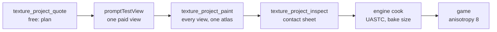

# Texture projection — real surfaces on a gray blockout level

An image model paints a gray blockout level or environment from camera views, the views are
projected into the level's UV atlas, and a GLB with one baked base-colour atlas comes back. The
geometry does not change, and the guards below keep it that way. The level must be UV-unwrapped: a
mesh without `TEXCOORD_0` fails with `TEXTURE_PROJECT_MISSING_UV` before anything is bought.
`outputPath` must be under the project's `assets/`; every other path is project-relative.



## Quote first — it is free and it needs no key

`texture_project_quote` reads the GLB and plans the views. No network call, no key, no charge. It
reports the planned view count, the model and its price, the atlas the bake would pick,
`estimatedBlurredTexelPercent` and `uvStretch`. `views`, `aerial`, `roofs` and `holes` decide how
many cameras the plan gets; the price is the views plus the hole pass. `atlas: "auto"` (the
default) picks the smallest power of two the views resolve, and an explicit number overrides it.
`uvStretch.p95` is the level's 95th-percentile texel coarseness against its own median, and
`worstMaterial` names the mesh to fix: above 4 the atlas cannot be sharp there. Quote again when
the blockout moves.

## The key, and the model it buys

`texture_project_paint` spends your own OpenRouter credit. Put `OPENROUTER_API_KEY` in the
environment the asset server was launched from. The server reads it, and it never reaches browser
globals, a log, `run.json` or the GLB. A paint with no key fails `TEXTURE_PROJECT_MISSING_API_KEY`
and writes nothing; a resume that reuses stored images needs no key.

| `model` | price per view | when |
| --- | --- | --- |
| `or-klein` (default) | $0.009 | FLUX 3 Klein; keeps the clay silhouette and the materials you name |
| `muse-image` | $0.01 | a second look on the same clay; test one view first |
| `or:<model id>` | the provider's price | any OpenRouter image model, one the author names |

## The style is materials, never objects

`style` describes surfaces, in words: weathered limestone, faded ochre lime plaster, terracotta
roof tiles, cobbles, moss on the steps. Do not name doors, arches, windows, awnings, signs, plants,
furniture or people: an image model paints whatever a prompt names, and painted geometry the
blockout does not have will not line up from any other angle. `styleImagePath` takes a reference
image, project-relative — its materials, colours and wear ride along as a second input, and its
camera and layout are ignored. `lighting` defaults to `"overcast"`, which keeps a sun direction out
of the baked albedo.

## Buy one view before you buy sixty

`promptTestView: 12` paints only planned view 12 and stops. That is one image, about $0.009, and it
is the cheapest way to learn that the style text or the reference image is wrong; the run stays
incomplete on purpose. Then paint with `resumeRunId` set to that run's `runId`: the stored view is
re-judged and reused, and only views with no image are bought. That also finishes an interrupted
run, so a view is never paid for twice.

## Look at the contact sheet

`texture_project_inspect` returns a contact sheet: per view the clay render, the model image and the
composite that went into the atlas, with rejected views labelled. Read it beside the numbers:

- `coveragePercent` — the share of atlas island texels a view painted; the rest is filled from the
  atlas and by an eight-texel gutter around each island, so mips blend into a neighbour, not clay.
  Raise `holes` to paint more of it.
- `blurredTexelPercent` — texels whose best view resolves more than about 2×2 atlas texels per image
  pixel: magnification blur.
- `rejectedViews` — each rejected view and its reason.
- `cookConfig` — an audit of `threenative.config.ts`: a base-colour `maxSize` below the atlas, or
  ETC1S on it, would blur the bake.

Do not ship a level whose sheet you have not looked at. For a human, `threenative-asset-mcp
texture-project-ui --level assets/blockout/courtyard.glb` serves the same app on `127.0.0.1`: the
plan, the cost, each view and the atlas, and a free quote. The key stays in that process. Use it to
compare two styles by eye before a run is paid for.

## The guards

- **Grazing reject.** A surface facing the camera at `cos < 0.35` is left to the fill or hole pass;
  a projected grazing texel is a smear, not a material.
- **Structure check.** Each generated view is compared with the clay it was given, surface by
  surface, at low frequency. A compact, closed, much darker or brighter blob inside one clay surface
  is an invented arch, door, window or passage: logged `rejected: "structure"`, not projected.
- **Stop-spending breaker.** When the first three painted views of a run all invent geometry, the
  run stops before it buys the rest and fails `TEXTURE_PROJECT_STRUCTURE_REJECTED`. The paid images
  are kept, so fix the style text and continue with `resumeRunId`.
- **`TEXTURE_PROJECT_NO_COVERAGE`** means no view reached the atlas, so nothing was baked; the images
  are still stored for a resume.

## The cook already knows the atlas

The painted GLB carries `extras.threenative.textureProjection = { atlas, runId }` on its atlas
texture. The engine model cook reads that marker and keeps the authored size, up to 4096 px (the
KTX2 encoder's ceiling), instead of capping at 2048. It encodes UASTC with the full mip chain and
keeps KTX2, not the JPEG that wins on download bytes alone. The cook report names every texture it
honoured, and an explicit `maxSize` or codec override for that slot still wins and is reported
instead:

```text
embedded texture courtyard.glb#atlas: textureProjection atlas 4096 px
```

## First-person floors

Set `anisotropy 8` on the level's base-colour map. The atlas holds one texel per view pixel, and a
floor is seen at a graze along its whole length, so without anisotropy it smears into the distance.
Walls read as real material from a few metres; the floor at the player's feet stays softer, because
the view that painted it saw it at a graze and it holds fewer texels than the wall ahead.

```ts
import type { Mesh, MeshStandardMaterial } from "three";

const level = await ctx.assets.model("courtyard.glb");
level.traverse((object) => {
  const material = (object as Mesh).material as MeshStandardMaterial | undefined;
  if (material?.map) material.map.anisotropy = 8;
});
```

## What one courtyard proved

One blockout courtyard, 60 views (52 planned, 8 hole), FLUX 3 Klein, then the default cook:

| | |
| --- | --- |
| run cost | $0.54 |
| atlas painted by a view | 54% |
| atlas | 4096 px |
| blurred texels | 1.24% |
| cooked atlas | 22 MB → 10.4 MB download |
| GPU memory | 89 MB (JPEG, no mips) → 22 MB (UASTC) |
| cook SSIM against the source atlas | 0.992 |

The JPEG row is why the marker exists: it downloads larger and costs four times the VRAM.
