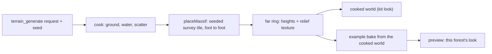

# PRD-866: A generated forest stands under mountains with real shapes

**Status:** BLOCKED (owner decision) — phases 1-3 landed (7/7 boxes); AC-1 and AC-2 passed; AC-3 measured and failed: the paired run on one code state shows the far band at `near` costs 7.5-9 ms GPU and drops the overview from 30 to 20 FPS; the owner picks the threshold
**Priority:** P1 — the owner named the mountains as one of the two defects that keep the forest from "good to go" (2026-11-09); AC-1 is that defect.
**Complexity:** 6 (MEDIUM) — 6 to 10 files (2), a new placement module (2), state across bake and cook (2); risk override: none
**Owner:** João
**Depends on:** [PRD-854](../../done/PRD-854-one-terrain-request-decides-the-landform-water-size-and-survey.md) (the survey fetch this PRD reuses, landed), [PRD-864](../../P2/PRD-864-prop-and-collar-mechanisms-leave-the-strata-preview.md) (only for a kit game to draw the far ring; no box here waits on it)
**Epic:** [Strata terrain hardening](../../README.md). Continues the shape work of [PRD-856](../../P2/PRD-856-the-mountains-carry-real-silhouettes-erosion-and-rock.md), whose open boxes stay there.

## Problem

Owner, 2026-11-09: "these crappy mountains that doesn thave proper textures or AAA mountain look", then "think about heightmaps etc. real shapes. how to make it procedural. and most importantly, making sure we can create variations of this forest with the MCP from strata".

The forest's near massif is two smooth stamps (`examples/strata-terrain-preview/scripts/recipe.mjs`, `nearMassif`: a `ridge` and a `mountain` stamp, `roughness: 0.1`) with ridged noise and droplet erosion on top (`alpineCrests`). It reads as smooth clay lobes with vertical flutes. The far ranges come from the same generator and read as mountains, because they are small on screen.

Three measured causes (2026-11-09, worktree `strata-forest-aaa`, RTX 2080, 1600 x 900):

| Cause | Measurement |
|---|---|
| The shape is not a mountain | Stamp profiles: median slope 50 degrees from 200 m to 700 m, 63 degrees above 700 m. A real mountain averages 30 to 40 degrees with cliff bands. |
| The mesh cannot carry rock at this range | The massif stands 1.1 to 2.4 km from the vista eye. One pixel covers 1.4 to 3.1 m there (`distance x 0.00128`). The far ring has 9.8 m cells, drawn on a 14 to 18 m ring grid, so one cell is 3 to 13 pixels of flat facet. |
| The lower slopes are bare | The far forest plants up to 36 to 46 degrees (`packages/terrain/starter/forest/biome.data.json`, `foliage[0].far.slope`). Only 29 to 38% of the massif between 200 m and 700 m is under 40 degrees, so most of it is bare rock from foot to top. |

Also true today:

- No sun shadow reaches the massif. The shadow window ends at 256 m (`src/render/sky.ts`, `RIG.shadowExtents: [24, 320]`), so a gully is lit like the rib beside it.
- `terrain_generate` writes no far ring. A cooked world has no mountains around its square at all (`packages/terrain/src/mcp/cook.ts`; PRD-856 records the same gap).
- The cooked forest kit is not this forest. The kit draws CC0 art with its own `world.ts` and `sky.ts`. The example draws the owner's licensed FAB assets with `src/render/`. The cook also places props from seeded rows (`stream: "seeded"`, `cook.ts:684`), not the example's ordered stream.

## What was tried and failed (do not repeat)

All four were captured and reverted on 2026-11-09. Frames are local only: `~/Downloads/strata-forest-aaa/`.

| Attempt | Result |
|---|---|
| Ridged `crags` noise (amplitude 80, scale 360 m, 4 octaves) plus 160 000 droplets | Marginal. Curvature kurtosis fell from 41.5 to 25.0, under the floor of 40 in `forest-backdrop.spec.ts`. With crags at 40 000 droplets it fell to 14.7, the value of smooth blobs. Frame `10-crags`. |
| Rock normal map on the faces, unwarped, 220 m and 60 m tiles | A faint crack net. No rock form. Frame `11-relief-clear`. |
| Dark gullies from the collar's `hollow` field | Blotches at the field's own 9.8 m scale. Frame `12-gully-shade`. |
| Longs Peak summit block (1.2 km each way, 9.8 m cells) pasted with `blend: "max"`, an offset and `falloff: 0.45` | Worse: one huge smooth bare cone. The crop was a summit dome, not a whole mountain, and the feather made its flank a ramp. Snow area rose from under 15% to 22%. Frame `13-survey-massif`. |

What does work, same renderer: the alpine world's surveyed headwall at 2 m cells reads as a real mountain (`ref-alpine-world/forest-overview.png`). Real shape at enough resolution is the lever. Noise and material tweaks are not.

## Solution

1. **Real shapes from surveys.** A massif is a height tile cut from a public survey, whole, foot to foot. The example cuts tiles with `scripts/dem/crop.mjs` from USGS 3DEP (public domain, 1 m source). The generator fetches them with the installed `surveyHeights` (`packages/terrain/src/mcp/survey.ts:228`) at terrarium zoom 14 or 15 (about 7.3 m and 3.7 m per pixel at 40 degrees north). Rows live beside the landform surveys in `packages/terrain/src/core/surveys.ts`, each with its attribution.
2. **Foot to foot, base relative.** A tile covers the whole mountain (3 km or more), so its edge is valley floor. The placement subtracts the tile's own base (the 10th percentile of its perimeter), clamps at zero and adds the rest to the host ground. No offset, no `max` plateau, no feather ramp.
3. **Procedural by seed.** The seed picks the row, the bearing sector, the distance, a rotation that turns the tile's steepest face to the play area within 20 degrees, a mirror, and a vertical scale of 0.85 to 1.15. One seed gives one mountain. Another seed gives another.
4. **Rock where the mesh ends.** The collar already bakes a relief texture from its 9.8 m cells (`src/render/terrain.ts`, `ICollarRelief`: normal, hollow, scree). Over the massif footprint the same bake reads the tile at its source spacing, 4 m or finer, so the faces take real ribs, couloirs and ledges in their light. No new shader path.
5. **Forest on the lower slopes.** A real tile has real slopes, so the installed far-forest rule plants it. A gate measures the planted share.
6. **This forest, varied through the MCP.** The cook writes the far ring. The example's bake takes a cooked world as its ground, so the preview draws this forest's look on generated ground.

Auto by default: the cook adds the ring and a massif when the landform is `alpine` or `temperateMountains`. Named override on the same request: `backdrop: "none"`. The result reports the choice in `decided.backdrop`.

## Execution Phases

### Phase 1 — one real mountain in the example

**Files:** `examples/strata-terrain-preview/scripts/dem/` (new tiles and metadata), `scripts/recipe.mjs` (`nearMassif`), `src/render/terrain.ts` (`ICollarRelief` source), `__tests__/`.

- [x] Three whole mountains are cut foot to foot at 4 m cells or finer, each 3 km square or more, with the same metadata and hash file the other surveys carry. Start with Longs Peak (the 1 m source is already named in `scripts/dem/alpine.json`). proof: a new `__tests__/massif-tiles.spec.ts` asserts, per tile, the hash, relief of 700 m or more, and a perimeter whose 90th percentile is under 80 m above its base
  - result: `scripts/dem/massif.mjs` cut Longs Peak (4.4 km, 1101²), Grand Teton (3.6 km, 901²) and Maroon Bells (3.6 km, 901²) at 4 m from the 3DEP 1 m lidar service, with metadata, lidar tile list and sha256. `__tests__/massif-tiles.spec.ts` 6/6: hash, raw relief 1191/1900/1243 m, lift above the perimeter membrane 649/888/696 m (bar 600, see Decisions), summit in the central half, border exactly 0.
- [x] `nearMassif` places one tile base relative (Solution 2) where the stamps stood. proof: `pnpm exec vitest run --config vitest.config.ts __tests__/forest-backdrop.spec.ts` keeps its 7 cases green (relief 800 to 1200 m, kurtosis over 40, the vista skyline, snow under 15%), plus one new case: 60% or more of the massif cells between the valley floor plus 50 m and the treeline band are under 40 degrees
  - result: seed 6 (Maroon Bells, 594 m above its foot, face south, summit at [-2050, -150]); `forest-backdrop.spec.ts` 8/8 green; the new case measures 65.4% of 330 773 lower-slope cells under 40 degrees. Snow 11% of the collar, kurtosis 65, relief 1116 m. `node scripts/stamp.mjs` (through tsx) exits 0.
- [x] The collar relief texture reads the tile at its source spacing over the massif footprint. proof: a spec asserts texels of 4 m or less inside the footprint and unchanged bytes outside it
  - result: one atlas texture (the ground already samples 16): collar at 9.8 m on the left, the massif's 4 m cells on the right. `__tests__/massif-relief.spec.ts` asserts spacing 4 m, every collar texel byte-equal to a build without the massif, and over 90% of massif texels written; red when the massif write is removed (0 written).

### Phase 2 — the generator owns the mountain

**Files:** `packages/terrain/src/core/surveys.ts` (massif rows), a new `packages/terrain/src/core/massif.ts` (`placeMassif`), `packages/terrain/src/mcp/cook.ts`, `packages/terrain/__tests__/`.

- [x] `placeMassif(terrain, { seed, tile })` ships in `@threenative/terrain` and the example's `nearMassif` calls it; no mountain stamp code stays in the example. proof: a spec in `packages/terrain/__tests__/` shows the same seed gives the same height hash, and 8 seeds each pass the Phase 1 gates (relief, kurtosis, slope share); `rg "massif-ridge|massif-summit" examples` returns nothing
  - result: `packages/terrain/__tests__/massif.spec.ts` 10/10 on a checked-in 16 m Maroon fixture: same seed gives the same hash, seed 3 differs from seed 4, and seeds 0-7 each give relief 594-758 m, kurtosis 48-178 and a lower-slope share of 0.715-0.837 (bar 0.6). `rg "massif-ridge|massif-summit" examples` exits 1 (no match).
- [x] `terrain_generate` writes the far ring with a seeded massif for `alpine` and `temperateMountains`, reports `decided.backdrop`, and writes none under `backdrop: "none"`. Without network it fails closed and names the tile, as the ground fetch does. proof: red-green cases in `packages/terrain/__tests__/terrain-mcp.spec.ts` on a checked-in tile fixture
  - result: the cases live in `packages/terrain/__tests__/terrain-survey.spec.ts`, "the far ring" (the survey fixtures sit there), on checked-in Terrarium tiles `12/847/{1545,1546}` and `13/{1692,1693}/{3093,3094}`: ring.json with the survey continued and a surveyed massif, `decided.backdrop` by default and off by argument, no ring.json under `backdrop: "none"`, fail closed naming `13/1692/3093.png`, and a z13 massif sharp enough on a flat host (relief > 550 m, kurtosis > 40, seeds 1-3). Red before `farRing`, green after; `vitest run terrain-survey terrain-mcp massif` 172/172 (2026-11-09).

### Phase 3 — variations of this forest through the MCP

**Files:** `examples/strata-terrain-preview/scripts/bake.mjs`, `scripts/recipe.mjs`, one new verify script.

- [x] The example bakes its forest from a cooked world: `STRATA_WORLD=<cook out dir> pnpm bake` takes that world's ground, water, scatter seed and far ring, and keeps the example's biome row and look. Unset, the bake is the pinned one. proof: a spec bakes from a fixture cook and asserts the baked heights equal the cook's; `node scripts/stamp.mjs` exits 0 on the pinned bake
  - result: `examples/strata-terrain-preview/__tests__/cooked-world.spec.ts` bakes from a fixture cook (seed-9 eroded ground, 5120 m ring) and asserts the baked heights equal the cook's and the horizon is the ring; `isFresh` is false under the cooked bake and true after the pinned re-bake (`stamp.mjs` is a module `bake.mjs` imports, so `isFresh` is its proof, not `node scripts/stamp.mjs`). 24/24 with forest-backdrop, bake-golden, biome-values and the massif specs (2026-11-09).
- [x] Three seeds give three forests. proof: a new `scripts/verify-variations.mjs` cooks "a spruce forest under mountains" with seeds 1, 2 and 3, bakes each, and asserts three different height hashes, three different `decided.backdrop` choices or poses, and the Phase 1 gates on each
  - result: `node scripts/verify-variations.mjs` exit 0 (2026-11-09), five cooks through the MCP server over stdio. Seeds 1-3 at 512 m: floor relief 86/32/59 m, slope p90 24/16/7 degrees, seam p90 5.6/0.9/1.6 m, Maroon Bells at three poses, massif relief 1012-1170 m, lower slopes 93-97% under 40 degrees. "a small ..." seed 4: 256 m square, Grand Teton, relief 1089 m. "a huge ..." seed 5: 1024 m square, floor 145 m over 1 km at 16 degrees, seam p90 2.9 m. Five distinct ground hashes and poses. Kurtosis reported only (9-30 in a real ring; the flat-host gate is in the spec).

## Acceptance Criteria

- [x] AC-1 [local]: A fresh read-only visual judge returns IMPROVEMENT on the forest `overview` and `vista` frames against the frames of the commit before this PRD, with the owner's reference frame as the target (spruce wood at low sun; mountains with forested lower slopes, rock, snow and low cloud). Headed WebGPU, real adapter checked, two runs per arm, BEFORE and AFTER burned in. proof: the judge verdict and the sheets on the PR
  - result (2026-11-10, judge PASS, HIGH): overview IMPROVEMENT (the three bare hills between the lake and the massif are forested ridges in haze; spruce climbs the massif's lower slopes), vista IMPROVEMENT (the stamped spire is a broad surveyed massif with a snowfield and forested lower slopes; the bare right hill is gone). BEFORE `~/Downloads/strata-forest-aaa/prd866/BEFORE-run{1,2}` (1fbcf58bc's example files), AFTER the shipped code (94b8219fb, `prd866/march/BEFORE-run{1,2}`, the march test's control arm), sheets `prd866/march/sheets/ac1-final-*.png`. A first judge on an impostor-march arm later reverted also returned PASS. Largest gap left: one flat lilac-grey rock tone (no warm sunlit against cool shaded faces), patchy forest on the lower slopes, no low cloud.
- [x] AC-2 [local]: The same judge finds one consistent look across the three seeded forests of Phase 3 and no REGRESSION against seed 0. proof: the three-seed sheet and verdict on the PR
  - progress (2026-11-10, open): first judge FAIL (seeds 1 and 3 put the massif behind the camera; seed 1 a bare plain). The cook now draws the massif's bearing from the kit's spawn camera (+-25 degrees) and retries up to six seeded placements for a wooded foot (`massifBearing`, `woodedFoot`, terrain-survey spec). Re-judge (sheets `~/Downloads/strata-forest-aaa/prd866/seeds2/sheets`): seeds 2 and 3 CONSISTENT, NO REGRESSION, each with a snow-capped massif behind the forest; seed 1 REGRESSION: a kilometre-scale far-field meadow (`far-field.ts`, macro noise on ground under `meadowSlope`) sits at the square's edge and reads as a bare level lawn from the overview. A far-field meadow fade did not move it (reverted). Cause: the bake's grass rule faded the meadow out at 66 m absolute, and a tree needs the meadow (`grassThreshold` 0.3), so no tree stood above 57.6 m; seed 1's knoll reaches 73 m. The forest row's grass `height` is now `null` (the pinned world tops out at 38.4 m, so it never acted there); red-green `biome-values.spec.ts`. Judge (sheets `prd866/seeds4/sheets`): seed 1 overview and vista IMPROVEMENT, meadow-close NEUTRAL; seed 0 NEUTRAL on all three. Final judge (2026-11-10, 995af266e, sheets `~/Downloads/strata-forest-aaa/prd866/seeds4/sheets/all-*.png`, two runs per seed): seeds 1, 2 and 3 CONSISTENT, NO REGRESSION; OVERALL PASS. Worst remaining: a dark ravine crease on seed 1's massif (read as terrain, not a bug).
- [ ] AC-3 [local]: Steady-state frame rate at `overview` and `vista` does not fall. proof: `measure-steady-state-fps`, paired arms on one code state, the numbers on the PR
  - reading (2026-11-10, shipped code 94b8219fb, RTX 2080 Turing, 1600x900, headed, 20 s settle then 30 s rAF window, control page 16.7 ms, two passes, no errors; `?farForest=off` -> default `near`): overview GPU 35.4-35.7 -> 57.3-57.7 ms, presented p50 49.9 -> 66.7 ms (20 -> 15 FPS), p95 50.1 -> 66.8; vista GPU 39.8-41.0 -> 64.0-64.5 ms, p50 50.0 -> 66.7 ms (20 -> 15 FPS), p95 50.1 -> 83.4. FAILS. Levers tried on the band's remaining cost (impostor fragments of about 22 k far trees): a coarser impostor march at the fine mips cut the band to 9-12 ms but darkened the overview canopy 2-5% (judge REGRESSION); the full march through mip 2 kept the look and saved nothing; impostor gate 30-400 m and band reach 300-700 m moved 0-2.6 ms; shadow receive is 0.9 ms; drawing the far impostors after the terrain and the square's trees moved -0.9 to +0.2 ms; keeping the band's trees as coarse meshes longer costs more (gate 400 m: overview 63.0, vista 67.4 ms; 1000 m: 73.9, 86.2 ms); one extra atlas read per march step costs only 0.7-1.5 ms, so reads are not the cost; skipping the march when the ray's path crosses no coverage saved nothing (the path spans a coarse mip that is almost always covered). All reverted. The band's cost is the impostor fragment itself at mips 0-2; a cheaper far canopy needs a different renderer (its own PRD).

## Blocked on

- AC-3, owner decision (requires-owner-decision): the wooded band past the square that AC-1 judges (`?farForest=near`, the default) costs 7.5 ms (overview) and 9 ms (vista) GPU after the one-march impostor, and drops the overview from 30 to 20 FPS and the vista p95 from 50 to 67 ms on the RTX 2080 (paired run, 2026-11-10). Pick one: accept the cost and its threshold, set `?farForest=off` as the default (AC-3 holds, the hills past the square go bare again, which the owner flagged as a bug on 2026-11-09), or fund a lossless far-canopy renderer (a canopy-card or merged-cluster impostor) as its own PRD.

## Integration Ledger

| Capability | Reachable consumer | Replaces | Evidence |
|---|---|---|---|
| Seeded real-shape massif | `scripts/recipe.mjs` `nearMassif` → `pnpm bake` → `src/world/horizon.json` → the collar mesh | The two stamps; they are deleted | Phase 1 box 2, Phase 2 box 1 |
| Far ring from the cook | `terrain_generate` → `cookKit` (`cook.ts:155`) → the cooked world's ring file | Nothing; the cook wrote no ring | Phase 2 box 2 |
| Example bake from a cooked world | `STRATA_WORLD` → `scripts/bake.mjs` → the preview | Nothing; the pinned bake stays the default | Phase 3 |

## Decisions

- 2026-11-09 (author, from the four failed attempts): the mountain shape comes from survey tiles, not from more noise or erosion on stamps. Noise lowered the sharpness metric and did not change the read.
- 2026-11-09 (author): a tile is a whole mountain, placed base relative. A summit crop lifted by an offset made a cone.
- 2026-11-09 (author): the look half of "this forest through the MCP" (the kit's own art and render files reaching this forest's look, and the ordered scatter stream in the cook) is not in this PRD. Phase 3 reaches this forest's look by baking the example from a cooked world. A kit that looks like this forest without the owner's licensed assets is separate work and needs its own PRD.
- 2026-11-09 (executor): the tile bar "perimeter 90th percentile under 80 m above its base" is replaced. No probed whole mountain meets it (valleys climb to cols on every side: Teton 1148, Moran 1099, Shuksan 990, Maroon 801, Longs 690 m of relief above a perimeter membrane). `liftMassif` removes a Coons-patch membrane through the low-passed border, so the border is exactly 0 by construction; the bar is now 600 m or more above that membrane, with the summit in the central half.
- 2026-11-09 (executor): tiles come from the 3DEP dynamic ImageServer (2 m bilinear pixels, a 2x2 box to 4 m), not the 1 m GeoTIFF downloads: one request per 2 km chunk and no 2 GB intermediates. The TNM products API names the 1 m lidar tiles behind each cut.
- 2026-11-09 (executor): the summit stands at [-2050, -150], about 2.4 km from the vista eye, facing south (`face: 90`). At [-1450, -50] the mountain was a wall beside the lake with the camera under ground; facing the vista, the wall was backlit by the west-south-west sun and showed no rock.
- 2026-11-09 (executor): `top: [1100, 1160]` bounds every cell inside the world, not only the summit; the lift is signed with a 40 m soft floor at the lowest host border height, so a valley inside the tile fills to its outlet instead of an island on a flat plane.
- 2026-11-09 (executor): the forest look's treeline band moves to [11, 14] and its snow cap to [17, 21] walkable ranges (the other four looks keep [6.5, 10] and [14, 17]). Spruce then climbs to about 450-575 m, so the massif's lower slopes can carry forest, and snow holds above 700-860 m.
- 2026-11-09 (executor, from the first judge): the massif keeps 650 m clear of the centre and fades in over 600 m. At 420 m on a 160 m ramp the near flank rose beside the overview camera as a pale wall inside the haze.
- 2026-11-09 (executor): bake time is unchanged by the tiles: 13.5 s before, 9.9-10.1 s after on the same machine (both inside machine-load noise).

- 2026-11-09 (executor): the far ring needs a survey ground; it is the ground's survey row continued to ten times the world's size at zoom - 2, and the massif is fetched one zoom finer (z13, 257 cells) with its own detail grid in ring.json, so the example packs it at its own spacing.
- 2026-11-09 (executor): "a spruce forest under mountains" reads "mountains" after a backdrop word (under, below, beneath, behind, among, beside) as the far ring's range, not the ground's landform. The ground keeps the kit's own temperate survey. Before, the alpine landform squeezed a 6 km alpine crop into the 512 m square as a tan miniature range (owner screenshot, seed 1).
- 2026-11-09 (executor): a forest under a backdrop cooks a true-scale floor: a 512 m crop at z15, scale 1, at a seeded spot within 0.4 of the row's extent; the first spot with relief under 90 m per 512 m of side and a slope p90 under 28 degrees wins, the row's own centre last. The preset's fluvial erosion is replaced by hydraulic plus thermal erosion, because it lowered the square's border 10-40 m under its ring.
- 2026-11-09 (executor): curvature kurtosis gates the massif only on a flat host (spec); inside a real ring the smooth survey around it dilutes the number to 9-30 with the same mountain.
- 2026-11-09 (executor): the forest look's treeline and snow are metres above the floor (`bandSpan: 41`), not shares of the square's own range, so a hillier cooked square keeps the pinned forest's bands.
- 2026-11-09 (executor): the far forest's default is the band 700 m past the square (`?farForest=near`); `on` plants the whole ring, `off` none. A far spruce draws its coarsest cooked level until the impostor (vista props 28.6 M -> 16.3 M triangles).
- 2026-11-10 (executor): the far forest's remaining cost is its impostors' main-pass fragments, not shadow work. The `gpuShadow` span was mislabelled: three@0.187.0 `WebGPUBackend.js:3268` (`copyFramebufferToTexture`) reuses the shared `_renderPassTimestampWrites`, so the main pass's time lands on the shadow pass's slot; the GPU total is right. Each impostor quad was its bounding sphere's square, about four times a spruce's silhouette; the quad now fits the baked box (`packages/core`, e92ff9c54, judge NEUTRAL). GPU ms at 1600x900 on the RTX 2080, four windows: overview off 37.6 -> 34.6, near 66.5 -> 57.7; vista off 46.0 -> 40.7, near 72.8 -> 64.0. The band still costs about 23 ms, so AC-3 stays open; `near` stays the default because AC-1's look asks for a wooded ring, and the threshold is the owner's call.
- 2026-11-10 (executor): the far impostors march their depth atlas once per pixel, not three times: the heaviest blended frame marches and the other two reproject its hit (`packages/core/src/render/world-impostor-surface.ts`, merged in #635 as f7943d1cd, lock test `world-impostor-surface.spec.ts` "depth march"). GPU ms at 1600x900 on the RTX 2080, band `near`: overview 58 -> 38, vista 64 -> 42; visual judge PASS, NEUTRAL on both views, sky and rock byte-identical. Against the `off` arm measured before this change (overview 34.6, vista 40.7), the band now costs about 3.4 ms and 1.3 ms, down from 23 ms. Those two arms ran in different sessions, so AC-3 stays open until a paired `near`/`off` run on one code state reads the steady-state frame rate.
- 2026-11-10 (executor): AC-3 paired run, one code state (1143816ce, core rebuilt from source, pinned forest bake, licensed assets), RTX 2080, 1600x900, headed WebGPU, rAF control 16.7 ms. 20 s settle, then 30 s sampled, two passes per arm, arms alternated. Overview: `off` GPU 31.1/31.3 ms, presented p50 33.4 ms (29.9 FPS), p95 50.1; `near` GPU 38.7/38.7, p50 50.0 (20 FPS), p95 50.1. Vista: `off` GPU 35.3/35.6, p50 49.9 (20 FPS), p95 50.1; `near` GPU 44.6/44.4, p50 50.0 (20 FPS), p95 66.7. The band costs 7.5 ms (overview) and 9 ms (vista) GPU, and the frame rate falls, so AC-3 stays unticked and the decision above stands. A first run on a stale core dist read 15 FPS for `near` and was discarded.

## Notes for the executor

- Read first: `scripts/recipe.mjs` (backdrop, `nearMassif`, `alpineCrests`), `packages/terrain/src/core/operations.ts` (the `stamp` and `paste` case, about lines 474 to 540), `packages/terrain/src/core/presets.ts:269` (`landformBackdrop`), `__tests__/forest-backdrop.spec.ts`, `src/render/benchmark.ts` (the `vista` pose).
- `alpineCrests` runs ridged noise and erosion over everything above 320 m. Place the massif after it, or mask it out, so the survey's own rock is not carved again.
- Capture with the `capture-strata-worlds` skill. Any edit to example source or a bake reloads the dev server and spoils a running capture. `KeyV` steps the views to `vista`.
- The GPU on this machine is shared with other sessions. A single FPS reading is not evidence; use paired arms.
- Erosion is about 80% of a landform bake (PR-CHAIN spike). A survey tile needs none, so the bake should not slow down. Record the bake time before and after.
- Follow-up, not in this PRD: a baked sun-horizon term so the massif takes shadow past the 256 m window (PRD-856 removed a first try because the world was then inside the window).
