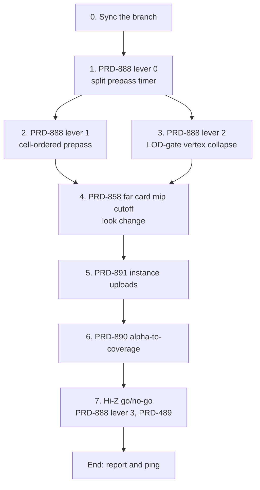

# Forest performance — overnight chain

**Written:** 2026-11-14, on branch `prd-584-forest-60fps` (PR #677).
**Purpose:** one ordered run for the next forest frame levers. Source: the lane's own ranking in [PRD-888 "The next lever, ranked"](../../../../docs/PRDs/rendering/PRD-888-a-masked-depth-prepass-pays-for-itself-on-the-forest.md), plus two engine gaps filed today ([PRD-890](../../../../docs/PRDs/native-engine/PRD-890-cutouts-keep-alpha-to-coverage-on-the-owned-engine.md), [PRD-891](../../../../docs/PRDs/performance/PRD-891-a-big-world-uploads-only-the-instances-that-moved.md)). An agent runs it top to bottom without questions.

## Rules for the agent

- Read `/AGENTS.md` first. Search `engine_search_capabilities` before each new file and before you debug a symptom.
- **Work in `.worktrees/perf-forest-584`, branch `perf/forest-584-measure`, which pushes to `prd-584-forest-60fps`.** Every step lands on PR #677 (owner decision, 2026-11-14). Open no other PR.
- Instrument: the forest starter kit (`packages/terrain/starter/forest`) at 1600×900, WebGPU, RTX 2080 on the real display, headed `--browser-recipe webgpu`, `adapter.info` checked. The 5 fixed poses and the bill method are in PRD-888. Check free GPU memory before each browser probe.
- Pair every A/B: 2 runs per arm, one code state, one page load with a live toggle where the PRD says so.
- A 0-pixel claim needs a frame diff of 0 at every fixed pose with time frozen. A pixel-changing box ticks only with a fresh visual-judge subagent verdict (BEFORE and AFTER burned in, 2 runs per arm), sheets on the PRD's `<prd>-screenshots` orphan branch.
- Builds over 5 minutes go to the laptop (`laptop-offload` skill) when its `status` shows room. GPU timing stays on the desktop.
- Commit after each green box, with the PRD tick in the same commit. Push once per finished step.
- After two failures with the same cause, stop the step, write the cause under its open box and go to the next step.
- Report real results only. "Unverified" is a valid result.
- Before you end the run, send one `attention-ping` with the completion %, the boxes ticked and the ms saved per pose.

## Run log — 2026-11-14 (one session, this branch)

- **Step 0 done.** Rebased clean onto `origin/prd-584-forest-60fps`.
- **Step 1 done and measured.** `TN_PREPASS=split` puts the depth rows in their own timed pass; the
  bill is in PRD-888, "The split, measured". Commits `230644752`, `d7ac14fa0`, `4e70d17f7`.
- **Two reviewer checkpoints (fresh read-only Claude Code, Opus, high), because the gate is
  "only proceed if it authorizes".**
  - Round 1 **REFUSED** step 2: the bill was per pose, not per band, which is step 1's own proof
    clause. Fixed: the per-band bill now exists, and four prose/unit errors it found are corrected.
  - Round 2 **AUTHORIZED step 3, measurement first**; **refused step 2** (3 h on an unproven ZCULL
    premise for 0–6 ms, and the excess is fragment work, which near-to-far order cannot reject for
    wrong-level instances) and **refused step 4 for now** (the far band
    `strata-props:far:*` is the collar's *mesh*, 769 826 triangles against 93 194 card triangles at
    overview — so "the cards' whole cost" had no support, and the cards' look fix is not where the
    depth half's 10.5 ms sits).
- **Step 3, first sub-step: half done.** Triangles per band and row kind are in PRD-888. The number
  step 3 needs — how many of a row's instances its level gate rejects — is **not reachable from the
  page**: `tnPublishedLodRange` read all zeros and `material.uniforms.lod` was null in this build.
  It needs an engine-side counted gate.
- **Step 3 built, measured, box left open (2026-11-14).** `?lodCollapse=1` collapses the vertices
  of instances the level gate provably discards. Both halves fall 0.22–0.71 ms at overview, vista
  and meadow-close (2 paired runs). River and player stay flat. No arm-attributable pixel at any
  pose, clock frozen. The 83–99 % count was row capacity, not submitted draws, so it overstated the
  waste about 20×. Details: PRD-888 Phase 2, lever 2 box.
- **Reviewer round 3 AUTHORIZED step 7** (measure only); refused step 4 again (the far band is
  collar mesh, the card fix has no measured performance case) and step 5 (PRD-891 does not touch the
  depth half).
- **Step 7 stopped on its own condition.** `?tnOcclusion=measure` arms the test, but every prop
  world runs `gpuScene: false`, so the GPU scene's cull kernel never runs: `samples: 0`, `share: 0`
  at overview and vista. Written under PRD-888 lever 3. No go/no-go number exists.
- **Reviewer round 4 REFUSED step 6** (PRD-890 is a look fix with only a 0.5 ms non-regression
  budget, no frame-time case on the depth half, and it needs a visual judge). It confirmed the
  step-7 stop: occlusion is measured only inside the GPU scene's dispatch
  (`world-gpu-scene.ts:876`), so `share: 0` there means not measured. **The chain ends here.**
- **Not run:** steps 2, 4, 5, 6 (refused by review). No other PR was opened.
- **Follow-ups for a later session:** a local `gpuScene: true` arm could give the Hi-Z geometric
  share. The occlusion report reads `share: 0, reason: ""` when it sampled nothing, and the rule
  "a missing observation fails" says it should read "not measured".

## Chain

Step 1 comes first, because PRD-888 says every later choice depends on its split. After step 1, a stopped step does not block the next one.

### Step 0 — sync the branch · ~10 min

The local branch was 5 ahead and 4 behind `origin/prd-584-forest-60fps` on 2026-11-14 (the remote has the PRD-889 commits). Run `git pull --rebase origin prd-584-forest-60fps`. On a conflict, stop the whole run and ping. Do not resolve another lane's conflict by guessing.

### Step 1 — split prepass timer (PRD-888 lever 0) · ~1.5 h

Add a box to PRD-888 Phase 2, then build it: "`TN_PREPASS=split` records the prepass rows in their own render pass with their own timestamp segment. proof: `TN_GPU_PASSES` shows prepass and shade apart at all 5 poses, and the bill per band is written in PRD-888."

### Step 2 — cell-ordered prepass instances (PRD-888 lever 1) · ~3 h

Add a box to PRD-888 Phase 2: "Prepass rows draw as cell-contiguous sub-draws sorted near to far. proof: frame diff 0 at all 5 poses, and the step-1 prepass segment time before and after, paired." Use `#cullMainPass` in `world-cell-batches.ts` as PRD-888 describes. If the prepass segment does not drop, Turing's ZCULL does not reject tiles for a discarding shader. Write that result and keep the code out.

### Step 3 — collapse the vertices the LOD gate discards (PRD-888 lever 2) · ~2 h

First compare triangles per band against the admitted levels. Then add a box to PRD-888 Phase 2: "A draw only rasterises the instances of its own level. proof: frame diff 0 at all 5 poses, triangles per band and the shade segment time, paired."

### Step 4 — far card mip cutoff (PRD-858) · ~3 h · look change

PRD-888 "The far cards' look" names the cause and the order. Add a box to PRD-858 Phase 3 (`packages/terrain/docs/PRDs/P1/PRD-858-world-impostors-bake-on-the-owned-web-engine.md`): "Far impostor cards keep their silhouette at overview and vista: no card draws as a solid rectangle. proof: a red-green spec on the threshold at a 64-texel footprint, and the PRD-888 look-change protocol with an IMPROVEMENT verdict."

1. Bake coverage-preserving mips (Castaño 2010) and drop the cutoff division in `mipThresholdNode` (`packages/core/src/render/world-impostor-surface.ts:243`).
2. Only after step 1 is judged: skip the ray march at sub-pixel parallax. That is a second box with its own judge.
3. Do not extend impostors to the horizon bucket (`propWorld.ts`). That needs the owner's look call.

### Step 5 — instance uploads (PRD-891) · ~3 h

Run the PRD from Phase 1. Phase 1 measures, and the measurement decides the fix. Its validation scene names the Strata preview. If the kit shows the same counters, use the kit and write that change in the PRD.

### Step 6 — alpha-to-coverage on the pipeline (PRD-890) · ~2 h

Run phases 1 to 3. It needs `pnpm wasm:build` and `pnpm native:build`. Phase 2 uses the prepass from this branch (`?tnPrepass=1`).

### Step 7 — Hi-Z go/no-go (PRD-888 lever 3, PRD-489) · ~45 min, measure only

A working cull is parked on branch `feat/prd489-cull` (`a641f22a3`). It was declined because Machinefall culls a median 1.3 %.

1. Open the kit with `?tnOcclusion=measure` at overview and vista. If measure mode reports unsupported on the default engine, write that in PRD-888 and stop the step.
2. Compute `share × scene ms − 0.07 ms`, PRD-489's own go/no-go formula.
3. Write the result in PRD-888 under lever 3. Do not build the cull tonight. GO (≥ 1.0 ms) means: reopen PRD-489 next session.

## Owner actions (not for the agent)

- The overview and vista 16.6 ms ceiling stays in PRD-888 AC-B, not in PRD-584 AC-4. AC-4 is a walk, and the walk passes.
- Impostors for the horizon bucket change the look. They wait for your call.
