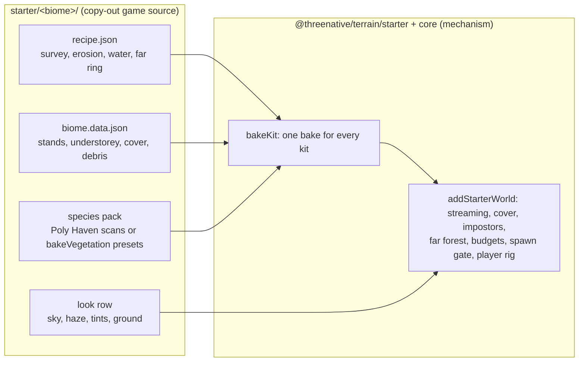

# PRD-892 — Every Strata kit bakes on the forest stack

**Status:** PARTIAL — Phase 1 box 1 landed
**Priority:** P1 — the forest kit has the whole world-building stack (real survey, vegetation, ground cover, far forest, 60 FPS work, a playable scene). The other four kits have one boulder asset and no scene, so they cannot be revamped to the forest's level (all phases open).
**Complexity:** 8 (HIGH); risk override: the forest must not change while it moves onto the shared path, so the owner's visual-judge rule applies to every phase
**Owner:** ThreeNative maintainers
**Depends on:** PR #677 (`prd-584-forest-60fps`) merged into `develop`: the forest stack this PRD spreads lives only on that branch
**Epic:** Strata terrain hardening. Art acceptance per kit stays in [PRD-580](../PRD-580-strata-starter-kit-art-bar.md).

## Context

Owner, 2026-11-15: "should we create a base 'starter kit scaffold' with all performance optimizations
and etc done on the forest version? Then we create the other terrains? I want to be able to bake the
others with same level of details (realistic heighmap, vegetation, trees where applicable, etc)" and
"the goal is spreading all world building capabilities/generation/perfromance to the other kits so
we can revamp these as well".

Audit of `origin/prd-584-forest-60fps`, `packages/terrain/starter/`:

| Part | `forest/` (about 700 KB, 47 files) | `alpine/`, `coastal/`, `desert/`, `tundra/` (about 10 files each) |
| --- | --- | --- |
| Bake | Own 14.5 KB `bake.mjs`: survey, erosion, lake bed, creek, road, pad, far ring with a surveyed massif. It does not read `recipe.json`. | 227-byte `bake.mjs` calling `bakeKit` on `recipe.json`: survey, erosion, surfaces, scree |
| Real ground | Sprague Lake, USGS 3DEP; PRD-887 region rows swap in a real survey (Hainich, Oulanka, Val d'Orcia, Pacific Northwest) | Alpine is Longs Peak. Coastal, desert and tundra are all Colorado crops that do not match their biome. |
| Vegetation | Scanned trees, shrubs, ferns, flowers (`render/props/pack.ts`); forest-floor debris and cover from `bakeVegetation` (PRD-889) | One asset (`boulder`, or a fir stand on coastal) |
| Ground | Streamed ground, `ScatterField3D` cover, far collar and horizon (`render/ground/`) | Splat table only |
| Performance | Far-forest impostors, distant fir triangle cut (18–20 ms to about 15 ms on RTX 2080), residency budgets, spawn gate | `impostors: false`, `gpuScene: false` |
| Game | `ForestScene`, `FOREST_GAME`, player rig, diagnostics, benchmark views | "The kit ships no scene: the game writes one." |

So there are two kit paths. A fix or a performance win on the forest path does not reach the other
four, and copying the forest four times makes five paths to keep in step.

Related PRDs: [PRD-790](../P2/PRD-790-a-new-biome-is-a-data-row-and-the-world-streams-past-one-square.md)
(a biome is a data row, written against the preview before the forest moved into `starter/`),
[PRD-864](../P2/PRD-864-prop-and-collar-mechanisms-leave-the-strata-preview.md) (mechanisms leave the
preview), [PRD-889](../../../../../docs/PRDs/done/PRD-889-the-forest-floor-bakes-and-scatters-from-one-nature-package.md)
(forest-floor presets).

Unreal reference (re-checked 2026-11-15 in `~/projects/UnrealEngine`; borrow the data layout, never
the code): one spawner holds a list of foliage types and tiles the area,
`UE 5.8.3: Engine/Source/Runtime/Foliage/Public/ProceduralFoliageSpawner.h:27` (`TileSize`), `:42`
(`FoliageTypes`). Each type is data: `Engine/Source/Runtime/Foliage/Public/FoliageType.h:151`
(`Density`), `:240` (`GroundSlopeAngle`), `:244` (`Height`), `:375` (`BodyInstance`), `:450`
(`InitialSeedDensity`). Ground cover is per layer:
`Engine/Source/Runtime/Landscape/Classes/LandscapeGrassType.h:45` (`GrassDensity`), `:59`
(`StartCullDistance`), `:176` (`GrassVarieties`). The biome changes the type list, not the spawner.

## Solution

A few abstractions, not a fifth copy. The forest's biome-agnostic stack becomes the one kit path,
and a biome is the data it reads. The forest is then the first data set on that path, not a special case.

- **Mechanism moves to the package** (imported, not copied): the forest bake steps (lake bed, creek,
  road, pad, far ring and massif) become recipe steps that `bakeKit` runs. Streamed ground,
  `ScatterField3D` cover, far-forest impostors, budgets, spawn gate, player rig and diagnostics become
  options of `addStarterWorld`. General mechanisms go to core when PRD-864 already names them.
- **The look stays copy-out source** in each kit (`render/biomes.ts` row, `sky.ts`, `surface.json`, species pack):
  root rule "Never own the look".
- **Real ground per biome**: each kit's default survey becomes a real place of that biome, through
  the PRD-887 region rows (one row per kit, plus its far ring).
- **Vegetation source** (root `AGENTS.md`, owner 2026-11-15): Poly Haven CC0 scans first, then
  `@threenative/procedural-vegetation` presets. A species with neither becomes a new preset in that
  package.

- **The vegetation package already holds most of the four biomes** (checked 2026-11-15 on
  `origin/prd-584-forest-60fps`: 28 Arbor trees, 27 Arbor cover plants, 12 forest-kit cover and debris
  presets). Desert has `saguaro`, `joshua`, `creosote`, `agave`, `bunchgrass`; the cold kits have
  `blackspruce`, `tundragrass`, `tussock`, `blueberry`, `fireweed`. A krummholz or dwarf tree is a
  `form` patch on an existing preset, not a new species. Gaps: dwarf willow, marram grass, lichen.
  Lichen and moss read as ground, so they go in the splat table, not a preset. The forest-kit `rock`
  and `log` presets are named "mossy". Phase 2 checks that the kit material, not the preset, sets that look.

## Execution Phases

### Phase 1 — one kit path, forest unchanged

- [x] The forest bake runs as `bakeKit` recipe steps; the forest `bake.mjs` shrinks to the 227-byte form of the other kits. proof: forest bake output byte-identical before and after (`sha256sum` of `world/`), `pnpm exec vitest run packages/terrain/__tests__`
  Result 2026-11-15: `bakeKit` runs the forest from `recipe.json`'s `world` row (`src/kit-world.ts`); all 17 `world/` files and 86 art files sha256-identical to the PR #677 bake; terrain tests 628/628, typecheck exit 0. `bake.mjs` is 1 KB, not 227 B: one `bakeKit` call plus the kit's look and prop policy, which package code must not import (see Decisions).
- [ ] `addStarterWorld` carries the forest runtime (streamed ground, cover, impostors, far forest, spawn gate, player rig, diagnostics) as options; `ForestScene` calls it with the forest rows. proof: forest kit playtests green, `measure-steady-state-fps` within 3% of the PR #677 frame on RTX 2080, judge NEUTRAL on ground, edge, lake and overview
- [ ] A kit that names a mechanism option without its data (for example cover with no cover rows) fails with a named code. proof: a `packages/terrain/__tests__` spec per option

### Phase 2 — four biomes as data

- [ ] Alpine: Longs Peak survey and far ring; `spruce`, `scotspine` and `blackspruce` stands with a krummholz form patch at the tree line, `tundragrass`, `tussock`, `fireweed`, `blueberry`, `rock` scree. proof: `KIT=alpine pnpm --filter strata-terrain-preview test:kit`, kit playtest from spawn
- [ ] Desert: a real desert survey replaces the Colorado crop; `saguaro`, `joshua` and `acacia` stands, `creosote`, `agave`, `thornbush`, `bunchgrass`, `drygrass`, `marigold` cover, `branch`, `twig` and `rock` debris with a dry material. proof: `KIT=desert pnpm --filter strata-terrain-preview test:kit`, kit playtest from spawn
- [ ] Tundra: a real tundra survey replaces the Colorado crop; `blackspruce` at the taiga edge, `birch` with a dwarf form patch, `tundragrass`, `tussock`, `blueberry`, `reeds`, `rock` erratics, kettle ponds; a new dwarf-willow preset. proof: `KIT=tundra pnpm --filter strata-terrain-preview test:kit`, kit playtest from spawn
- [ ] Coastal: a real coast survey replaces the Colorado crop; `scotspine` or `stonepine` stands (or `douglasfir`, `redcedar`, `salal`, `swordfern` on a Pacific coast), `drygrass` dune cover, `reeds`, `log` driftwood, `rock`; a new marram-grass preset. proof: `KIT=coastal pnpm --filter strata-terrain-preview test:kit`, kit playtest from spawn

### Phase 3 — the revamp holds

- [ ] Every kit holds 60 FPS on web at its spawn and overview views, with no `TN_FRAME_BUDGET` or `TN_SCENE_WARNING`. proof: `measure-steady-state-fps` per kit, RTX 2080, headed WebGPU, `adapter.info` checked

## Acceptance criteria

- [ ] AC-1: All five kits bake through `bakeKit` and run through `addStarterWorld`; no kit holds its own bake or streaming code. proof: `rg -l "bakeKit|addStarterWorld" packages/terrain/starter` lists all five, and no kit file defines a streaming loop
- [ ] AC-2: A sixth biome needs only data files in its kit folder, with no package edit. proof: a test kit with recipe, biome rows, species pack and look row bakes and streams in `packages/terrain/__tests__`
- [ ] AC-3: The forest looks and runs the same as on PR #677 (judge NEUTRAL or better, FPS within 3%). proof: judge verdict and FPS readings on the PR
- [ ] AC-4: Each of the four revamped kits reaches the PRD-580 rubric. proof: PRD-580 judge scores on the PR

## Decisions

- 2026-11-15 (owner): "must add instructions on CLAUDE.md/AGENTS.md how to create a new environment with this scaffold". The guide is `docs/authoring/new-environment.md` (ships in the package), linked from the root and terrain `AGENTS.md`, the package README, the forest README and the generated game's terrain reference. The forest kit's world name is now one `WORLD` constant (`render/worldNames.ts`) instead of ten literals. The guide follows each later phase.

- 2026-11-15 (agent): a streamed-world kit passes its look (palette, ground maps, canopy crowns) and prop policy to `bakeKit` as `look`; the package does not import kit source. The canopy painter and `skyVisibility` are mechanism and moved into the package. The forest `recipe.json` now holds the real bake's surfaces (dirt rule, pad paint); its old moss rule fed only the world.glb cook fixture, whose `surface.json` dirt thresholds now match the real splat.

- 2026-11-15 (agent proposed, owner confirmed the same day): one shared kit path plus biome data rows, not a copied forest scaffold. Reason: a copy gives five paths, and each later performance win would need five ports. The PRD-887 region rows already show that a biome works as data.
- 2026-11-15 (agent): this PRD covers the starter kits under `packages/terrain/starter/`. The preview-side part of PRD-790 (biome branches in `examples/strata-terrain-preview/src`) has one branch left and stays in PRD-790. Its streaming past one square also stays there.
