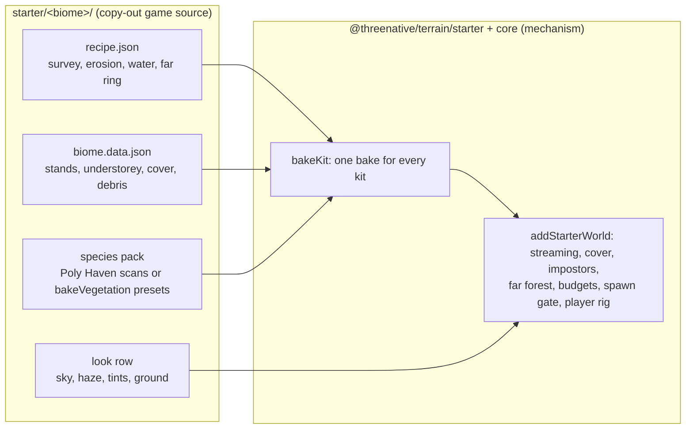

# PRD-892 — Every Strata kit bakes on the forest stack

**Status:** PARTIAL — Phase 1 boxes 1 and 3 landed; box 2 in progress (4 of the 8 named mechanisms moved)
**Priority:** P1 — the forest kit has the whole world-building stack (real survey, vegetation, ground cover, far forest, 60 FPS work, a playable scene). The other four kits have one boulder asset and no scene, so they cannot be revamped to the forest's level (all phases open).
**Complexity:** 8 (HIGH); risk override: the forest must not change while it moves onto the shared path, so the owner's visual-judge rule applies to every phase
**Owner:** ThreeNative maintainers
**Depends on:** PR #677 (`prd-584-forest-60fps`) merged into `develop`: the forest stack this PRD spreads lives only on that branch
**Epic:** Strata terrain hardening. Art acceptance per kit stays in [PRD-580](../PRD-580-strata-starter-kit-art-bar.md).

## Context

Owner, 2026-11-15: "should we create a base 'starter kit scaffold' with all performance optimizations
and etc done on the forest version? Then we create the other terrains? I want to be able to bake the
others with same level of details (realistic heighmap, vegetation, trees where applicable, etc)" and
"the goal is spreading all world building capabilities/generation/perfromance to the other kits so
we can revamp these as well".

Audit of `origin/prd-584-forest-60fps`, `packages/terrain/starter/`:

| Part | `forest/` (about 700 KB, 47 files) | `alpine/`, `coastal/`, `desert/`, `tundra/` (about 10 files each) |
| --- | --- | --- |
| Bake | Own 14.5 KB `bake.mjs`: survey, erosion, lake bed, creek, road, pad, far ring with a surveyed massif. It does not read `recipe.json`. | 227-byte `bake.mjs` calling `bakeKit` on `recipe.json`: survey, erosion, surfaces, scree |
| Real ground | Sprague Lake, USGS 3DEP; PRD-887 region rows swap in a real survey (Hainich, Oulanka, Val d'Orcia, Pacific Northwest) | Alpine is Longs Peak. Coastal, desert and tundra are all Colorado crops that do not match their biome. |
| Vegetation | Scanned trees, shrubs, ferns, flowers (`render/props/pack.ts`); forest-floor debris and cover from `bakeVegetation` (PRD-889) | One asset (`boulder`, or a fir stand on coastal) |
| Ground | Streamed ground, `ScatterField3D` cover, far collar and horizon (`render/ground/`) | Splat table only |
| Performance | Far-forest impostors, distant fir triangle cut (18–20 ms to about 15 ms on RTX 2080), residency budgets, spawn gate | `impostors: false`, `gpuScene: false` |
| Game | `ForestScene`, `FOREST_GAME`, player rig, diagnostics, benchmark views | "The kit ships no scene: the game writes one." |

So there are two kit paths. A fix or a performance win on the forest path does not reach the other
four, and copying the forest four times makes five paths to keep in step.

Related PRDs: [PRD-790](../P2/PRD-790-a-new-biome-is-a-data-row-and-the-world-streams-past-one-square.md)
(a biome is a data row, written against the preview before the forest moved into `starter/`),
[PRD-864](../P2/PRD-864-prop-and-collar-mechanisms-leave-the-strata-preview.md) (mechanisms leave the
preview), [PRD-889](../../../../../docs/PRDs/done/PRD-889-the-forest-floor-bakes-and-scatters-from-one-nature-package.md)
(forest-floor presets).

Unreal reference (re-checked 2026-11-15 in `~/projects/UnrealEngine`; borrow the data layout, never
the code): one spawner holds a list of foliage types and tiles the area,
`UE 5.8.3: Engine/Source/Runtime/Foliage/Public/ProceduralFoliageSpawner.h:27` (`TileSize`), `:42`
(`FoliageTypes`). Each type is data: `Engine/Source/Runtime/Foliage/Public/FoliageType.h:151`
(`Density`), `:240` (`GroundSlopeAngle`), `:244` (`Height`), `:375` (`BodyInstance`), `:450`
(`InitialSeedDensity`). Ground cover is per layer:
`Engine/Source/Runtime/Landscape/Classes/LandscapeGrassType.h:45` (`GrassDensity`), `:59`
(`StartCullDistance`), `:176` (`GrassVarieties`). The biome changes the type list, not the spawner.

## Solution

A few abstractions, not a fifth copy. The forest's biome-agnostic stack becomes the one kit path,
and a biome is the data it reads. The forest is then the first data set on that path, not a special case.

- **Mechanism moves to the package** (imported, not copied): the forest bake steps (lake bed, creek,
  road, pad, far ring and massif) become recipe steps that `bakeKit` runs. Streamed ground,
  `ScatterField3D` cover, far-forest impostors, budgets, spawn gate, player rig and diagnostics become
  options of `addStarterWorld`. General mechanisms go to core when PRD-864 already names them.
- **The look stays copy-out source** in each kit (`render/biomes.ts` row, `sky.ts`, `surface.json`, species pack):
  root rule "Never own the look".
- **Real ground per biome**: each kit's default survey becomes a real place of that biome, through
  the PRD-887 region rows (one row per kit, plus its far ring).
- **Vegetation source** (root `AGENTS.md`, owner 2026-11-15): Poly Haven CC0 scans first, then
  `@threenative/procedural-vegetation` presets. A species with neither becomes a new preset in that
  package.

- **The vegetation package already holds most of the four biomes** (checked 2026-11-15 on
  `origin/prd-584-forest-60fps`: 28 Arbor trees, 27 Arbor cover plants, 12 forest-kit cover and debris
  presets). Desert has `saguaro`, `joshua`, `creosote`, `agave`, `bunchgrass`; the cold kits have
  `blackspruce`, `tundragrass`, `tussock`, `blueberry`, `fireweed`. A krummholz or dwarf tree is a
  `form` patch on an existing preset, not a new species. Gaps: dwarf willow, marram grass, lichen.
  Lichen and moss read as ground, so they go in the splat table, not a preset. The forest-kit `rock`
  and `log` presets are named "mossy". Phase 2 checks that the kit material, not the preset, sets that look.

## Execution Phases

### Phase 1 — one kit path, forest unchanged

- [x] The forest bake runs as `bakeKit` recipe steps; the forest `bake.mjs` shrinks to the 227-byte form of the other kits. proof: forest bake output byte-identical before and after (`sha256sum` of `world/`), `pnpm exec vitest run packages/terrain/__tests__`
  Result 2026-11-15: `bakeKit` runs the forest from `recipe.json`'s `world` row (`src/kit-world.ts`); all 17 `world/` files and 86 art files sha256-identical to the PR #677 bake; terrain tests 628/628, typecheck exit 0. `bake.mjs` is 1 KB, not 227 B: one `bakeKit` call plus the kit's look and prop policy, which package code must not import (see Decisions).
- [ ] `addStarterWorld` carries the forest runtime (streamed ground, cover, impostors, far forest, spawn gate, player rig, diagnostics) as options; `ForestScene` calls it with the forest rows. proof: forest kit playtests green, `measure-steady-state-fps` within 3% of the PR #677 frame on RTX 2080, judge NEUTRAL on ground, edge, lake and overview
  In progress 2026-11-16 (1 of 8 mechanisms): the spawn gate left the kit. `createSpawnGate` is now
  `@threenative/terrain/starter` mechanism (`src/runtime/spawn-gate.ts`, `@requires` install line, bundled
  through the existing `starter` entry) and the forest's `scene.ts`/`sceneProps.ts` import it; the kit's own
  `spawnGate.ts` is gone. Proof: terrain 652/652 including 8 new cases in `spawn-gate.spec.ts`,
  `pnpm --filter @threenative/terrain typecheck` exit 0, and the scaffolded `minimal` game with the copied
  forest kit typechecks, builds and renders in WebGPU on the RTX 2080 (`capture.json`: nvidia/turing).
  ⚠️ The kit playtest's own assertions are red on this machine **with and without** the move, so this box's
  judge and FPS proof are still unrun: `KIT=forest test:kit` reports `timeToReadyMs` 23.7 s after the change
  and 20.6 s on the pre-change baseline, `maxViewGpuMs` 101 ms vs 71 ms, against a 15 s / 12 ms expectation,
  with an identical failure set otherwise — a cold, unsteady lane, not the change. The same playtest ran
  again after the collar/streamed-ground move and failed on the **same six assertion ids** as the
  pre-change baseline report (`/tmp/kit-playtest-base.json`, the before arm of that A/B): `enterMs`
  58.2 ms vs 52.3/53.2, `afterFirstFrameTaskMs` 2767 vs 2715/2769, `timeToReadyMs` 25.2 s vs
  20.6–23.7 s, `maxViewGpuMs` 89.97 vs 71.3–101.0, and the two harness rows that fail identically in
  both arms (`world` and `player.visible`); diagnostics 0 console/network errors, six captures written,
  `capture.json` nvidia/turing. Still no judge or FPS verdict: the outer two rows are the virtual-display
  lane the PRD refuses to call a frame-rate claim.
  In progress 2026-11-16 (3 of 8 named files, and the collar half of a fourth): the collar geometry and the
  streamed ground left the kit. `src/runtime/collar.ts` holds `collarMorph`, `createMorphedHeight`,
  `collarSeamGap`, `collarArithmeticHeight`, `collarDrawnHeight` and the three seam constants; its ring
  curve is an argument, so the kit's own `HORIZON_POWER`/`HORIZON_REACH` stay the kit's.
  `src/runtime/streamed-ground.ts` holds `addStreamedGround` as one options object (size, resolution, height,
  collar, curve, reach, stream, surface, follow, report), and refuses a world with no streamable grid by
  `TN_STARTER_GROUND_DATA`. `horizon.ts` keeps the surveyed collar, its colours and `createWorldHeight`;
  the kit's `world/streamedGround.ts` is gone and `scene.ts`/`terrain.ts` import the two package modules.
  Proof: the moved functions were compared against the kit's originals **before** deletion on a
  forest-shaped collar (2.1 km, 384 rings, 1.65 spread): 3/3 cases exact for 4000 drawn/arithmetic heights,
  600 morphed heights and the seam measures; then terrain 657/657 (5 new in `collar-geometry.spec.ts`,
  including the `TN_STARTER_GROUND_DATA` refusal), `pnpm --filter @threenative/terrain typecheck` exit 0,
  and the forest bake is **byte-identical to HEAD** (103 files, all 17 `world/` files) after a stash A/B on
  the same tree.
  In progress 2026-11-16 (4 of 8 named files): diagnostics moved. `src/runtime/diagnostics.ts` and
  `src/runtime/view-statistics.ts` now own the state factory `createDiagnosticsState(world)` (a blank
  world fails by `TN_STARTER_DIAGNOSTICS_DATA`), the view accounting and the per-world measurement; the
  kit's `sceneState.ts` spreads the factory with `WORLD` and adds its look values, and
  `scene.ts`/`sceneProps.ts` import the package. Two kit leaks were fixed on the way: `publish` keys the
  starter kit's four per-view slots to `facts.world` (it spelled `forest:river`/`forest:meadow-close`/…
  before) and leaves the preview-only `alpine:`/`desert:`/`tundra:` slots at their initial 0 — the preview
  keeps its own copy under `examples/strata-terrain-preview/src` — and `observeFrame` loses its world
  argument, which answered only a per-world rendered-frame map nothing published. Proof:
  `diagnostics-state.spec.ts` (4 cases: factory defaults and blank refusal, the first-GPU-frame latch,
  world-keyed view slots, a left scene stops attributing windows), terrain **661/661**, typecheck exit 0,
  publint green; the moved file's three pre-existing complexity offenders are recorded in the ratchet
  baseline (83 -> 86) rather than hidden. Remaining: prop world and player rig, then `ForestScene`
  composes every mechanism for the forest rows.
- [x] A kit that names a mechanism option without its data (for example cover with no cover rows) fails with a named code. proof: a `packages/terrain/__tests__` spec per option
  Result 2026-11-16: four codes, each raised where the option's data is joined: `TN_STARTER_WATER_DATA` (`water` over a bake with no `water.json`), `TN_STARTER_SKY_DATA` (`lighting.sky` resolving to no file), `TN_STARTER_COLLIDER_DATA` (a `colliders` row for an asset the world places nowhere — the silent one, the player walked through it), `TN_STARTER_EDIT_DATA` (ID edits over a bake with no placement sidecar), and `TN_STARTER_WORLD_DATA` on the world's own files. `kit-runtime.spec.ts` runs one case per option for all four kits: 16 red without the change, 112 green with it; terrain 644/644, `pnpm --filter @threenative/terrain typecheck` exit 0. The codes for the mechanisms Phase 1 box 2 moves in (cover, far forest, spawn gate, player rig) land with that move on the same shape.

### Phase 2 — four biomes as data

- [ ] Alpine: Longs Peak survey and far ring; `spruce`, `scotspine` and `blackspruce` stands with a krummholz form patch at the tree line, `tundragrass`, `tussock`, `fireweed`, `blueberry`, `rock` scree. proof: `KIT=alpine pnpm --filter strata-terrain-preview test:kit`, kit playtest from spawn
- [ ] Desert: a real desert survey replaces the Colorado crop; `saguaro`, `joshua` and `acacia` stands, `creosote`, `agave`, `thornbush`, `bunchgrass`, `drygrass`, `marigold` cover, `branch`, `twig` and `rock` debris with a dry material. proof: `KIT=desert pnpm --filter strata-terrain-preview test:kit`, kit playtest from spawn
- [ ] Tundra: a real tundra survey replaces the Colorado crop; `blackspruce` at the taiga edge, `birch` with a dwarf form patch, `tundragrass`, `tussock`, `blueberry`, `reeds`, `rock` erratics, kettle ponds; a new dwarf-willow preset. proof: `KIT=tundra pnpm --filter strata-terrain-preview test:kit`, kit playtest from spawn
- [ ] Coastal: a real coast survey replaces the Colorado crop; `scotspine` or `stonepine` stands (or `douglasfir`, `redcedar`, `salal`, `swordfern` on a Pacific coast), `drygrass` dune cover, `reeds`, `log` driftwood, `rock`; a new marram-grass preset. proof: `KIT=coastal pnpm --filter strata-terrain-preview test:kit`, kit playtest from spawn

### Phase 3 — the revamp holds

- [ ] Every kit holds 60 FPS on web at its spawn and overview views, with no `TN_FRAME_BUDGET` or `TN_SCENE_WARNING`. proof: `measure-steady-state-fps` per kit, RTX 2080, headed WebGPU, `adapter.info` checked

## Acceptance criteria

- [ ] AC-1: All five kits bake through `bakeKit` and run through `addStarterWorld`; no kit holds its own bake or streaming code. proof: `rg -l "bakeKit|addStarterWorld" packages/terrain/starter` lists all five, and no kit file defines a streaming loop
- [ ] AC-2: A sixth biome needs only data files in its kit folder, with no package edit. proof: a test kit with recipe, biome rows, species pack and look row bakes and streams in `packages/terrain/__tests__`
- [ ] AC-3: The forest looks and runs the same as on PR #677 (judge NEUTRAL or better, FPS within 3%). proof: judge verdict and FPS readings on the PR
- [ ] AC-4: Each of the four revamped kits reaches the PRD-580 rubric. proof: PRD-580 judge scores on the PR

## Decisions

- 2026-11-15 (owner): "must add instructions on CLAUDE.md/AGENTS.md how to create a new environment with this scaffold". The guide is `docs/authoring/new-environment.md` (ships in the package), linked from the root and terrain `AGENTS.md`, the package README, the forest README and the generated game's terrain reference. The forest kit's world name is now one `WORLD` constant (`render/worldNames.ts`) instead of ten literals. The guide follows each later phase.

- 2026-11-15 (agent): a streamed-world kit passes its look (palette, ground maps, canopy crowns) and prop policy to `bakeKit` as `look`; the package does not import kit source. The canopy painter and `skyVisibility` are mechanism and moved into the package. The forest `recipe.json` now holds the real bake's surfaces (dirt rule, pad paint); its old moss rule fed only the world.glb cook fixture, whose `surface.json` dirt thresholds now match the real splat.

- 2026-11-15 (agent proposed, owner confirmed the same day): one shared kit path plus biome data rows, not a copied forest scaffold. Reason: a copy gives five paths, and each later performance win would need five ports. The PRD-887 region rows already show that a biome works as data.
- 2026-11-16 (agent): this PRD covers the starter kits under `packages/terrain/starter/`. The preview-side part of PRD-790 (biome branches in `examples/strata-terrain-preview/src`) has one branch left and stays in PRD-790. Its streaming past one square also stays there.

- 2026-11-16 (agent): **the forest does not have the world format `addStarterWorld` loads, so "ForestScene calls it" cannot be a call swap.** Evidence from the kit's own bake: `world/forest.world.json` is `{"version":1,"extent":…,"terrain":{"layers":…}}`, 153 bytes — no `cells`, no `assets`, no `placements`, no heightmap. The forest's ground is an authored height grid (`world/forest.json`, 6 MB), its splat, its surveyed collar and a prop package of buckets, streamed by `propWorld.ts` through `WorldCells`; `addStarterWorld` loads a cell/placement package (`world.json` + `placements.bin` + `heightmap.u16`) and draws terrain with `TerrainTiles`. Teaching the package the streamed format is a second world format (closed outranking rule); re-baking the forest to the cell format changes what reaches the screen (this PRD's first constraint). The seam that already exists is `IWorldCellsLoadOptions.terrain?: … | false` — "the caller owns terrain geometry and collision". So the mechanisms land as package options/functions that `addStarterWorld` offers for packaged worlds and an authored-ground kit composes with `terrain: false`; the forest and the Phase 2 kits run one implementation of each mechanism without a second world format. The sentence "ForestScene calls it with the forest rows" should then read "ForestScene composes the same options with the forest rows" — proposed, not changed here.

- 2026-11-16 (agent): **two of the eight named files are look, not mechanism, and must not move.** Read before cutting, with the two questions in the root `AGENTS.md`:

  | file | verdict | why |
  | --- | --- | --- |
  | `spawnGate.ts` | **moved** (`src/runtime/spawn-gate.ts`) | no appearance, no data of its own; takes progress/witness/released from the game |
  | `world/streamedGround.ts` (139) | **moved** (`src/runtime/streamed-ground.ts`) | `TerrainTiles`, admission budget, `warmUnculled`, seam measurement; its inputs are a height function, the collar, the surface material and uniforms |
  | collar part of `render/ground/horizon.ts` | **moved** (`src/runtime/collar.ts`) | `collarMorph`, `createMorphedHeight`, `collarSeamGap`, `collarArithmeticHeight`, `collarDrawnHeight` are geometry/measurement and moved; `createHorizonCollar`, `collarColors`, `createWorldHeight`/`cubicAt`/`collarHeight` stay — the drawn collar, its palette and the surveyed far ring are the kit's |
  | `render/props/propWorld.ts` (719) | **split, cheap** | reads only three kit modules: `FAR_FOREST_IMPOSTOR`+`FAR_FOREST_LAYER` (two constants), `standShaded` (one material function) and a progress type — so the residency/impostor/budget machinery moves with those three handed in; the species table, roles and materials it draws stay |
  | `playerRig.ts` (223) | **split** | the capsule, clip state machine and follow camera move; `orbitCamera.ts` constants and `sightLine` against the prop pack stay |
  | `diagnostics.ts` (1021) | **moved** (`src/runtime/diagnostics.ts` + `src/runtime/view-statistics.ts`) | it owned the state shape it exports, and its only kit imports were the `WorldName` type and `WORLD`; the world is now a factory argument and `publish` keys its view slots to `facts.world`, while the game keeps adding its own look values to the state |
  | `render/props/prepared.ts` (225) | **stays** | it maps authored material names onto **this game's** prop roles (`pine`, `bark`, `impostor`), decides triplanar-vs-UV for this game's rock surface and writes the sway attribute this game's wind reads |
  | `render/props/farForest.ts` (94) | **stays** | the rule already lives in the package (`farForestPlacements`); what is left is which worlds plant a collar, the layer name and the impostor gate — game policy |

  Net after the fourth move: 4 moved (spawn gate, streamed ground, the collar geometry, diagnostics), 2 stay
  (`prepared.ts`, `farForest.ts`), 2 split (`propWorld.ts`, `playerRig.ts`). The box's own proof (judge
  NEUTRAL, FPS within 3%) is unchanged.

- 2026-11-16 (agent): the diagnostics move surfaced two kit leaks that were fixed rather than carried into
  the package: a hard-coded `forest:` view prefix in `publish` and a per-world rendered-frame map that only
  the preview used. The first is now `facts.world`, so a copied kit reports its own view slots with no
  package edit; the second is gone from the package (the preview keeps its copy under
  `examples/strata-terrain-preview/src`, per the decision above). The state factory refuses a blank world
  with `TN_STARTER_DIAGNOSTICS_DATA`, the same named-code shape as the other starter options.

- 2026-11-16 (agent): the collar morph and the streamed ground are exported from
  `@threenative/terrain/starter`, not the headless root: the morph builds a tile material node and reads a
  `UniformNode`, which the package's own rule keeps out of the root. The ring curve is an argument
  (`{ power, reach }`) rather than a package constant, because the kit builds the collar and its survey
  decides how far the rings reach; a hard-coded curve made the moved functions disagree with the kit's
  originals on a second collar (caught by the pre-deletion equivalence run).

- 2026-11-16 (agent): **Phase 2's own proof command was red on `develop`.** `KIT=alpine pnpm --filter strata-terrain-preview test:kit` wrote `src/terrain/composition.ts` but injected `import { edits } from "../../composition.js"` into `src/terrain/alpine/world.ts`, which resolves to `src/composition.ts`; the scaffolded game failed with `TS2307: Cannot find module '../../composition.js'` before it drew a frame. One directory off, since PR #677 wrote both lines. Fixed to `"../composition.js"`; `KIT=alpine` now typechecks, bakes, builds and renders to the playtest on this machine. Nothing had been checking the four data kits' proof. `KIT=forest … test:kit` measured `timeToReadyMs` 22.3 s and `maxViewGpuMs` 76.8 ms on a second, warm run (cold: 20.6 s / 71.3 ms; against 15 s / 12 ms expectations), on the private-Xvfb capture display the runner uses, with the same failure set before and after the spawn-gate move. The playtest runner refuses a frame-rate claim from a virtual display by design (`--allow-virtual-display` is the explicit opt-in), so the box-2 FPS and judge lanes need a real, foreground display — the owner's screen — not a warmer cache.
