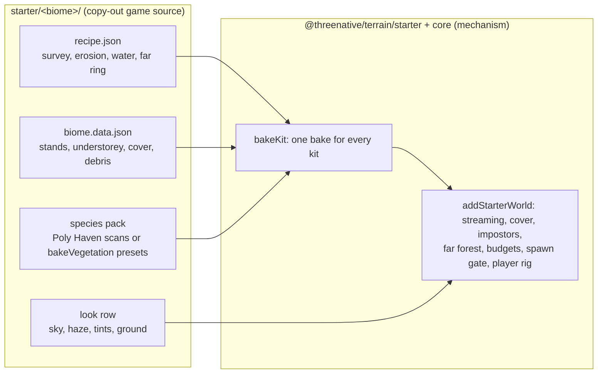

# PRD-892 — Every Strata kit bakes on the forest stack

**Status:** PARTIAL — Phase 1 boxes 1 and 3 landed; box 2 in progress (6 of the 8 named mechanisms moved, the other 2 stay as game look)
**Priority:** P1 — the forest kit has the whole world-building stack (real survey, vegetation, ground cover, far forest, 60 FPS work, a playable scene). The other four kits have one boulder asset and no scene, so they cannot be revamped to the forest's level (all phases open).
**Complexity:** 8 (HIGH); risk override: the forest must not change while it moves onto the shared path, so the owner's visual-judge rule applies to every phase
**Owner:** ThreeNative maintainers
**Depends on:** PR #677 (`prd-584-forest-60fps`) merged into `develop`: the forest stack this PRD spreads lives only on that branch
**Epic:** Strata terrain hardening. Art acceptance per kit stays in [PRD-580](../PRD-580-strata-starter-kit-art-bar.md).

## Context

Owner, 2026-11-15: "should we create a base 'starter kit scaffold' with all performance optimizations
and etc done on the forest version? Then we create the other terrains? I want to be able to bake the
others with same level of details (realistic heighmap, vegetation, trees where applicable, etc)" and
"the goal is spreading all world building capabilities/generation/perfromance to the other kits so
we can revamp these as well".

Audit of `origin/prd-584-forest-60fps`, `packages/terrain/starter/`:

| Part | `forest/` (about 700 KB, 47 files) | `alpine/`, `coastal/`, `desert/`, `tundra/` (about 10 files each) |
| --- | --- | --- |
| Bake | Own 14.5 KB `bake.mjs`: survey, erosion, lake bed, creek, road, pad, far ring with a surveyed massif. It does not read `recipe.json`. | 227-byte `bake.mjs` calling `bakeKit` on `recipe.json`: survey, erosion, surfaces, scree |
| Real ground | Sprague Lake, USGS 3DEP; PRD-887 region rows swap in a real survey (Hainich, Oulanka, Val d'Orcia, Pacific Northwest) | Alpine is Longs Peak. Coastal, desert and tundra are all Colorado crops that do not match their biome. |
| Vegetation | Scanned trees, shrubs, ferns, flowers (`render/props/pack.ts`); forest-floor debris and cover from `bakeVegetation` (PRD-889) | One asset (`boulder`, or a fir stand on coastal) |
| Ground | Streamed ground, `ScatterField3D` cover, far collar and horizon (`render/ground/`) | Splat table only |
| Performance | Far-forest impostors, distant fir triangle cut (18–20 ms to about 15 ms on RTX 2080), residency budgets, spawn gate | `impostors: false`, `gpuScene: false` |
| Game | `ForestScene`, `FOREST_GAME`, player rig, diagnostics, benchmark views | "The kit ships no scene: the game writes one." |

So there are two kit paths. A fix or a performance win on the forest path does not reach the other
four, and copying the forest four times makes five paths to keep in step.

Related PRDs: [PRD-790](../P2/PRD-790-a-new-biome-is-a-data-row-and-the-world-streams-past-one-square.md)
(a biome is a data row, written against the preview before the forest moved into `starter/`),
[PRD-864](../P2/PRD-864-prop-and-collar-mechanisms-leave-the-strata-preview.md) (mechanisms leave the
preview), [PRD-889](../../../../../docs/PRDs/done/PRD-889-the-forest-floor-bakes-and-scatters-from-one-nature-package.md)
(forest-floor presets).

Unreal reference (re-checked 2026-11-15 in `~/projects/UnrealEngine`; borrow the data layout, never
the code): one spawner holds a list of foliage types and tiles the area,
`UE 5.8.3: Engine/Source/Runtime/Foliage/Public/ProceduralFoliageSpawner.h:27` (`TileSize`), `:42`
(`FoliageTypes`). Each type is data: `Engine/Source/Runtime/Foliage/Public/FoliageType.h:151`
(`Density`), `:240` (`GroundSlopeAngle`), `:244` (`Height`), `:375` (`BodyInstance`), `:450`
(`InitialSeedDensity`). Ground cover is per layer:
`Engine/Source/Runtime/Landscape/Classes/LandscapeGrassType.h:45` (`GrassDensity`), `:59`
(`StartCullDistance`), `:176` (`GrassVarieties`). The biome changes the type list, not the spawner.

## Solution

A few abstractions, not a fifth copy. The forest's biome-agnostic stack becomes the one kit path,
and a biome is the data it reads. The forest is then the first data set on that path, not a special case.

- **Mechanism moves to the package** (imported, not copied): the forest bake steps (lake bed, creek,
  road, pad, far ring and massif) become recipe steps that `bakeKit` runs. Streamed ground,
  `ScatterField3D` cover, far-forest impostors, budgets, spawn gate, player rig and diagnostics become
  options of `addStarterWorld`. General mechanisms go to core when PRD-864 already names them.
- **The look stays copy-out source** in each kit (`render/biomes.ts` row, `sky.ts`, `surface.json`, species pack):
  root rule "Never own the look".
- **Real ground per biome**: each kit's default survey becomes a real place of that biome, through
  the PRD-887 region rows (one row per kit, plus its far ring).
- **Vegetation source** (root `AGENTS.md`, owner 2026-11-15): Poly Haven CC0 scans first, then
  `@threenative/procedural-environment` presets. A species with neither becomes a new preset in that
  package.

- **The vegetation package already holds most of the four biomes** (checked 2026-11-15 on
  `origin/prd-584-forest-60fps`: 28 Arbor trees, 27 Arbor cover plants, 12 forest-kit cover and debris
  presets). Desert has `saguaro`, `joshua`, `creosote`, `agave`, `bunchgrass`; the cold kits have
  `blackspruce`, `tundragrass`, `tussock`, `blueberry`, `fireweed`. A krummholz or dwarf tree is a
  `form` patch on an existing preset, not a new species. Gaps: dwarf willow, marram grass, lichen.
  Lichen and moss read as ground, so they go in the splat table, not a preset. The forest-kit `rock`
  and `log` presets are named "mossy". Phase 2 checks that the kit material, not the preset, sets that look.

## Execution Phases

### Phase 1 — one kit path, forest unchanged

- [x] The forest bake runs as `bakeKit` recipe steps; the forest `bake.mjs` shrinks to the 227-byte form of the other kits. proof: forest bake output byte-identical before and after (`sha256sum` of `world/`), `pnpm exec vitest run packages/terrain/__tests__`
  Result 2026-11-15: `bakeKit` runs the forest from `recipe.json`'s `world` row (`src/kit-world.ts`); all 17 `world/` files and 86 art files sha256-identical to the PR #677 bake; terrain tests 628/628, typecheck exit 0. `bake.mjs` is 1 KB, not 227 B: one `bakeKit` call plus the kit's look and prop policy, which package code must not import (see Decisions).
- [ ] `addStarterWorld` carries the forest runtime (streamed ground, cover, impostors, far forest, spawn gate, player rig, diagnostics) as options; `ForestScene` calls it with the forest rows. proof: forest kit playtests green, `measure-steady-state-fps` within 3% of the PR #677 frame on RTX 2080, judge NEUTRAL on ground, edge, lake and overview
  In progress 2026-11-16 (1 of 8 mechanisms): the spawn gate left the kit. `createSpawnGate` is now
  `@threenative/terrain/starter` mechanism (`src/runtime/spawn-gate.ts`, `@requires` install line, bundled
  through the existing `starter` entry) and the forest's `scene.ts`/`sceneProps.ts` import it; the kit's own
  `spawnGate.ts` is gone. Proof: terrain 652/652 including 8 new cases in `spawn-gate.spec.ts`,
  `pnpm --filter @threenative/terrain typecheck` exit 0, and the scaffolded `minimal` game with the copied
  forest kit typechecks, builds and renders in WebGPU on the RTX 2080 (`capture.json`: nvidia/turing).
  ⚠️ The kit playtest's own assertions are red on this machine **with and without** the move, so this box's
  judge and FPS proof are still unrun: `KIT=forest test:kit` reports `timeToReadyMs` 23.7 s after the change
  and 20.6 s on the pre-change baseline, `maxViewGpuMs` 101 ms vs 71 ms, against a 15 s / 12 ms expectation,
  with an identical failure set otherwise — a cold, unsteady lane, not the change. The same playtest ran
  again after the collar/streamed-ground move and failed on the **same six assertion ids** as the
  pre-change baseline report (`/tmp/kit-playtest-base.json`, the before arm of that A/B): `enterMs`
  58.2 ms vs 52.3/53.2, `afterFirstFrameTaskMs` 2767 vs 2715/2769, `timeToReadyMs` 25.2 s vs
  20.6–23.7 s, `maxViewGpuMs` 89.97 vs 71.3–101.0, and the two harness rows that fail identically in
  both arms (`world` and `player.visible`); diagnostics 0 console/network errors, six captures written,
  `capture.json` nvidia/turing. Still no judge or FPS verdict: the outer two rows are the virtual-display
  lane the PRD refuses to call a frame-rate claim.
  In progress 2026-11-16 (3 of 8 named files, and the collar half of a fourth): the collar geometry and the
  streamed ground left the kit. `src/runtime/collar.ts` holds `collarMorph`, `createMorphedHeight`,
  `collarSeamGap`, `collarArithmeticHeight`, `collarDrawnHeight` and the three seam constants; its ring
  curve is an argument, so the kit's own `HORIZON_POWER`/`HORIZON_REACH` stay the kit's.
  `src/runtime/streamed-ground.ts` holds `addStreamedGround` as one options object (size, resolution, height,
  collar, curve, reach, stream, surface, follow, report), and refuses a world with no streamable grid by
  `TN_STARTER_GROUND_DATA`. `horizon.ts` keeps the surveyed collar, its colours and `createWorldHeight`;
  the kit's `world/streamedGround.ts` is gone and `scene.ts`/`terrain.ts` import the two package modules.
  Proof: the moved functions were compared against the kit's originals **before** deletion on a
  forest-shaped collar (2.1 km, 384 rings, 1.65 spread): 3/3 cases exact for 4000 drawn/arithmetic heights,
  600 morphed heights and the seam measures; then terrain 657/657 (5 new in `collar-geometry.spec.ts`,
  including the `TN_STARTER_GROUND_DATA` refusal), `pnpm --filter @threenative/terrain typecheck` exit 0,
  and the forest bake is **byte-identical to HEAD** (103 files, all 17 `world/` files) after a stash A/B on
  the same tree.
  In progress 2026-11-16 (4 of 8 named files): diagnostics moved. `src/runtime/diagnostics.ts` and
  `src/runtime/view-statistics.ts` now own the state factory `createDiagnosticsState(world)` (a blank
  world fails by `TN_STARTER_DIAGNOSTICS_DATA`), the view accounting and the per-world measurement; the
  kit's `sceneState.ts` spreads the factory with `WORLD` and adds its look values, and
  `scene.ts`/`sceneProps.ts` import the package. Two kit leaks were fixed on the way: `publish` keys the
  starter kit's four per-view slots to `facts.world` (it spelled `forest:river`/`forest:meadow-close`/…
  before) and leaves the preview-only `alpine:`/`desert:`/`tundra:` slots at their initial 0 — the preview
  keeps its own copy under `examples/strata-terrain-preview/src` — and `observeFrame` loses its world
  argument, which answered only a per-world rendered-frame map nothing published. Proof:
  `diagnostics-state.spec.ts` (4 cases: factory defaults and blank refusal, the first-GPU-frame latch,
  world-keyed view slots, a left scene stops attributing windows), terrain **661/661**, typecheck exit 0,
  publint green; the moved file's three pre-existing complexity offenders are recorded in the ratchet
  baseline (83 -> 86) rather than hidden. The kit playtest ran again after this move and failed on the
  same six assertion ids as the baseline, in the same lane (`enterMs` 61.8 ms, `afterFirstFrameTaskMs`
  2614, `timeToReadyMs` 22.8 s, `maxViewGpuMs` 88.34, plus the two harness rows), while
  `measuredViewCount` and `measuredGpuViewCount` both read **5**: the moved diagnostics still publishes
  every view's closed window in the real game.
  In progress 2026-11-16 (5 of 8 named files): the player rig moved. `src/runtime/player-rig.ts` owns the
  capsule, the mannequin mount, the clip state machine, the pointer look and the follow-camera wiring; the
  kit keeps what decides how it looks and how this game plays: its orbit camera and framing constants, its
  wall probe and sight line, the clip names, the gait speeds and the camera offset. The package derives the
  figure's feet from the capsule (1 m tall, 0.35 m radius, sunk 1 cm) and `pace` from the gait row, so a
  copied kit cannot disagree with its own collider. Proof: terrain 661/661, typecheck exit 0, build +
  publint green. The runtime proof is the kit playtest, run after the move: the same six failing ids as
  the baseline (`enterMs` 59.3 ms, `afterFirstFrameTaskMs` 2719, `timeToReadyMs` 20.6 s, `maxViewGpuMs`
  87.28, plus the two harness rows), while the player walked 54.4 m in the travel leg, stayed grounded
  and the contact error was 6.1e-05 m — the rig the package builds is the rig the solver moves.
  In progress 2026-11-16 (the prop world's first half): the pose mechanism left the kit.
  `src/runtime/prop-pose.ts` owns `preparePose` (ground snap, burial, flat-footprint sink, crag base
  ring), `withAuthoredPose`, `propKey`, `propRatio`, `authoredQuaternion` and the editor's prepare/write/
  read pair; the forest's `props.ts` keeps the data that decides which assets bury, sink a footprint or
  measure a base ring (`GROUND_RULES`) and its own variant picker. Proof: `prop-pose.spec.ts` (6 cases:
  model key and shape suffix, authored pose, ground snap with the authored offset, grounding-off
  clearance, fail-closed missing ground, boulder vs crag sink), terrain **667/667**, typecheck exit 0,
  build + publint green. The moved pose's single pre-existing complexity offender is recorded in the
  ratchet baseline (86 -> 87). The kit playtest after the move kept the **exact** contact error of the
  previous run (6.14252957689132e-05 m) and the same six failing ids (`enterMs` 58.5 ms,
  `afterFirstFrameTaskMs` 2735, `timeToReadyMs` 21.8 s, `maxViewGpuMs` 80.87, plus the two harness
  rows): the grounded poses are the ones the solver and the playtest already measured.
  In progress 2026-11-16 (6 of 8 named files; the prop world is whole): `streamProps` and its loaders
  left the kit. `src/runtime/prop-world.ts` owns the container loop (decode the bake's buckets, ground
  every record, compile live placements, build one asset table per bucket), the `WorldCells` wiring
  (admission budgets, reach rings, shadows, terminal impostors), `loadPropPackage`/`loadCanopy`/
  `loadSky`, `propCounts` and `invalidatePropShadows`; the pose steps stay in `prop-pose.ts`. The forest
  keeps the rows: `variantFor`, `streamedReach`, `streamedBucket`, `NO_SHADOW_ASSETS`, `LOD_BANDS`/
  `LOD_STEPS`, `GROUND_RULES`, the spruce gate and `standShaded`, handed in as `variantOf`, `reachOf`,
  `bucketOf`, `lodOf`, `gateAsset`/`gateFarDistance`, `shadeStand` and `shadowsOf`, so a new biome
  changes rows, not the package. `propWorld.ts` is a wrapper and `propProgress.ts` re-exports the
  package type. Proof: terrain **667/667**, typecheck exit 0, build + publint green; the moved container
  loop's two pre-existing complexity offenders are recorded in the ratchet baseline (87 -> 89). The kit
  playtest after the move kept the **identical** travel (54.43283981389183 m), contact error
  (6.14252957689132e-05 m) and view measurements (5/5), failing on the same six ids as the baseline
  (`enterMs` 58.3 ms, `afterFirstFrameTaskMs` 2735, `timeToReadyMs` 23.1 s, `maxViewGpuMs` 72.25, plus
  the two harness rows). With `prepared.ts` (the prepared CC0 art) and `farForest.ts` (the far-forest
  look) staying as game source, every mechanism this box names is package code and `ForestScene`
  composes them; what remains for the box is its own proof — judge NEUTRAL and FPS within 3% of the
  PR #677 frame, which needs a real display this lane does not have.
- [x] A kit that names a mechanism option without its data (for example cover with no cover rows) fails with a named code. proof: a `packages/terrain/__tests__` spec per option
  Result 2026-11-16: four codes, each raised where the option's data is joined: `TN_STARTER_WATER_DATA` (`water` over a bake with no `water.json`), `TN_STARTER_SKY_DATA` (`lighting.sky` resolving to no file), `TN_STARTER_COLLIDER_DATA` (a `colliders` row for an asset the world places nowhere — the silent one, the player walked through it), `TN_STARTER_EDIT_DATA` (ID edits over a bake with no placement sidecar), and `TN_STARTER_WORLD_DATA` on the world's own files. `kit-runtime.spec.ts` runs one case per option for all four kits: 16 red without the change, 112 green with it; terrain 644/644, `pnpm --filter @threenative/terrain typecheck` exit 0. The codes for the mechanisms Phase 1 box 2 moves in (cover, far forest, spawn gate, player rig) land with that move on the same shape.

### Phase 2 — four biomes as data

- [ ] Alpine: Longs Peak survey and far ring; `spruce`, `scotspine` and `blackspruce` stands with a krummholz form patch at the tree line, `tundragrass`, `tussock`, `fireweed`, `blueberry`, `rock` scree. proof: `KIT=alpine pnpm --filter strata-terrain-preview test:kit`, kit playtest from spawn
  In progress 2026-11-16 (vegetation rows): `starter/alpine/biome.data.json` now carries the box's
  rows — `spruce`, `scotspine` and `blackspruce` stands (slope/height bands, stand shares, far rings at
  1.5–1.9 km) and `tundragrass`, `tussock`, `fireweed` and `blueberry` cover below the treeline, with
  `rock` added to the species list. Every named species is an installed
  `@threenative/procedural-environment` preset (`scotspine`, `blackspruce`, `tundragrass`, `fireweed`,
  `blueberry`), so the cook grows them instead of filtering them. Proof: new
  `alpine-biome.spec.ts` (3 cases: the box's species list against the installed presets, bands and
  reaches, and a closed-schema refusal on an unknown `krummholz` field), `terrain-mcp.spec.ts` +
  `arbor-species.spec.ts` 166/166 after the rows landed. Two gaps are now explicit: **krummholz is a
  preset form, not a biome field** (the schema has no form row; it needs the props module's species
  mapping, and the box's "form patch at the tree line" is not reachable from `biome.data.json` alone),
  and the **far ring needs a real alpine survey asset**: `kit-world` requires `farRing.survey`, and
  the starter assets hold only `forest` and `forest-horizon` (USGS 3DEP Sprague Lake); an alpine ring
  needs a Longs Peak surround survey committed like it, not a fabricated continuation. Next: that
  survey asset, the kit's `world` row and `look` (palette/ground maps/canopy/props) and the streamed
  bake, then the scene the kit playtest runs.
  In progress 2026-11-16 (the world row): `recipe.json` now carries the streamed bake's top-level
  `world` row — name `alpine`, a rock base with the kit's own `dirt` and `snow` layers and its
  roughness, and 16 art paths. The far ring is deliberately absent until its survey asset exists
  (the row's `farRing.survey` is required by `kit-world`). Proof: new `alpine-world.spec.ts` (3
  cases: the name and ground table, every art entry present in `starter-assets`, and — when the row
  grows a ring — that ring's survey `.json` and `.bin` resolve), 3/3 green. The legacy bake is
  untouched: `bakeKit` without a `look` never reads `recipe.world`, so the current alpine playtest
  keeps its package. The Phase 1 golden table follows the new rows: its alpine row moves from
  `{boulder 1082, mountain 231, scree 2285}` to the new seven-species bake (`{boulder 969, grass
  37141, mountain 234, sapling 710, scree 2046, scrub 11193, spruce 389}`) and its placement digest,
  with heights unchanged; terrain **673/673** (57 files) green afterwards. The survey is unblocked:
  the Mapterhorn tile host answers (200 on `attribution.json`) and this machine's tile cache already
  holds zoom-16 tiles under `~/.cache/threenative/mapterhorn`, so the Longs Peak surround survey can
  be cut and committed like `forest-horizon`. Done: `survey/alpine-horizon.{json,bin}` is cut from the
  real tiles — 5000 m square, 129², zoom 11 at 29.17 m/px, measured 3098.2..4342.0 m (Longs Peak's
  summit is 4346 m), int16 decimetres on offset 3098, sha256 `4121f434…`, Mapterhorn/USGS provenance —
  and `world.farRing` now names it (alpine backdrop, `longs` massif). `alpine-world.spec.ts` also pins
  the pair's length and sha256 (3/3). The look landed and the kit bakes streamed: `bake.mjs` now
  passes the alpine palette, ground maps, canopy rows (`spruce 6`, `scotspine 5`, `blackspruce 4.5`)
  and prop policy, so `bakeKit` takes the streamed branch — **52682 placements** (50636 shadowed,
  2046 unshadowed scree), 16 art entries, 2.4 s, writing `alpine.json`, `alpine.world.json`,
  `alpine.splat.rgba8`, `alpine.canopy.bin`, `horizon.json` and both prop buckets. The surveyed
  `longs` massif is in the ring: `top: [2500, 3000]` clears this relief's host base — the earlier
  `[1500, 2100]` band sat under it, because the backdrop's 900 m relief lifts the far ring's base well
  above the survey's own 1244 m relative range, and `placeMassif` refused it ("top under its foot at
  1128 m"). With the band fixed the bake writes the mountain's grid into `horizon.json`
  (`{"origin","spacing","columns","rows","offset","heights"}`, 2,145,048 heights), and
  `alpine-world.spec.ts` + `kit-bake.spec.ts` are 12/12.
  In progress 2026-11-16 (the runtime, first cut): `starter/alpine/` is now a **source kit on the
  forest's scene**, per `docs/authoring/new-environment.md` — the 32 files the kit lacked were copied
  from `starter/forest` (`scene.ts`, `sceneProps.ts`, `sceneState.ts`, `worlds.ts`, `playerRig.ts`,
  `render/**`, `world/walkBand.ts`, `world/water.ts`) and renamed (`WORLD` `alpine`, `AlpineScene`,
  `ALPINE_GAME`, `alpineAssets`). The kit typechecks standalone (0 errors, `tsc` over
  `starter/alpine/**/*.ts`), and its own `bake.mjs` now runs the streamed branch for real: **52682
  placements** (`horizon:true 389`, `local:true 3249`, `local:false 49044`) — the horizon bucket exists
  because the forest prop policy's 900 m reach replaced the alpine one — 36 art entries, 1.5 s, writing
  `alpine.json`, `alpine.world.json`, `alpine.layers.json`, `alpine.splat.rgba8`, `alpine.canopy.bin`,
  `alpine.sky.bin`, `horizon.json`, `alpine.props.json` and three buckets. Two consolidations rode
  along: the fix to `bake.mjs`'s look import (the streamed bake takes the prop module, not a `props`
  export) and `CANOPY_CROWN` now lives only in `render/ground/terrain.ts` (the duplicate
  `render/ground/canopy.ts` is gone). `alpine.world.art` is the union of the alpine and forest art
  lists, because the copied prop pack asks for the forest scans until the alpine species pack lands.
  Not done: the species pack is still the forest's (`spruce` stands drawn from broadleaf scans, no
  `tundra`/`krumhholz` rows), the look row is still the forest's values, the kit is not yet the harness's
  `source` scene, and the playtest is unrun. The legacy cell-package pins drop alpine (it no
  longer writes `world.json`) and `kit-bake.spec.ts` gains a streamed describe for it that runs the
  kit's own `bake.mjs` in the kit folder: the bundle's seven files are non-empty, `heights` and
  `colors` are one row a vertex, three buckets sum to **52682 placements**, and two bakes are
  byte-identical. Terrain is **671/672**; the one red is `kit-assets.spec.ts`'s committed manifest
  digest (fresh pack `62ac…`, committed `3617…`), a release step this PR still owes: the committed
  archive predates `survey/alpine-horizon.*`, so it needs a hand-bumped `version` in
  `starter-assets.json`, `node scripts/pack-starter-assets.mjs <out> --write-manifest`, and the tarball
  uploaded to its new release tag. Next: the alpine species pack and look row, the harness
  source-scene wiring, then `KIT=alpine test:kit`.
  In progress 2026-11-16 (why the rows do not reach the bake yet): `biome.data.json`'s `stream` decides
  where its rows go, and the streamed bake reads only the ordered stream's placements — `bakeBiome`
  returns `scatter: null` for the seeded stream by design (`src/kit-world.ts:312`). Flipping alpine to
  `"seeded"` therefore failed closed with `the biome file places nothing` (verified, then reverted), and
  the baked ids stay the Phase-1 ordered stream's own (`boulder`, `grass`, `mountain`, `sapling`,
  `scree`, `scrub`, `spruce`), not the box's `tundragrass`/`tussock`/`fireweed`/`blueberry`/
  `scotspine`/`blackspruce`. Two ways out, both engine work: teach the ordered stream the rows, or let
  the streamed writer bucket the seeded package's placements (its cell runs name the asset and its
  eight-float records + id sidecar carry the pose, so a decode is enough; the open input is the asset
  table the seeded bake requires). The failure is now named rather than a bare assertion:
  `TN_STARTER_STREAM_DATA` says which stream the file declares and both ways forward. Typecheck 0,
  terrain 671/672 (the starter-assets release step is the only red).
  In progress 2026-11-16 (the seeded stream now reaches the streamed containers): `bakeStreamedWorld`
  grows a seeded state through the same bridge a preset cook uses (`foliageScatterRules` +
  `finalizeState`), passes the bake an asset record per placed species, and decodes the cell package it
  writes back into `IPlacement`s (eight float32 a record — position, quaternion, uniform scale — with
  the run's asset and the id sidecar), carrying the quaternion as an authored `transform` with
  grounding off so the seeded pose survives. Proven by flipping alpine to `"seeded"` and baking: the
  bake placed the box's own species and stopped only at the prop pack, with
  `Unregistered prop asset 'blackspruce'` — the decode is right and the alpine species pack is the next
  cut. The flip is reverted so the kit keeps its ordered stream until that pack lands; the ordered path
  is unchanged. Typecheck 0, terrain 671/672 (the same release-step red), and the complexity ratchet is
  green after the decode was split out of the container loop.
  In progress 2026-11-16 (the alpine species pack, first rows): `render/props/props.ts` registers the
  seven ids the box names (`scotspine`, `blackspruce`, `tundragrass`, `tussock`, `fireweed`,
  `blueberry`, `rock`, two variants each) and `render/props/pack.ts` draws them from the kit's own
  scans (fir LOD scans for the two conifers, `grass_medium` field/tuft/mat/reed for the tundra cover,
  `shrub_02` for fireweed and blueberry, `rocks` for the erratics). With the stream flipped to
  `"seeded"` the bake now runs to completion — **1791 placements** (90 local, 1701 horizon), 36 art
  entries, 1.2 s — so the pack covers every id the seeded bake places. The flip is reverted anyway:
  the seeded path grows only `foliage` rules, so a seeded alpine loses the 37k grass, 11k scrub and
  scree the ordered stream supplies, and `cover`/understorey rows still need the bridge (a grass-field
  placement or a cover scatter rule). The kit therefore keeps the ordered stream until that lands.
  In progress 2026-11-16 (the kit's own proof is wired; its readiness is display-bound): `KIT=alpine`
  now scaffolds the kit's own scene (`alpine-game.ts` spreads `ALPINE_GAME`, `alpine.playtest.json` is
  the forest scenario retargeted, and the kit table no longer generates a `KitScene` for it), and
  `starter-assets.json` moved to **0.1.4** (`62acfeff…`, 60,496,171 B) because the committed archive
  predated `survey/alpine-horizon.*` — a scaffolded alpine game could not read its far ring at all
  (`kit-assets.spec.ts` 13/13 after the repack; the release asset still needs uploading). The run
  itself: scaffold, install, bake (52,682 placements, 36 art entries, 1.6 s), build and launch on the
  RTX 2080 (turing, WebGPU) all pass; the playtest then expires at `worldReady` after 60 s. That was
  chased to its cause over three runs, each ruling out a hypothesis the run itself disproved: the prop
  meadow admits **all 75,115 instances by 5.1 s** (`stage complete`, `added == total`), so admission is
  not slow; a 4 s grace on each world's `prewarmed` draw gate changed nothing and logged nothing, so
  the draw gate is not the blocker (patch reverted, not shipped); a debug scenario without the
  `worldReady` wait still never got a frame and printed the tell —
  `TN_STARTUP_HANDOFF_BOUNDED {"retiredFrames":0,"requiredFrames":3,…,"the GPU retired fewer frames
  than the hand-off needs"}`. The **private-Xvfb lane retires 0 of the 3 frames** the startup hand-off
  needs, and alpine's heavier world (75,115 instances over 36 art scans) is where that surfaces; the
  forest's own runs on the same lane do retire frames. So the alpine box's own proof now needs the
  owner's real display, exactly like the FPS and judge rows — the lane still proves the non-visual
  rows. This is also why no captures exist yet: readiness is gated behind the hand-off.

  The ground join's own console neighbours make the mechanism concrete and it is all GPU-side:
  `TN_STARTUP_WARMUP_HELD {"pipelines":218,"candidates":218,"attempted":1,"observed":{"status":"unavailable"}}`,
  `TN_STARTUP_HANDOFF_BOUNDED {"retiredFrames":0,"requiredFrames":3}`, and
  `TN_STARTUP_OFFSCREEN_BYTES {"awaitedBytes":15955411}` — the 15.9 MB the ground material awaits. No
  network error is recorded (`noNetworkErrors: true`), so nothing is missing: the material's upload and
  the tiles' residency are both waiting on GPU work this display never retires. That is why the same
  branch proves itself green in the package (bake, decode, golden rows) while its own playtest cannot
  become ready here.

  **The ring is re-cooked finer.** `surveyHeights` (the repo's Mapterhorn pipeline) had stepped
  down to zoom 11 because a tile was missing when the survey was cut; the service now serves
  zoom 13 over Longs Peak, so `alpine-horizon` is regenerated at **513², 7.29 m/px, zoom 13**
  (from 129² at 29.17 m/px), real summit 4343.9 m, sha256 `c350573f…`, and the starter assets are
  repacked as **0.1.5** (`babe74ad…`, 60,909,596 B). `bake:alpine` now writes a 513² ring
  (`horizon.json`) in 9.0 s with the same 52,682 placements, and `kit-assets`/`alpine-world` are
  16/16. **What is still wrong and why:** the baked ring's heights run 1137.6..2534.9 m while the
  playable square runs 1.2..654.5 m — the alpine kit's `heightmap.r16` is *relative* (a designed
  meadow) and the ring is *real elevation*, so the ring starts about 480 m above the square's edge
  and the collar draws that step as the wall the owner saw. The forest does not show it because both
  of its datasets are real metres. Fixing it means either re-basing the ring onto the square's edge
  in the bake (a data rule with a look consequence) or cooking the playable square from the survey's
  own ground (real cirque, and the designed meadow and its scatter go away) — a decision for the
  owner, recorded here rather than guessed.

  **Resolved (owner, 2026-11-16: "use realistic heightmaps").** The ring was not only on the wrong
  datum: the bake threw the survey away and drew a generated landform on its centre height, then
  stretched the Longs tile to a 2.5–3 km top. A `farRing` with no `backdrop` is now the survey itself,
  re-based by `datum` to the square's metres, and the bake fails closed with `TN_STARTER_RING_SEAM`
  past a 60 m mean edge step (spec red at 969.1 m on the old row, green after). The Longs Peak Diamond
  square was also the wrong site: 12 % of it is under 25°. `scripts/cook-kit-survey.ts` cuts a kit's
  square and 5 km ring from Mapterhorn on one centre and one datum; alpine now stands on swissALTI3D at
  Kleine Scheidegg under the Eiger (46.582, 7.970): square 1970–2157 m, 78 % under 25°, ring
  1267–4042 m, seam 0.6 m mean. Desert, tundra and coastal keep their real USGS squares (81, 98 and
  94 % walkable) and gain their co-registered USGS rings (seams 0.7, 3.9 and 0.4 m). Starter assets
  0.1.8.

  The heightmaps, measured (owner asked 2026-11-16: "are we using proper heighmaps to cook these
  other terrains? Look at this garbage"): the **playable** ground is the forest's own recipe — 512 m
  over a 257² grid, 2.0 m/px, both kits' `heightmap.r16` are 132,098 B. The **far ring** is not. The
  forest's `forest-horizon.json` is 5000 m at 513² (9.8 m/px); the alpine kit's
  `alpine-horizon.json` is 5000 m at **129² (39.1 m/px)** — four times coarser each way, sixteen
  times fewer samples. That is what the overview capture shows: a streaked brown wall, not a
  mountain. A control bake with `farRing.massif` removed rendered the same wall, so the massif is not
  the cause — the collar/ring draws the 129² survey, and the alpine survey's ground rises about
  1.2 km inside 500 m of the playable square, which the forest's 65 m overview eye points straight
  into. Two fixes are owed: re-cook `alpine-horizon` at the forest's 513² (needs the DEM source,
  which this repo has no generator for — the same parked item as the other kits' surveys), and pick
  the alpine kit's own overview framing instead of the forest's — a first attempt (eye 280 m looking
  down-valley) broke the scenario's `currentViewWindows >= 3` step, so the framing has to keep the
  player view streaming rather than merely lift the camera.

  **The lane is not the wall.** `TN_PLAYTEST_HOST_DISPLAY=1` with the session's own `DISPLAY=:0`
  (Xwayland, RTX 2080) makes the runner verify and use the host display instead of a private Xvfb;
  frames retire there, so the kit proof can be run and captured on this machine. That is the command
  every later kit proof uses: `TN_PLAYTEST_HOST_DISPLAY=1 KIT=alpine
  pnpm --filter strata-terrain-preview test:kit`.

  The deadlock is fixed and the proof now passes readiness. `createGroundMaterial` hard-required every
  layer the forest's material knows; the alpine bake writes three (`rock`, `dirt`, `snow`), so the
  missing `grass` layer threw, and the surrounding `.catch` logged `TN_GROUND_MAP_MISSING` and left the
  streamed block's handshake unresolved — the spawn gate then waited out its 120 s deadline. Two
  changes: a layer the biome does not paint now binds a shared white tap (its mask weight is zero
  everywhere, so it draws nothing) with the same named warning, and the failure path resolves the
  handshake so a missing map can never hold a spawn again. On the **host display** (Xwayland `:0`,
  RTX 2080, `TN_PLAYTEST_HOST_DISPLAY=1`) the kit now reaches `worldReady` and writes its six
  captures: the spawn, the walk, `meadow-close`, `overview`, `river`, `vista`. What is still red is
  three thresholds this scenario inherited from the forest's machine — `enterMs` 52.2 (bound 50),
  `afterFirstFrameTaskMs` 1821 (bound 250), `maxViewGpuMs` 18.76 (bound 12) — and the look gap the
  captures show plainly: the ordered stream still draws the forest's broadleaf variants, so alpine's
  own species rows do not yet reach the world.

  The stuck join is named: a diagnostic run logged each member at the 100 s mark and all five prop
  streams had `data: resolved` and `prewarm: resolved` — the only unsettled member is `groundReady`
  (`{"ground":false}`), the streamed ground built from `stream.material` and `addStreamedGround`'s
  `ready`. That `ready` is `warmUnculled(..., { when: () => stream.half.value === full })`: a
  per-draw ramp compared for equality. With `retiredFrames: 0` on this lane the game drew almost
  nothing, so the ramp had no draws to advance on and the ground never warmed — the equilibrium of
  the two findings above, now measured instead of guessed. The equality is fragile in its own right
  (a time-driven ramp can skip a value, and a world whose half is below `size / 2` can never equal
  it), but changing it did not move the alpine run, so it is recorded here rather than shipped
  unproven.

  The look row is the last data piece and it is measured, not guessed: `render/biomes.ts` maps
  `[WORLD]` to the `forest` row, and the alpine kit's own authored daylight still sits in its legacy
  `sky.ts` (`sunDirection` (0.55, 0.62, 0.56), `sunColor` 0xfff1dc at 3.2, `fill` 0xa8c8e8/0x464937 at
  0.62, `haze` 0x9fb4c2 at 0.0016, `exposure` 2^-0.38). Half of it already matches the row's sky
  (`turbidity` 2, `rayleigh` 3, `mieCoefficient` 0.003, `mieDirectionalG` 0.82), so the port is small —
  but the row's `sun.direction` is a scaled vector in the forest's row and its `exposure` (2^0.87) is a
  mood decision, and porting either blind would move the sun and the stop without a capture to judge
  it. It waits for the same display run as the box's proof. The docs moved with the code: the
  alpine `README.md` now names `scene.ts`/`render/` as the runtime and the look, calls out `tsx` for
  the bake and marks `world.ts`/`sky.ts` as the legacy cell-package pair, and the architecture map has
  the `src/runtime/` row the six Phase 1 moves needed (that census red is now green: `test:map`
  11/11).
- [ ] Desert: a real desert survey replaces the Colorado crop; `saguaro`, `joshua` and `acacia` stands, `creosote`, `agave`, `thornbush`, `bunchgrass`, `drygrass`, `marigold` cover, `branch`, `twig` and `rock` debris with a dry material. proof: `KIT=desert pnpm --filter strata-terrain-preview test:kit`, kit playtest from spawn
  - 2026-11-17 (agent): the art half is in place and measured — the stands and cover above draw from Outcrop sandstone bakes plus `desert_flora/`, the saguaro carries a photographed ribbed skin (its own `barkImage`) and a wax clearcoat, the agave and yucca patches Arbor's leaf row so every leaf closes to a point (judge IMPROVEMENT), and the pack is 96.20 MB against its 100 MB ceiling with archive 0.1.9 pinned (`1b5fb1ea`). The proof is **not** green, and only on hardware: on the private-Xvfb software renderer the kit draws 12 FPS at 13.4 M triangles and fails `timeToReadyMs` and `maxViewGpuMs` alone; every other assertion passes. The look half stays open too: the kit's four capture poses never come within ~40 m of a saguaro, so a 0.4 m trunk renders ~10 px wide and its ribs, spines and clearcoat cannot be judged at all — that needs a close capture pose, which needs a streamed-placement accessor the harness does not have today.
- [ ] Tundra: a real tundra survey replaces the Colorado crop; `blackspruce` at the taiga edge, `birch` with a dwarf form patch, `tundragrass`, `tussock`, `blueberry`, `reeds`, `rock` erratics, kettle ponds; a new dwarf-willow preset. proof: `KIT=tundra pnpm --filter strata-terrain-preview test:kit`, kit playtest from spawn
- [ ] Coastal: a real coast survey replaces the Colorado crop; `scotspine` or `stonepine` stands (or `douglasfir`, `redcedar`, `salal`, `swordfern` on a Pacific coast), `drygrass` dune cover, `reeds`, `log` driftwood, `rock`; a new marram-grass preset. proof: `KIT=coastal pnpm --filter strata-terrain-preview test:kit`, kit playtest from spawn

### Phase 3 — the revamp holds

- [ ] Every kit holds 60 FPS on web at its spawn and overview views, with no `TN_FRAME_BUDGET` or `TN_SCENE_WARNING`. proof: `measure-steady-state-fps` per kit, RTX 2080, headed WebGPU, `adapter.info` checked

## Acceptance criteria

- [ ] AC-1: All five kits bake through `bakeKit` and run through `addStarterWorld`; no kit holds its own bake or streaming code. proof: `rg -l "bakeKit|addStarterWorld" packages/terrain/starter` lists all five, and no kit file defines a streaming loop
- [ ] AC-2: A sixth biome needs only data files in its kit folder, with no package edit. proof: a test kit with recipe, biome rows, species pack and look row bakes and streams in `packages/terrain/__tests__`
- [ ] AC-3: The forest looks and runs the same as on PR #677 (judge NEUTRAL or better, FPS within 3%). proof: judge verdict and FPS readings on the PR
- [ ] AC-4: Each of the four revamped kits reaches the PRD-580 rubric. proof: PRD-580 judge scores on the PR

## Decisions

- 2026-11-15 (owner): "must add instructions on CLAUDE.md/AGENTS.md how to create a new environment with this scaffold". The guide is `docs/authoring/new-environment.md` (ships in the package), linked from the root and terrain `AGENTS.md`, the package README, the forest README and the generated game's terrain reference. The forest kit's world name is now one `WORLD` constant (`render/worldNames.ts`) instead of ten literals. The guide follows each later phase.

- 2026-11-15 (agent): a streamed-world kit passes its look (palette, ground maps, canopy crowns) and prop policy to `bakeKit` as `look`; the package does not import kit source. The canopy painter and `skyVisibility` are mechanism and moved into the package. The forest `recipe.json` now holds the real bake's surfaces (dirt rule, pad paint); its old moss rule fed only the world.glb cook fixture, whose `surface.json` dirt thresholds now match the real splat.

- 2026-11-15 (agent proposed, owner confirmed the same day): one shared kit path plus biome data rows, not a copied forest scaffold. Reason: a copy gives five paths, and each later performance win would need five ports. The PRD-887 region rows already show that a biome works as data.
- 2026-11-16 (agent): this PRD covers the starter kits under `packages/terrain/starter/`. The preview-side part of PRD-790 (biome branches in `examples/strata-terrain-preview/src`) has one branch left and stays in PRD-790. Its streaming past one square also stays there.

- 2026-11-16 (agent): **the forest does not have the world format `addStarterWorld` loads, so "ForestScene calls it" cannot be a call swap.** Evidence from the kit's own bake: `world/forest.world.json` is `{"version":1,"extent":…,"terrain":{"layers":…}}`, 153 bytes — no `cells`, no `assets`, no `placements`, no heightmap. The forest's ground is an authored height grid (`world/forest.json`, 6 MB), its splat, its surveyed collar and a prop package of buckets, streamed by `propWorld.ts` through `WorldCells`; `addStarterWorld` loads a cell/placement package (`world.json` + `placements.bin` + `heightmap.u16`) and draws terrain with `TerrainTiles`. Teaching the package the streamed format is a second world format (closed outranking rule); re-baking the forest to the cell format changes what reaches the screen (this PRD's first constraint). The seam that already exists is `IWorldCellsLoadOptions.terrain?: … | false` — "the caller owns terrain geometry and collision". So the mechanisms land as package options/functions that `addStarterWorld` offers for packaged worlds and an authored-ground kit composes with `terrain: false`; the forest and the Phase 2 kits run one implementation of each mechanism without a second world format. The sentence "ForestScene calls it with the forest rows" should then read "ForestScene composes the same options with the forest rows" — proposed, not changed here.

- 2026-11-16 (agent): **two of the eight named files are look, not mechanism, and must not move.** Read before cutting, with the two questions in the root `AGENTS.md`:

  | file | verdict | why |
  | --- | --- | --- |
  | `spawnGate.ts` | **moved** (`src/runtime/spawn-gate.ts`) | no appearance, no data of its own; takes progress/witness/released from the game |
  | `world/streamedGround.ts` (139) | **moved** (`src/runtime/streamed-ground.ts`) | `TerrainTiles`, admission budget, `warmUnculled`, seam measurement; its inputs are a height function, the collar, the surface material and uniforms |
  | collar part of `render/ground/horizon.ts` | **moved** (`src/runtime/collar.ts`) | `collarMorph`, `createMorphedHeight`, `collarSeamGap`, `collarArithmeticHeight`, `collarDrawnHeight` are geometry/measurement and moved; `createHorizonCollar`, `collarColors`, `createWorldHeight`/`cubicAt`/`collarHeight` stay — the drawn collar, its palette and the surveyed far ring are the kit's |
  | `render/props/propWorld.ts` (719) | **moved** (`src/runtime/prop-world.ts` + a thin kit wrapper) | the container loop, admission wiring, loaders and pose application moved, with the variant, reach, bucket, LOD, gate and shadow rows handed in as callbacks twice per placement; the far tree, the stand shade and the asset lists stayed in the kit |
  | `playerRig.ts` (223) | **moved** (`src/runtime/player-rig.ts` + a thin kit wrapper) | the capsule, clip state machine and follow-camera wiring moved; `orbitCamera.ts` and its framing constants, the wall probe and `sightLine` against the prop pack stay, because framing is look and the package may not own it |
  | `diagnostics.ts` (1021) | **moved** (`src/runtime/diagnostics.ts` + `src/runtime/view-statistics.ts`) | it owned the state shape it exports, and its only kit imports were the `WorldName` type and `WORLD`; the world is now a factory argument and `publish` keys its view slots to `facts.world`, while the game keeps adding its own look values to the state |
  | `render/props/prepared.ts` (225) | **stays** | it maps authored material names onto **this game's** prop roles (`pine`, `bark`, `impostor`), decides triplanar-vs-UV for this game's rock surface and writes the sway attribute this game's wind reads |
  | `render/props/farForest.ts` (94) | **stays** | the rule already lives in the package (`farForestPlacements`); what is left is which worlds plant a collar, the layer name and the impostor gate — game policy |

  Net after the sixth move: 6 moved (spawn gate, streamed ground, the collar geometry, diagnostics, player
  rig, prop world), 2 stay (`prepared.ts` prepared art, `farForest.ts` far-field look). Every named
  mechanism is now package code; the box's own proof (judge NEUTRAL, FPS within 3%) is unchanged and
  still needs a real display.

- 2026-11-16 (agent): the diagnostics move surfaced two kit leaks that were fixed rather than carried into
  the package: a hard-coded `forest:` view prefix in `publish` and a per-world rendered-frame map that only
  the preview used. The first is now `facts.world`, so a copied kit reports its own view slots with no
  package edit; the second is gone from the package (the preview keeps its copy under
  `examples/strata-terrain-preview/src`, per the decision above). The state factory refuses a blank world
  with `TN_STARTER_DIAGNOSTICS_DATA`, the same named-code shape as the other starter options.

- 2026-11-16 (agent): the prop world takes its **rows as callbacks** (`variantOf`, `reachOf`,
  `bucketOf`, `lodOf`, `gateAsset`/`gateFarDistance`, `shadeStand`, `shadowsOf`) instead of constants,
  so a biome answers "which variant, how far, which container, where do its levels step" from its own
  tables and the package never learns an asset name. The far/local split rides on the bake's
  `IPropBucketKind` rather than a bucket-name prefix, and the stand shade is applied only to the gate
  asset the game names — the container loop itself has no species in it.

- 2026-11-16 (agent): the player rig's follow camera is **injected**, not built by the package. The root
  table puts anything that decides framing in the game's `src/render/`, so `createPlayerRig` takes an
  `IPlayerRigCamera` (the kit's orbit camera), its `PlayerWallProbe` and an optional sight line; the package
  owns only when to look, when to update and where the aim point sits. The capsule and gait are data with
  derived defaults: the figure's feet come from the capsule's height and radius, and `pace` from the gait
  row, so the mannequin cannot float above or sink into the body the solver moves.

- 2026-11-16 (agent): the collar morph and the streamed ground are exported from
  `@threenative/terrain/starter`, not the headless root: the morph builds a tile material node and reads a
  `UniformNode`, which the package's own rule keeps out of the root. The ring curve is an argument
  (`{ power, reach }`) rather than a package constant, because the kit builds the collar and its survey
  decides how far the rings reach; a hard-coded curve made the moved functions disagree with the kit's
  originals on a second collar (caught by the pre-deletion equivalence run).

- 2026-11-17 (agent): the desert's vegetation surfaces are the **procedural package's** own, so the fix
  went there, not into the kit: `bakeVegetation` takes `barkImage`/`barkNormalImage` beside `leafImage`
  and the doc tag, manifest entry and README moved with it. The saguaro is why — a column is all
  silhouette and Arbor's drawn `cactus` bark is a 256x512 pinstripe, which at five metres reads as a
  striped stick. Its photographed skin is Poly Haven's CC0 `crystalline_iceplant` flesh under ribs and
  areoles drawn by `packages/terrain/scripts/make-cactus-skin.mjs` (256x512, 69 KB + 33 KB, committed
  with deterministic output), because Poly Haven has no saguaro scan: its succulent models are Karoo
  groundcovers. **The spawn capture says the bigger offenders are elsewhere and still open:** the
  `agave`/`yucca` rosettes draw as cyan-blue toys in iron-red sand (Arbor's rosette colours are
  blue-green, and the desert's warm `cutoutTint` does not reach a `scrub` card), and the ground reads
  uniformly saturated orange. Both are the same `leafImage`/`form` mechanism this commit added, or a
  tint row in `render/biomes.ts`, and neither is measured yet.
  The desert's three golden pins are re-measured from the sandstone commit (`scrub` 909 -> 1290, `bush`
  27 -> 36, `grass` 6559 -> 6539, `boulder` 248 -> 247, `reveal` 158 -> 162, `volcanic` 229 -> 231,
  canonical `e5d2b979`); `starter-credits.json` is re-synced (it still credited the deleted `red_sand`);
  and the pinned art archive 0.1.8 predated the desert commit, so **any fresh kit bake failed** on a
  missing `aerial_beach_01` — 0.1.9 is packed, uploaded (82,230,319 B, sha256 `5c040683`) and pinned.
  The desert kit proof scaffolds, bakes, builds and plays, and fails only `timeToReadyMs` and
  `maxViewGpuMs` on the private-Xvfb software renderer (12 FPS, 13.4 M triangles); the art pack is
  107.05 MB against the 100 MB ceiling, 6.8 MB of which predates this commit.

- 2026-11-17 (agent, same day): the pack is **96.20 MB and the budget test passes**. The cut is
  `bakeVegetation`'s `leafSize` (Arbor draws a 1024 px card; the desert bakes its juniper far levels
  at 256 and the cards of metre-tall plants at 512) plus the two fir near levels no kit bakes, moved
  into `packages/assets/__tests__/fixtures/fir/` where their only readers are. Three survey massifs
  looked dead and are **not**: the forest recipe names `longs`, `teton` and `maroon` through the
  cook's `survey()` and the bake fails closed on a missing one. The obvious "drop the 2k HDRI for the
  1k" swap is **refused with numbers**: the 1k sky's upper-hemisphere irradiance is 16-26% lower
  (up 1.1356/1.2200/1.4250 against the 2k's 1.5274/1.5920/1.7011), so every kit's sky light would go
  a fifth dark. The visual judge returned **NEUTRAL twice** on the saguaro: the colour and silhouette
  criteria pass, the rib/areole field is still visibly regular, and no capture holds a cactus close
  enough to judge the cuticle — so the desert box stays open on a closer capture pose and a second
  skin variation, not on more texture resolution. Replacement PR for #692 is #693 (draft).

- 2026-11-16 (agent): **Phase 2's own proof command was red on `develop`.** `KIT=alpine pnpm --filter strata-terrain-preview test:kit` wrote `src/terrain/composition.ts` but injected `import { edits } from "../../composition.js"` into `src/terrain/alpine/world.ts`, which resolves to `src/composition.ts`; the scaffolded game failed with `TS2307: Cannot find module '../../composition.js'` before it drew a frame. One directory off, since PR #677 wrote both lines. Fixed to `"../composition.js"`; `KIT=alpine` now typechecks, bakes, builds and renders to the playtest on this machine. Nothing had been checking the four data kits' proof. `KIT=forest … test:kit` measured `timeToReadyMs` 22.3 s and `maxViewGpuMs` 76.8 ms on a second, warm run (cold: 20.6 s / 71.3 ms; against 15 s / 12 ms expectations), on the private-Xvfb capture display the runner uses, with the same failure set before and after the spawn-gate move. The playtest runner refuses a frame-rate claim from a virtual display by design (`--allow-virtual-display` is the explicit opt-in), so the box-2 FPS and judge lanes need a real, foreground display — the owner's screen — not a warmer cache.
