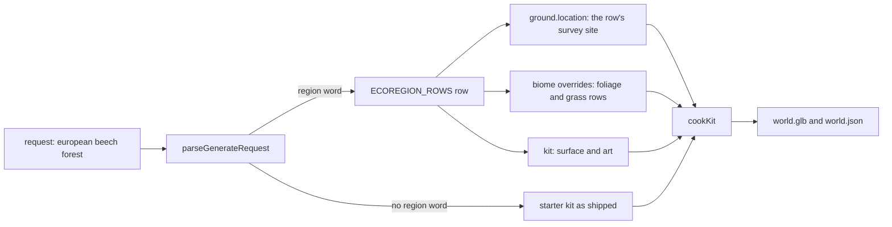

# PRD-887 — A region request cooks its real ground and its plant community

**Status:** NOT STARTED
**Priority:** P2 — A request such as "European beech forest" cooks United States ground with one swapped tree species (AC-1 to AC-4 open), so the terrain MCP cannot give a regional forest that reads as real.
**Complexity:** 4 (MEDIUM); risk override: none
**Owner:** ThreeNative maintainers
**Depends on:** [PRD-886](../P2/PRD-886-terrain-code-sits-in-one-folder-per-stage-with-an-architecture-map.md) Phase 2 (the `request/` and `ground/` folders this PRD adds rows to). No box here waits on a look PRD.

## Context

Owner, 2026-11-13: "terrain mcp receives a request: eg: 'European forest, etc etc' => it either
uses a starter which would be quicker, or bakes something from scratch. Terrain, heightmap based
on real info, vegetation, etc. Realistic look."

Read on 2026-11-13 at `dc131b610`. The paths below are the ones before PRD-886 moves them.

- **The skeleton exists.** `terrain_generate` (`packages/terrain/src/mcp/tools.ts:130`) takes a
  free-text `request`. `parseGenerateRequest` (`tools.ts:413`) reads it against word tables and
  returns `decided` and `unused`. `cookKit` (`src/mcp/cook.ts:169`) cooks a starter's own
  `recipe.json`, or a landform preset on a real survey, into `world.glb`.
- **A region is not an input.** The tables in `src/core/request-words.ts` and
  `src/core/biome-words.ts` hold landform, water, size and tree words. No row names a region, so
  "european" goes to `unused`.
- **The ground does not follow the region.** With no `ground` argument, the cook uses the starter's
  crop (the forest kit is USGS 3DEP ground) or one fixed site per landform from `SURVEYS`
  (`src/core/surveys.ts`): Colorado, Wisconsin, the Matterhorn. The `ground: { location }` argument
  already cuts a survey at a latitude and longitude, but only when the caller passes it.
- **Vegetation is one swapped tree.** A tree word sets `treeSpecies`, and `growArborSpecies`
  (`src/mcp/arbor-species.ts:161`) replaces the kit's tree art with one Arbor preset. The
  understory, the ground cover and the surface stay the kit's.
- **A multi-species stand already cooks, but only from a hand-written spec.** `growArborSpecies`
  bakes each `arbor:<preset>[@seed]` that a biome's `foliage` rows name. No request word produces
  such rows.
- **Cook time today:** the forest starter cooks in 3 839 ms and a new `savanna` biome in 2 982 ms
  (`docs/PRDs/refactoring/strata-refactoring/README.md`, measured 2026-11-05, not run again here).

## Solution

One new data table and no new mechanism. A region word resolves to a row. The row fills the same
arguments an agent can already pass by hand.

### The ecoregion row

`ECOREGION_ROWS` lives in `packages/terrain/src/request/` beside the other word tables. A row has:

- `words`: the request words that select it.
- `site`: an `ISurveyRow`, the same shape `SURVEYS` uses, with its attribution.
- `kit`: the starter whose surface and art suit the region.
- `overrides`: `IBiomeSpec` fields, the same shape `terrain_biome_new` accepts. Its `foliage` rows
  name several `arbor:<preset>@<seed>` species with their density, slope and spacing, so a canopy
  is a mix and not one cloned tree. Its `grass` and understory rows name ids the kit's
  `assets.json` already has.

First rows, each limited to presets that `vegetationPresets()` returns:

| Row | Words | Candidate site | Canopy |
| --- | --- | --- | --- |
| `european-broadleaf` | european, europe, beech (with a region word) | Hainich, Thuringia, Germany | beech, oak, birch |
| `boreal` | boreal, taiga, nordic, scandinavian | Oulanka, Finland | the kit's spruce, birch, aspen |
| `mediterranean` | mediterranean, tuscan | Val d'Orcia, Tuscany, Italy | olive, cypress, oak |
| `pacific-northwest` | pacific northwest, cascadia | Hoh valley, Olympic Peninsula, Washington | douglasfir, redcedar, bigleafmaple |

The sites are candidates. Phase 1 fetches each crop, records its measured range in the row's
comment as `surveys.ts` does, and replaces a site whose crop is not a forest floor
(`isForestFloor`, `cook.ts:912`).

### Rules the parser keeps

- An explicit argument wins over a word, as today. `ground`, `biome` and `kit` passed by the caller
  override the row.
- A landform word in the same request still picks the shape preset. The row decides the site and
  the plants.
- A tree word in the same request (`"european oak forest"`) moves that species to the first canopy
  row. It does not remove the other species.
- A request with no region word cooks as it does today, so a starter request stays the quick path.
- `decided.region` names the row and the word behind it. A request that names a region with no row
  reports the word in `unused`, as today.

### Reused, not built

`parseGenerateRequest`, `newBiomeSpec` (`tools.ts:628`), `validateBiome`, `surveyHeights`,
`growArborSpecies` and `cookKit` are reused as they are. [PRD-885](../P2/PRD-885-a-terrain-survey-reads-lidar-grade-ground-from-mapterhorn.md)
changes the tile source under `surveyHeights`. A row's `site` works with both sources.

### Risks

- **Cook time.** Each distinct Arbor preset and seed is one bake. A row with six species costs six
  bakes. Phase 2 measures it. The budget is in AC-3.
- **World size.** PRD-885 AC-4 holds a cooked kit at 25 MiB. More species add models. AC-3 uses
  the same cap.
- **Frame cost.** The forest overview is over budget today
  ([PRD-584](../P1/PRD-584-an-agent-asks-for-a-forest-over-mcp-and-gets-a-60-fps-glb.md)
  AC-4 is open). This PRD does not promise 60 FPS. AC-3 requires that a region world costs no more
  than the forest starter on the same pose.
- **Look.** Arbor trees and the kit's CC0 surface decide the look. If the judge in AC-4 fails a row
  for the surface or the understory, that work belongs to
  [PRD-855](../P1/PRD-855-the-ground-vegetation-reads-like-a-real-forest-floor.md)
  and [PRD-870](../P2/PRD-870-the-procedural-forest-set-reads-like-the-fab-set.md),
  not to a second surface system here.

Not in this PRD: climate data, a biome border between two regions (PRD-790 Phase 3), new surface
texture sets, and a cache of cooked worlds.

## Acceptance Criteria

- [ ] AC-1 [local]: `terrain_generate` with `request: "european beech forest"` reports `decided.region` as `european-broadleaf`, grounds on that row's site with its attribution, and leaves "european" out of `unused`. proof: `pnpm exec vitest run packages/terrain/__tests__/terrain-mcp.spec.ts` — Evidence: pending.
- [ ] AC-2 [local]: The cooked world of that request scatters at least three canopy species, each with more than one seed. proof: a case in `packages/terrain/__tests__/terrain-mcp.spec.ts` that counts placements per species in the cooked `world.json` — Evidence: pending.
- [ ] AC-3 [local]: A region world cooks in 30 s or less on the desktop, stays at or under 25 MiB, and its presented p95 frame time is not above the forest starter's on the same pose. proof: the cook result's time and bytes, and `measure-steady-state-fps` with paired arms on one code state — Evidence: pending.
- [ ] AC-4 [local]: A fresh visual judge returns IMPROVEMENT for the European forest against today's output of the same request, with reference photos of a Central European beech forest. proof: `KIT=forest pnpm --filter strata-terrain-preview test:kit` on each arm, two headed WebGPU runs per arm, sheets and verdict on the PR — Evidence: pending.

## Integration Ledger

| Capability | Reachable consumer/trigger | Replaces / disposition | Evidence |
| --- | --- | --- | --- |
| Region word in a terrain request | An agent calls the MCP tool `terrain_generate` → `parseGenerateRequest` → `cookKit` (fill the `file:line` after PRD-886 moves them) | Adds a table. The one-tree swap stays for a request with a tree word and no region word | AC-1, AC-2 |
| Region world in a game | The scaffolded game in `examples/strata-terrain-preview/scripts/verify-consumer.mjs` loads the cooked world with no authoring package | None | Phase 2 box 2 |

## Decisions

- 2026-11-13 (agent): a region is a data row that fills existing arguments, not a new cook path. `growArborSpecies` already bakes every `arbor:` row of a biome, so the smallest change is the table and the parser rule.
- 2026-11-13 (agent): the 30 s cook budget in AC-3 is a proposal with no measurement behind it. Phase 2 box 1 measures the cook. The owner can change the number then.

## Execution Phases

#### Phase 1: A region word decides the site and the plants

**Status:** NOT STARTED
**Files:** `packages/terrain/src/request/ecoregions.ts` (new), the request parser, `packages/terrain/src/mcp/tools.ts` (the `decided.region` field and the tool description), `packages/terrain/__tests__/terrain-mcp.spec.ts`, `packages/terrain/__tests__/terrain-survey.spec.ts`, `packages/terrain/__tests__/arbor-species.spec.ts`, `packages/create-threenative/terrain-mcp-tools.json` (regenerated by `scripts/capture-terrain-mcp-tools.ts`).
**Implementation:** Red first: a spec case per row that fails today because the word is in `unused`. Add the table and the parser rule. Fetch each site once, record the measured range, and keep a fixture tile for the spec so the test needs no network.
**Verification:** the three specs above and `pnpm exec vitest run scripts/__tests__/mcp-tool-schemas.spec.ts`.

- [ ] Each of the four rows parses from its words to its site, kit and overrides, and an explicit argument wins over the row. proof: `pnpm exec vitest run packages/terrain/__tests__/terrain-mcp.spec.ts`
- [ ] Each row's site decodes to its recorded range, and each species a row names is an Arbor preset. proof: `pnpm exec vitest run packages/terrain/__tests__/terrain-survey.spec.ts packages/terrain/__tests__/arbor-species.spec.ts`

#### Phase 2: The region world cooks and plays

**Status:** NOT STARTED
**Files:** `packages/terrain/src/cook/cook.ts` only if a measured cost needs a change, `examples/strata-terrain-preview/scripts/verify-consumer.mjs` (one more request in its MCP stage), `packages/create-threenative/agent-docs/references/terrain-authoring.md` (the region words), `packages/terrain/docs/architecture.md` (the routing row for region words).
**Implementation:** Cook the four rows through the real MCP server. Record time, bytes and placements per species. If a row is over budget, reduce its species or seeds in the row. Do not add a cache.
**Verification:** `pnpm --filter strata-terrain-preview test:consumer`, and a playtest of the scaffolded game from the spawn that reads `TN_FRAME_BUDGET` and `TN_SCENE_WARNING`.

- [ ] The four rows cook through the MCP server, and each result records its time, bytes and placements per species. proof: `pnpm exec vitest run packages/terrain/__tests__/terrain-mcp.spec.ts`, with the four results in this box
- [ ] A scaffolded game outside the workspace loads the European world and plays from the spawn with no `TN_SCENE_WARNING`. proof: `pnpm --filter strata-terrain-preview test:consumer`

#### Phase 3: The European forest reads as one

**Status:** NOT STARTED
**Files:** the `european-broadleaf` row (densities, spacing, seeds), the judge sheets on the PR.
**Implementation:** Set the acceptance criteria for the judge before the capture: canopy mix visible, no cloned silhouettes in one frame, understory present at walking height. Capture the before arm (today's output of the same request) and the after arm on the same pose. Tune the row only. A failure caused by the surface or the understory art goes to PRD-855 or PRD-870 as a note, not into this PRD.
**Verification:** the visual judge that the root `AGENTS.md` describes, on headed WebGPU with `adapter.info` checked.

- [ ] The judge's verdict for the European forest is IMPROVEMENT, with both sheets on the PR. proof: the PR comment that carries the sheets and the verdict
