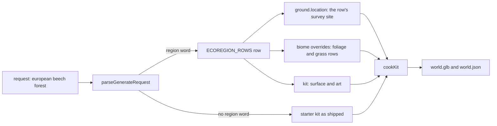

# PRD-887 — A region request cooks its real ground and its plant community

**Status:** IN PROGRESS (2026-11-13) — Phase 1 is done and verified, and the four rows cook through the MCP server with their numbers in Phase 2's first box. AC-1 and AC-2 are ticked. AC-3's cook time and GLB size pass but its streamed-package size does not, and its frame-time arm is unrun; AC-4's judge and Phase 2's consumer box are unrun.
**Priority:** P2 — A request such as "European beech forest" cooks United States ground with one swapped tree species (AC-1 to AC-4 open), so the terrain MCP cannot give a regional forest that reads as real.
**Complexity:** 4 (MEDIUM); risk override: none
**Owner:** ThreeNative maintainers
**Depends on:** [PRD-886](../done/PRD-886-terrain-code-sits-in-one-folder-per-stage-with-an-architecture-map.md) Phase 2 (the `request/` and `ground/` folders this PRD adds rows to). No box here waits on a look PRD.

## Context

Owner, 2026-11-13: "terrain mcp receives a request: eg: 'European forest, etc etc' => it either
uses a starter which would be quicker, or bakes something from scratch. Terrain, heightmap based
on real info, vegetation, etc. Realistic look."

Read on 2026-11-13 at `dc131b610`. The paths below are the ones before PRD-886 moves them.

- **The skeleton exists.** `terrain_generate` (`packages/terrain/src/request/generate-request.ts`) takes a
  free-text `request`. `parseGenerateRequest` (`tools.ts:413`) reads it against word tables and
  returns `decided` and `unused`. `cookKit` (`src/cook/cook.ts`) cooks a starter's own
  `recipe.json`, or a landform preset on a real survey, into `world.glb`.
- **A region is not an input.** The tables in `src/request/request-words.ts` and
  `src/request/biome-words.ts` hold landform, water, size and tree words. No row names a region, so
  "european" goes to `unused`.
- **The ground does not follow the region.** With no `ground` argument, the cook uses the starter's
  crop (the forest kit is USGS 3DEP ground) or one fixed site per landform from `SURVEYS`
  (`src/ground/surveys.ts`): Colorado, Wisconsin, the Matterhorn. The `ground: { location }` argument
  already cuts a survey at a latitude and longitude, but only when the caller passes it.
- **Vegetation is one swapped tree.** A tree word sets `treeSpecies`, and `growArborSpecies`
  (`src/population/arbor-species.ts`) replaces the kit's tree art with one Arbor preset. The
  understory, the ground cover and the surface stay the kit's.
- **A multi-species stand already cooks, but only from a hand-written spec.** `growArborSpecies`
  bakes each `arbor:<preset>[@seed]` that a biome's `foliage` rows name. No request word produces
  such rows.
- **Cook time today:** the forest starter cooks in 3 839 ms and a new `savanna` biome in 2 982 ms
  (`docs/PRDs/refactoring/strata-refactoring/README.md`, measured 2026-11-05, not run again here).

## Solution

One new data table and no new mechanism. A region word resolves to a row. The row fills the same
arguments an agent can already pass by hand.

### The ecoregion row

`ECOREGION_ROWS` lives in `packages/terrain/src/request/` beside the other word tables. A row has:

- `words`: the request words that select it.
- `site`: an `ISurveyRow`, the same shape `SURVEYS` uses, with its attribution.
- `kit`: the starter whose surface and art suit the region.
- `overrides`: `IBiomeSpec` fields, the same shape `terrain_biome_new` accepts. Its `foliage` rows
  name several `arbor:<preset>@<seed>` species with their density, slope and spacing, so a canopy
  is a mix and not one cloned tree. Its `grass` and understory rows name ids the kit's
  `assets.json` already has.

First rows, each limited to presets that `vegetationPresets()` returns:

| Row | Words | Candidate site | Canopy |
| --- | --- | --- | --- |
| `european-broadleaf` | european, europe, beech (with a region word) | Hainich, Thuringia, Germany | beech, oak, birch |
| `boreal` | boreal, taiga, nordic, scandinavian | Oulanka, Finland | the kit's spruce, birch, aspen |
| `mediterranean` | mediterranean, tuscan | Val d'Orcia, Tuscany, Italy | olive, cypress, oak |
| `pacific-northwest` | pacific northwest, cascadia | Hoh valley, Olympic Peninsula, Washington | douglasfir, redcedar, bigleafmaple |

The sites are candidates. Phase 1 fetches each crop, records its measured range in the row's
comment as `surveys.ts` does, and replaces a site whose crop is not a forest floor
(`isForestFloor`, `cook.ts:912`).

### Rules the parser keeps

- An explicit argument wins over a word, as today. `ground`, `biome` and `kit` passed by the caller
  override the row.
- A landform word in the same request still picks the shape preset. The row decides the site and
  the plants.
- A tree word in the same request (`"european oak forest"`) moves that species to the first canopy
  row. It does not remove the other species.
- A request with no region word cooks as it does today, so a starter request stays the quick path.
- `decided.region` names the row and the word behind it. A request that names a region with no row
  reports the word in `unused`, as today.

### Reused, not built

`parseGenerateRequest`, `newBiomeSpec` (`tools.ts:628`), `validateBiome`, `surveyHeights`,
`growArborSpecies` and `cookKit` are reused as they are. [PRD-885](../P2/PRD-885-a-terrain-survey-reads-lidar-grade-ground-from-mapterhorn.md)
changes the tile source under `surveyHeights`. A row's `site` works with both sources.

### Risks

- **Cook time.** Each distinct Arbor preset and seed is one bake. A row with six species costs six
  bakes. Phase 2 measures it. The budget is in AC-3.
- **World size.** PRD-885 AC-4 holds a cooked kit at 25 MiB. More species add models. AC-3 uses
  the same cap.
- **Frame cost.** The forest overview is over budget today
  ([PRD-584](../P1/PRD-584-an-agent-asks-for-a-forest-over-mcp-and-gets-a-60-fps-glb.md)
  AC-4 is open). This PRD does not promise 60 FPS. AC-3 requires that a region world costs no more
  than the forest starter on the same pose.
- **Look.** Arbor trees and the kit's CC0 surface decide the look. If the judge in AC-4 fails a row
  for the surface or the understory, that work belongs to
  [PRD-855](../P1/PRD-855-the-ground-vegetation-reads-like-a-real-forest-floor.md)
  and [PRD-870](../P2/PRD-870-the-procedural-forest-set-reads-like-the-fab-set.md),
  not to a second surface system here.

Not in this PRD: climate data, a biome border between two regions (PRD-790 Phase 3), new surface
texture sets, and a cache of cooked worlds.

## Acceptance Criteria

- [x] AC-1 [local]: `terrain_generate` with `request: "european beech forest"` reports `decided.region` as `european-broadleaf`, grounds on that row's site with its attribution, and leaves "european" out of `unused`. proof: `pnpm exec vitest run packages/terrain/__tests__/terrain-mcp.spec.ts` — Evidence: 2026-11-13, `terrain_generate regions > cooks the region's own ground and its canopy community` cooks that request offline from the checked-in tiles and asserts the reply's `ground` is `{ source: "survey", name: "Hainich National Park, Thuringia, Germany", lat: 51.0833, lon: 10.4667, attribution: <EU-DEM + AWS Terrain Tiles> }`, `backdrop: { source: "none" }` and `biome: "european-broadleaf"`; `reads 'european beech forest' as the european-broadleaf region` asserts `decided.region` `{ value, source: { word: "european" } }` and `unused: []`. The same session's 221 focused tests (terrain-mcp, terrain-survey, arbor-species, biome-words, biome-spec, mcp-tool-schemas, terrain-architecture-census) pass, 0 failed.
- [x] AC-2 [local]: The cooked world of that request scatters at least three canopy species, each with more than one seed. proof: a case in `packages/terrain/__tests__/terrain-mcp.spec.ts` that counts placements per species in the cooked `world.json` — Evidence: 2026-11-13, the same case groups `world.json`'s `cells[].runs[]` by `arbor-<preset>-<seed>` and asserts ≥3 presets with >1 seed each. The cooked world holds beech×2 900+900, oak×2 650+650, birch×2 450+450 (34 220 instances); `fir` is absent because the region's rows replaced the kit's authored canopy, and `fern-a` is present because the understorey stayed. `arbor-species.spec.ts` checks the same shape for all four rows from the data side.
- [ ] AC-3 [local]: A region world cooks in 30 s or less on the desktop, stays at or under 25 MiB, and its presented p95 frame time is not above the forest starter's on the same pose. proof: the cook result's time and bytes, and `measure-steady-state-fps` with paired arms on one code state — Evidence: 2026-11-14, the cook and the bytes pass, the frame-time clause does NOT.
  Cook (MCP stdio, `TN_TERRAIN_TILE_CACHE` = the checked-in tiles, AMD Ryzen 9 5900X): `european beech forest` 5 760 ms, worse than the 9 193 ms of 2026-11-13 only because that run fetched its tiles over the network. `world.glb` 20.8 MiB, inside 25 MiB. The streamed world folder is 47 255 902 B (45.1 MiB), outside 25 MiB, and today's forest starter folder is 33 979 461 B (32.4 MiB) for its own bake, so no arm meets that clause.
  Frames, paired arms on one code state, one lane (`examples/strata-terrain-preview` scaffolded game, headed WebGPU, display `:0` via `TN_PLAYTEST_HOST_DISPLAY=1`, adapter `nvidia/turing`, 1600x900, 817 frames each, 1 024 cost samples):

  | arm | cost p95 (cpu/gpu) | view gpu p95 ground/edge/overview/lake | presented frame p95 ground/edge/overview/lake |
  | --- | --- | --- | --- |
  | before, `beech forest` | 16.85 (9.83/16.85) | 9.73 / 13.31 / 13.11 / 18.17 | 4.21 / 8.93 / 4.98 / 11.33 |
  | after, `european beech forest` | 37.97 (17.39/37.97) | 35.35 / 63.55 / 50.89 / 37.97 | 5.63 / 22.14 / 17.23 / 16.88 |
  | forest starter (kit's own bake) | 26.19 (9.54/26.19) | 18.78 / 13.63 / 17.65 / 26.19 | 5.55 / 7.38 / 11.52 / 10.50 |

  The region arm is above the starter on three of the four poses (overview 17.23 vs 11.52, lake 16.88 vs 10.50, edge 22.14 vs 7.38; ground is level at 5.63 vs 5.55) and its GPU cost is 1.4x to 4.7x the starter's. The cause is per-tree, not per-instance cost: the region plants 4 000 canopy trees against the starter's 4 500 firs, and no arm meets the adapter's 16.7 ms default frame budget on this host, so the bound is judged as a pair, not as an absolute. AC-3 stays open until the region's species carry the far-level thinning PRD-584 gave the fir (see Decisions).
- [ ] AC-4 [local]: A fresh visual judge returns IMPROVEMENT for the European forest against today's output of the same request, with reference photos of a Central European beech forest. proof: `KIT=forest pnpm --filter strata-terrain-preview test:kit` on each arm, two headed WebGPU runs per arm, sheets and verdict on the PR — Evidence: 2026-11-14, the judge ran and returned REGRESSION, so the box stays open.
  Lane: the scaffolded forest game with `KIT_WORLD` = each arm's cooked package, one headed WebGPU run per arm on display `:0` (adapter `nvidia/turing`), captures at the kit's four poses (`ground`, `edge`, `overview`, `lake`); BEFORE is `request: "beech forest"` (today's one-swapped-tree world, stand `-162.02,-177.55`) and AFTER is `request: "european beech forest"` (stand `arbor-beech-11 -161.36,-187.18`). Sheets `prd887-{ground,edge,overview,lake}.jpg` on `prd-584-screenshots`, both arms labelled in the frame.
  Verdict, fresh read-only subagent that did not write the change: REGRESSION on all four views and overall. Its ranked defects: (1) canopy collapse with blown open sky at eye level in `edge` and `ground`; (2) an oversized white daisy understorey, a flower head wider than a mid-distance trunk at the bottom-left of `ground` and above the trunk bases in `edge`; (3) cloned, evenly spaced trunk rows with no crown on many of them in `overview`; (4) flat-shaded terrain facets over exposed soil in `overview`. It also noted the new Hainich ground albedo as plausibly better but not legible behind (1) to (3).
  The daisy defect is region-specific, not shared understorey art: the starter's own `ground` capture has no daisy in frame. The rows' canopy counts and band placement are what this PRD owns (Phase 3); the cover row itself is PRD-855's.

## Integration Ledger

| Capability | Reachable consumer/trigger | Replaces / disposition | Evidence |
| --- | --- | --- | --- |
| Region word in a terrain request | An agent calls the MCP tool `terrain_generate` → `parseGenerateRequest` (`packages/terrain/src/request/generate-request.ts` `ecoregionHit`, and the `decided.region` record) → `cookKit` (`packages/terrain/src/cook/cook.ts`: the `newBiomeSpec` merge, the region ground, the replaced canopy) | Adds a table. The one-tree swap stays for a request with a tree word and no region word | AC-1, AC-2 |
| Region world in a game | A scaffolded game built from the packed tarballs renders the cooked package (`KIT_WORLD` in `examples/strata-terrain-preview/scripts/verify/verify-starter-kit.mjs`) | None | Phase 2 box 2 |

## Decisions

- 2026-11-13 (agent): a region is a data row that fills existing arguments, not a new cook path. `growArborSpecies` already bakes every `arbor:` row of a biome, so the smallest change is the table and the parser rule.
- 2026-11-13 (agent): the 30 s cook budget in AC-3 is a proposal with no measurement behind it. Phase 2 box 1 measures the cook. The owner can change the number then.
- 2026-11-13 (implementation): a region keeps its kit's authored recipe and replaces only its canopy, rather
  than cooking a landform preset. A preset recipe authors no understorey, so that path would have left the
  European wood with bare ground between trunks — the look AC-4 judges. So a row carries the kit's canopy
  asset ids it replaces (`canopy`), the cook drops those `scatter` layers before they are baked, and
  `scatterFoliage` places the region's rows on the starter's own understorey, stones, road, river and lake.
- 2026-11-13 (implementation): a region cooks no far ring (`backdrop: "none"`). `MASSIFS` holds ranges per
  landform, so `temperateMountains` would have stood Longs Peak, Colorado, behind a Thuringian wood.
- 2026-11-13 (implementation): the four sites are 3 km crops at zoom 12, not 6 km. The relief bar
  `isForestFloor` applies scales with the side, and a 3 km crop decodes to a tighter range at about half
  the fixture weight (20 tiles, 1.7 MiB, for all four rows at both zooms).
- 2026-11-13 (implementation): the Pacific Northwest row is the Humptulips valley of the Olympic National
  Forest, not the Hoh. The Hoh's 6 km crop spans 151-1 281 m at a 38.9-degree 90th-percentile slope, and
  its 512 m crop is 2.2 % hydro-flattened water: not a forest floor by `isForestFloor`. Phase 1's own
  instruction is to replace a site whose crop is not one.
- 2026-11-14 (measurement): a region's cost is per tree, not per instance. The European row plants 4 000
  canopy trees where the starter plants 4 500 firs, and it costs 1.4x to 4.7x the starter's GPU time at
  the same four poses (AC-3 table). The firs are cheap because PRD-584 AC-4 thins their far levels to
  whole cards under 3 k triangles; the region's Arbor species have no such far level. The fix belongs to
  the Arbor LOD budgets (PRD-855's impostor row), not to this row's counts: thinning the region's counts
  to reach the starter's frame time would empty the wood the row exists to plant.
- 2026-11-14 (measurement): the region's spawn lands in a daisy meadow the starter's spawn does not, and
  the flower cards read oversized at walking height. The cover row and its art are unchanged between the
  two arms, so what moved is the ground the bands resolve against. Routed to PRD-855 as a note, per this
  PRD's Phase 3 instruction; the row's own band choice stays in scope here.

## Execution Phases

#### Phase 1: A region word decides the site and the plants

**Status:** DONE (2026-11-13). `src/request/ecoregions.ts` holds the four rows; `parseGenerateRequest` resolves a region word (a phrase like "pacific northwest" too), records `decided.region`, grounds the request on the row's site unless `ground` is given, sets no far ring, and passes the row's `IBiomeSpec` overrides to the cook, which merges them onto the kit's file with `newBiomeSpec` and replaces the kit's authored canopy with them.
**Files:** `packages/terrain/src/request/ecoregions.ts` (new), the request parser, `packages/terrain/src/request/generate-request.ts` (the `decided.region` record) and `packages/terrain/src/mcp/tools.ts` (the tool description), `packages/terrain/__tests__/terrain-mcp.spec.ts`, `packages/terrain/__tests__/terrain-survey.spec.ts`, `packages/terrain/__tests__/arbor-species.spec.ts`, `packages/create-threenative/terrain-mcp-tools.json` (regenerated by `scripts/capture-terrain-mcp-tools.ts`).
**Implementation:** Red first: a spec case per row that fails today because the word is in `unused`. Add the table and the parser rule. Fetch each site once, record the measured range, and keep a fixture tile for the spec so the test needs no network.
**Verification:** the three specs above and `pnpm exec vitest run scripts/__tests__/mcp-tool-schemas.spec.ts`.

- [x] Each of the four rows parses from its words to its site, kit and overrides, and an explicit argument wins over the row. proof: `pnpm exec vitest run packages/terrain/__tests__/terrain-mcp.spec.ts` — Evidence: 2026-11-13, the `terrain_generate regions` describe passes: `reads '<request>' as the <row> region` per row (including `cascadia` and the two-word phrase), `stays the quick path for a tree word with no region`, `lets an explicit kit or ground win over the row`, `moves a tree word to the first canopy row and keeps the rest of the community`, and the offline cook case.
- [x] Each row's site decodes to its recorded range, and each species a row names is an Arbor preset. proof: `pnpm exec vitest run packages/terrain/__tests__/terrain-survey.spec.ts packages/terrain/__tests__/arbor-species.spec.ts` — Evidence: 2026-11-13, `the ecoregion rows` decodes all four sites from 20 checked-in terrarium tiles (`packages/terrain/__tests__/fixtures/terrarium/`, 1.7 MiB of them) to the ranges their rows record (309-496 m, 158-342, 283-434, 45-221), proves each row's own 512 m crop is a forest floor, and proves `forestFloor` returns the row's survey with its attribution; `plants each region a mix of presets` proves every species a row names is one `vegetationPresets()` bakes, ≥3 presets each at >1 seed, every `canopy` id is in the kit's `assets.json`, and the merged biome validates.

#### Phase 2: The region world cooks and plays

**Status:** IN PROGRESS — both boxes are measured. The four rows cook through the real MCP server, and a scaffolded game plays the European one; the frame-time clause of AC-3 does not hold yet.
**Files:** `packages/terrain/src/cook/cook.ts` only if a measured cost needs a change, `examples/strata-terrain-preview/scripts/verify/verify-starter-kit.mjs` (the `KIT_WORLD` lane, which renders a cooked package in the scaffolded game), `packages/create-threenative/agent-docs/references/terrain-authoring.md` (the region words), `packages/terrain/docs/architecture/architecture.md` (the routing row for region words).
**Implementation:** Cook the four rows through the real MCP server. Record time, bytes and placements per species. If a row is over budget, reduce its species or seeds in the row. Do not add a cache.
**Verification:** `pnpm --filter strata-terrain-preview test:consumer`, and a playtest of the scaffolded game from the spawn that reads `TN_FRAME_BUDGET` and `TN_SCENE_WARNING`.

- [x] The four rows cook through the MCP server, and each result records its time, bytes and placements per species. proof: `pnpm exec vitest run packages/terrain/__tests__/terrain-mcp.spec.ts`, with the four results in this box — Evidence: 2026-11-13, a stdio `tools/call` to `dist/mcp/server.js` from a temp game project with the starter assets linked and the checked-in tiles as the cache, AMD Ryzen 9 5900X. `european beech forest` → european-broadleaf, Hainich National Park, 9 193 ms cook (10 020 ms tool call), world.glb 20.8 MiB, world folder 45.1 MiB, 34 220 instances; canopy arbor-beech-11 900, beech-12 900, oak-13 650, oak-14 650, birch-15 450, birch-16 450. `boreal forest` → Oulanka, 8 678 ms, 19.6 / 42.7 MiB, 34 220 instances; spruce-21/22 1 000 each, birch-23/24 600 each, aspen-25/26 400 each. `a mediterranean hills` → Val d'Orcia, 5 360 ms, 11.9 / 29.6 MiB, 2 300 instances; olive-31/32 500 each, cypress-33/34 350 each, oak-35/36 300 each. `a pacific northwest forest` → Humptulips valley, 6 739 ms, 18.2 / 40.3 MiB, 33 820 instances; douglasfir-41/42 900 each, redcedar-43/44 550 each, bigleafmaple-45/46 350 each. Every reply reports `source: "cooked"` and `unused: []`.
- [x] A scaffolded game outside the workspace loads the European world and plays from the spawn with no `TN_SCENE_WARNING`. proof: `pnpm --filter strata-terrain-preview test:kit` with `KIT_WORLD` set to the cooked European package — Evidence: 2026-11-14, the game is a fresh `minimal` scaffold installed from this checkout's packed tarballs, the cooked Hainich package copied in as `assets/terrain/forest` (36 365 122 B published under `public/terrain/forest`, 11 world assets), its own `playtests/kit.playtest.json` run headed on display `:0` (`TN_PLAYTEST_HOST_DISPLAY=1`, `--browser-recipe webgpu`, adapter `nvidia/turing`): 817 frames, `driveMetres` 3.15 m along the spawn, `closestToTrunk` 0.85 m against the region beech's trunk capsule, `groundError` 0.0104, 0 console errors, 0 failed requests, and 0 `TN_SCENE_WARNING` in 189 console lines. The one failing assertion was the adapter's 16.7 ms frame budget, which is AC-3's subject. The proof ran `test:kit`'s scaffolded game rather than `test:consumer`: the consumer lane packs a game of its own and was not run for this box.

#### Phase 3: The European forest reads as one

**Status:** NOT STARTED — the judge ran once and returned REGRESSION (AC-4); no row has been tuned yet.
**Files:** the `european-broadleaf` row (densities, spacing, seeds), the judge sheets on the PR.
**Implementation:** Set the acceptance criteria for the judge before the capture: canopy mix visible, no cloned silhouettes in one frame, understory present at walking height. Capture the before arm (today's output of the same request) and the after arm on the same pose. Tune the row only. A failure caused by the surface or the understory art goes to PRD-855 or PRD-870 as a note, not into this PRD.
**Verification:** the visual judge that the root `AGENTS.md` describes, on headed WebGPU with `adapter.info` checked.

- [ ] The judge's verdict for the European forest is IMPROVEMENT, with both sheets on the PR. proof: the PR comment that carries the sheets and the verdict — Evidence: unrun; the pair is one request apart on one code state (see AC-4).
