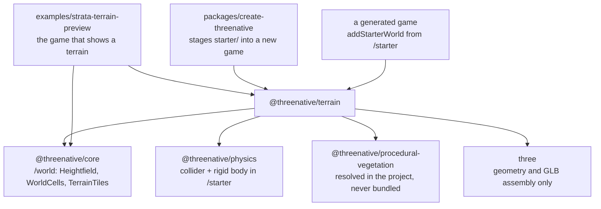
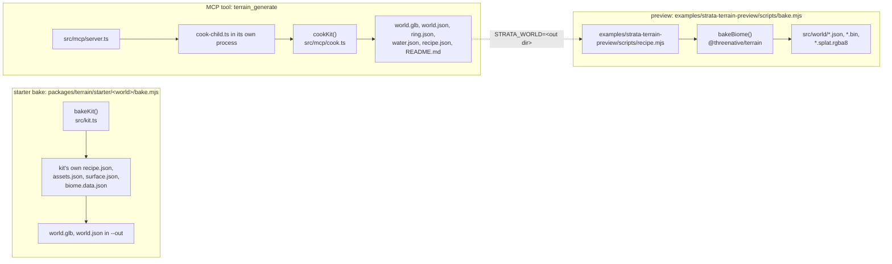

# Terrain: the architecture map

`@threenative/terrain` is optional authoring tooling: it turns a request or a recipe into ground
heights, water bodies, placements and a world package, and it owns no appearance. This file is the
map an agent reads before it changes terrain output. Rules live in `/AGENTS.md` and
[`../AGENTS.md`](../AGENTS.md); this file says where each stage's code sits and which command puts a
change on screen.

One rule ranks above every path below: a terrain stage decides *what* the ground is, never *how it
looks*. Materials, colours, lights, tone mapping and framing are game source, in an example's or a
template's `src/render/`.

## 1. The pipeline

One world, from a request to a playable package. Every arrow is a call, not a hope: the request
parser fills `IGenerateInput`, and each later stage reads only what the previous one wrote.

```mermaid
flowchart LR
  request["request: words + arguments"] --> parse["parseGenerateRequest<br/>src/mcp/tools.ts"]
  parse --> decoded["IGenerateDecided<br/>biome, landform, water, size,<br/>ground, backdrop, tree"]
  decoded --> biome["biome spec<br/>starter/&lt;world&gt;/biome.data.json<br/>or the request's own"]
  biome --> ground["ground<br/>survey, preset or heightmap"]
  ground --> evaluator["Terrain evaluator<br/>layers: heightmap, erode, carve"]
  evaluator --> terrainState["ITerrainState<br/>height + splat grids"]
  terrainState --> water["water<br/>lakes, rivers, coast, features"]
  water --> population["population<br/>scatter: foliage, ground cover, grass"]
  population --> cooked["cookTerrainWorld<br/>@threenative/assets"]
  cooked --> package["world package<br/>world.glb, world.json, placements.bin,<br/>terrain-table.json, water.json, ring.json"]
  package --> game["the game<br/>addStarterWorld, or WorldCells + loadTerrainSplat"]
```



The evaluator is the recovered one and stays as it is: `Terrain` in `src/core/terrain.ts` holds a
document of layers, `src/core/operations.ts` applies them, and `src/core/erosion.ts`,
`src/core/fluvial.ts`, `src/core/gully.ts` and `src/core/scree.ts` are the erosion passes they call.
Nothing downstream re-evaluates heights: the cook writes `ITerrainState` once and every consumer
reads that grid.

## 2. The packages

`@threenative/terrain` may not import a renderer, a scene, a camera, DOM or worker code (see
[`../AGENTS.md`](../AGENTS.md)): it imports arrays and writes files. The arrows below are the import
directions that exist; a new edge is a design decision, not a detail.



Two edges deserve their own line. `@threenative/assets` is not an import of the terrain package: the
cook receives `cookTerrainWorld` through `loadCooker`, which resolves the installed package from the
project root (`src/mcp/cook.ts`), because a cook must run against the consumer's installed asset
pipeline and never a second copy. `@threenative/procedural-vegetation` is the same shape: an Arbor
species is baked by the installed package, and a project without it fails with a named error.

## 3. The three producers

Three programs write terrain output and they disagree about everything except the format. Before you
edit one, name which producer you are looking at; an edit in the wrong one is invisible.



| Producer | Entry | Reads | Writes | Whose look |
| --- | --- | --- | --- | --- |
| Starter bake | `packages/terrain/starter/<world>/bake.mjs`, through `bakeKit` (`src/kit.ts`) | the starter's `recipe.json`, `assets.json`, `surface.json`, `biome.data.json` | `world.glb`, `world.json`, `placements.bin`, `terrain-table.json`, `heightmap.u16`, `splat.rgba`, `models/`, `textures/`, `sky.hdr`, `water.json` | the game's: `src/render/` in the copied starter |
| MCP tool | `terrain_generate` → `src/mcp/server.ts` → `src/mcp/cook-child.ts` → `cookKit` (`src/mcp/cook.ts`) | the request, the starter kit it names, the project's installed `@threenative/assets` | the same package plus `ring.json`, `recipe.json` and `README.md` | the requesting game's: the reply's `load` snippet is game source |
| Preview | `examples/strata-terrain-preview/scripts/bake.mjs` | `examples/strata-terrain-preview/scripts/recipe.mjs`, `examples/strata-terrain-preview/scripts/dem/`, `examples/strata-terrain-preview/src/render/biomes.ts`, `examples/strata-terrain-preview/src/world/terrainAssets.ts` | `src/world/<world>.*` | the preview's own `src/render/` |

`STRATA_WORLD` is the only bridge: set it to an MCP cook's output directory, run the preview bake,
and the forest is re-baked from that cook's own `recipe.json` and `ring.json` under the preview's look
(`examples/strata-terrain-preview/scripts/recipe.mjs`).

## 4. Edit to pixel

The order matters: the package is built from source, a bake imports the *built* package, and the page
reads the baked files. Skipping a step shows the previous result and reads as "my edit did nothing".

```mermaid
sequenceDiagram
  actor agent
  participant src as packages/terrain/src
  participant dist as packages/terrain/dist
  participant bake as starter bake or preview bake
  participant files as world.glb and src/world
  participant page as the page
  agent->>src: edit a stage or a recipe
  src->>dist: pnpm --filter @threenative/terrain build
  dist->>bake: bakeKit / bakeBiome / cookTerrainWorld
  bake->>files: pnpm --filter strata-terrain-preview bake<br/>or node starter/&lt;world&gt;/bake.mjs --out &lt;dir&gt;
  files->>page: pnpm --filter strata-terrain-preview dev
  page-->>agent: ?world=forest shows the change
```

A look-only edit skips the first three rows: `src/render/` is game source, Vite serves it directly,
and the page reload is the whole loop.

## 5. Where a change goes

One row per thing an agent changes. "Rebuild" is the shortest command that puts that change in front
of you; "Page" is where you see it.

| Change | File | Rebuild | Page |
| --- | --- | --- | --- |
| Ground shape | `packages/terrain/src/core/presets.ts` (the landform presets), or the recipe in `examples/strata-terrain-preview/scripts/recipe.mjs` | `pnpm --filter @threenative/terrain build`, then `pnpm --filter strata-terrain-preview bake` | `pnpm --filter strata-terrain-preview dev`, `?world=forest` |
| Ground texture and bands | `packages/terrain/src/core/biome.ts` (band and layer rows) and the surface manifest in `examples/strata-terrain-preview/scripts/recipe.mjs` | `pnpm --filter strata-terrain-preview bake` | `?world=forest`, `?showcase=1` |
| Tree species | `packages/terrain/src/mcp/arbor-species.ts` and `packages/terrain/starter/<world>/assets.json` | `pnpm --filter @threenative/terrain build`, then `node starter/<world>/bake.mjs --out <dir>` | the cooked world in its game |
| Tree density | `packages/terrain/src/core/scatter-ordered.ts` (the generators) and `<world>/biome.data.json` (the rows) | `pnpm --filter strata-terrain-preview bake` | `?world=forest` |
| Water | `packages/terrain/src/core/water.ts` and the cook's water stages (`packages/terrain/src/mcp/cook.ts`); the look in `examples/strata-terrain-preview/src/render/water.ts` | package build and bake for the shape; nothing for the look | `?waterproof=1`, then `pnpm --filter strata-terrain-preview test:terrain:web` |
| Sky and light | `examples/strata-terrain-preview/src/render/sky.ts`, `atmosphere.ts`, `environmentImages.ts` | nothing | `?world=forest&showcase=1` |
| Far ring | `packages/terrain/src/core/massif.ts` and `farRing` in `packages/terrain/src/mcp/cook.ts`; the preview's read in `src/render/horizon.ts` | package build, then the cook | `?world=alpine`, and the `vista` playtest pose |
| Loading and streaming | `packages/core/src/` (`WorldCells`, `TerrainTiles`) and `examples/strata-terrain-preview/src/render/loading.ts`, `streamLanes.ts` | `pnpm --filter @threenative/core build` | `?stream=1`, then `pnpm --filter strata-terrain-preview test:terrain:web` |
| Request words | `packages/terrain/src/core/request-words.ts`, `biome-words.ts`, `packages/terrain/src/mcp/tools.ts` | `pnpm --filter @threenative/terrain build` | the `terrain_generate` reply's `decided` and `unused` |

## 6. Stale output

Each trap below has shown an old result after a correct edit. The symptom is named so you recognise
it before you debug the wrong file.

| Trap | Symptom | One command |
| --- | --- | --- |
| Stale `dist` | an edit under `packages/terrain/src/` changes nothing in an MCP cook or a starter bake: the bake imports the package's `dist`, not its source | `pnpm --filter @threenative/terrain build` |
| Stale bake | the page shows the previous trees, water or ground after a recipe edit: `world.glb` and `src/world/*` are generated and are not tracked | `pnpm --filter strata-terrain-preview bake` |
| Vite prebundle | an installed workspace package keeps serving its previous build until the dev server restarts | restart `pnpm --filter strata-terrain-preview dev` |

## 7. Folders

One row per folder an agent lands in. `packages/terrain/src/` is grouped by stage, so the folder name
is the stage; a file two stages import lives at the root of `src/` or in `core/`.

| Folder | Stage | What belongs here |
| --- | --- | --- |
| `packages/terrain/src/core/` | The evaluator and the shared types | The recovered evaluator and the files every stage reads: the height layers and their passes, masks, math, types, validation, stats and the byte codecs |
| `packages/terrain/src/mcp/` | Tool schemas and dispatch | `server.ts` and `tools.ts`: the JSON-RPC surface, the argument schemas and the request parser |
| `packages/terrain/src/editor/` | The live editor | The typed editor modules PRD-588 split out; `packages/terrain/src/editor/app/` holds what runs in the page |
| `packages/terrain/scripts/` | The package's own data prep | Bake one shipped table from licensed sources; nothing here runs in a game |
| `packages/terrain/starter/` | Copy-out game source | One folder per world: recipe, bake, look, colliders. Package code never imports it |
| `examples/strata-terrain-preview/src/render/` | Appearance and the live scene | Every material, light, sky, water look and instanced batch the preview draws |
| `examples/strata-terrain-preview/scripts/` | The preview's bake, prep, proofs and measures | `bake.mjs`, `recipe.mjs` and the verifiers that put a world on screen |
| `examples/strata-terrain-preview/scripts/dem/` | Elevation input | The survey tiles and elevation crops the bake reads |
| `examples/strata-terrain-preview/scripts/fixtures/` | Recorded inputs | Committed fixtures a proof replays instead of re-authoring: documents, baked worlds and game modules |
| `examples/strata-terrain-preview/scripts/fixtures/handoff-game/` | A fixture game's scene | The scene a consumer proof hands a cooked world to, with no authoring import |
| `examples/strata-terrain-preview/scripts/fixtures/kit-game/` | A fixture starter game | The scaffolded game the starter-kit proof installs and plays |
| `examples/strata-terrain-preview/scripts/fixtures/kit-game/playtests/` | The fixture game's scenarios | The playtests that proof runs inside its scaffolded game |
