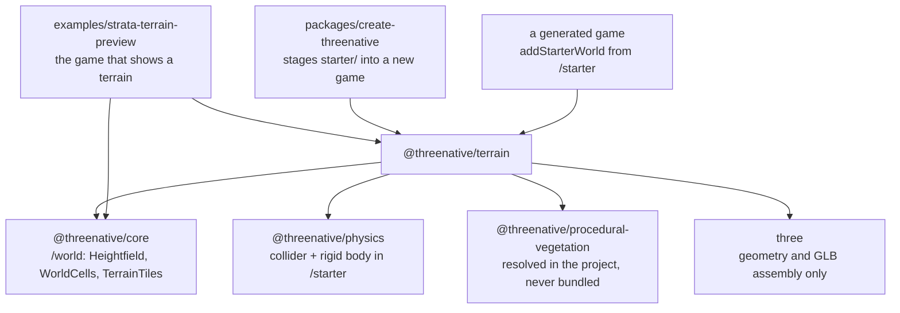
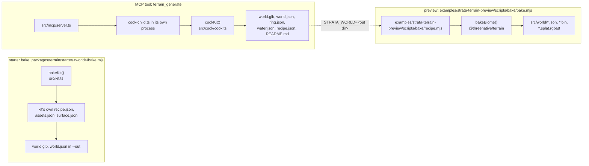
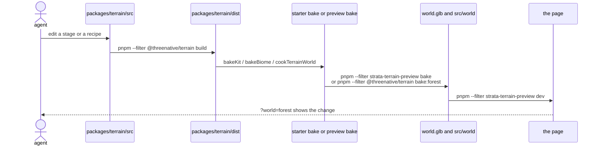

# Terrain: the architecture map

`@threenative/terrain` is optional authoring tooling: it turns a request or a recipe into ground
heights, water bodies, placements and a world package, and it owns no appearance. This file is the
map an agent reads before it changes terrain output. Rules live in `/AGENTS.md` and
[`../../AGENTS.md`](../../AGENTS.md); this file says where each stage's code sits and which command
puts a change on screen.

One rule ranks above every path below: a terrain stage decides *what* the ground is, never *how it
looks*. Materials, colours, lights, tone mapping and framing are game source, in an example's or a
template's `src/render/`.

Two companion documents go deeper:

- [`cook.md`](cook.md): the order of stages inside `terrain_generate`, and where each one lives.
- [`world-package.md`](world-package.md): the files a bake writes, byte by byte, and who reads them.

## Commands

Run each from the repository root. Every script below exists in the named `package.json`
(`scripts/__tests__/terrain-architecture-census.spec.ts` fails when one is renamed).

| You want to | Command | Measured |
| --- | --- | --- |
| See the preview after a `packages/terrain/src/` edit | `pnpm --filter strata-terrain-preview rebake`, then reload the page | 27 s |
| Start the preview with nothing stale (rebuilds terrain and core, clears the Vite prebundle) | `pnpm --filter strata-terrain-preview dev:fresh` | not timed |
| Start the preview as it is | `pnpm --filter strata-terrain-preview dev` | not timed |
| Bake one starter world into `artifacts/terrain/<world>/` | `pnpm --filter @threenative/terrain bake:forest` (also `bake:coastal`, `bake:alpine`, `bake:desert`, `bake:tundra`) | 14 s (forest) |
| Build the package | `pnpm --filter @threenative/terrain build` | not timed |
| Run the fast package check | `pnpm --filter @threenative/terrain test:consumer` | 11 s |
| Run every package test | `pnpm --filter @threenative/terrain test` | not timed |
| Prove this map is still true | `pnpm --filter @threenative/terrain test:map` | 1 s |
| Prove the preview on WebGPU | `pnpm --filter strata-terrain-preview test:terrain:web` | not timed |

Times are one local run each, on 2026-11-13, with a warm cache.

## 1. The pipeline

One world, from a request to a playable package, as `terrain_generate` runs it. The request parser
fills `IGenerateInput`, and each later stage reads only what the previous one wrote. Water, ground
and features are recipe edits made *before* evaluation, so the evaluator floods and erodes them in
one pass. [`cook.md`](cook.md) names the function behind every box.

```mermaid
flowchart LR
  request["request: words + arguments"] --> parse["parseGenerateRequest<br/>src/request/generate-request.ts"]
  parse --> decided["IGenerateDecided<br/>biome, landform, water, size,<br/>ground, backdrop, tree"]
  decided --> recipe["recipe<br/>starter/&lt;world&gt;/recipe.json<br/>or a landform preset"]
  recipe --> edits["recipe edits<br/>water rows, survey ground,<br/>features, coast, lakes, rivers"]
  edits --> evaluator["Terrain evaluator<br/>src/core/terrain.ts"]
  evaluator --> terrainState["ITerrainState<br/>height + splat grids"]
  terrainState --> population["population<br/>scatterFoliage + biome rows"]
  population --> cooked["cookTerrainWorld<br/>@threenative/assets"]
  cooked --> package["world package<br/>world.glb, world.json, placements.bin,<br/>terrain-table.json, water.json, ring.json"]
  package --> game["the game<br/>addStarterWorld, or WorldCells + loadTerrainSplat"]
```

The evaluator is the recovered one and stays as it is: `Terrain` in `packages/terrain/src/core/terrain.ts`
holds a document of layers, `packages/terrain/src/core/operations.ts` applies them, and
`packages/terrain/src/core/erosion.ts`, `packages/terrain/src/core/fluvial.ts`,
`packages/terrain/src/core/gully.ts` and `packages/terrain/src/core/scree.ts` are the erosion passes
they call. Nothing downstream re-evaluates heights: the cook writes `ITerrainState` once and every
consumer reads that grid.

## 2. The packages

`@threenative/terrain` may not import a renderer, a scene, a camera, DOM or worker code (see
[`../../AGENTS.md`](../../AGENTS.md)): it imports arrays and writes files. The arrows below are the
import directions that exist; a new edge is a design decision, not a detail.

Two edges deserve their own line. `@threenative/assets` is not an import of the terrain package: the
cook receives `cookTerrainWorld` through `loadCooker`, which resolves the installed package from the
project root (`packages/terrain/src/cook/cook.ts`), because a cook must run against the consumer's
installed asset pipeline and never a second copy. A starter's `bake.mjs` is game source, so it imports
`@threenative/assets` itself and hands `cookTerrainWorld` to `bakeKit`.
`@threenative/procedural-vegetation` is the same shape: an Arbor species is baked by the installed
package, and a project without it fails with a named error.

## 3. The three producers

Three programs write terrain output and they disagree about everything except the format. Before you
edit one, name which producer you are looking at; an edit in the wrong one is invisible.

| Producer | Entry | Reads | Writes | Whose look |
| --- | --- | --- | --- | --- |
| Starter bake | `packages/terrain/starter/<world>/bake.mjs`, through `bakeKit` (`packages/terrain/src/kit.ts`); in this repository `pnpm --filter @threenative/terrain bake:forest` | the starter's `recipe.json`, `assets.json`, `surface.json` | `world.glb`, `world.json`, `placements.bin`, `placement-ids.json`, `terrain-table.json`, `heightmap.u16`, `splat.rgba`, `models/`, `textures/`, `sky.hdr`, `water.json` | the game's: `src/render/` in the copied starter |
| MCP tool | `terrain_generate` → `packages/terrain/src/mcp/server.ts` → `packages/terrain/src/cook/cook-child.ts` → `cookKit` (`packages/terrain/src/cook/cook.ts`) | the request, the starter kit it names (including its `biome.data.json`), the project's installed `@threenative/assets` | the same package plus `ring.json`, `recipe.json` and `README.md` | the requesting game's: the reply's `load` snippet is game source |
| Preview | `examples/strata-terrain-preview/scripts/bake/bake.mjs`, run by `pnpm --filter strata-terrain-preview bake` | `examples/strata-terrain-preview/scripts/bake/recipe.mjs`, `examples/strata-terrain-preview/scripts/dem/`, `examples/strata-terrain-preview/src/render/biomes.ts`, `examples/strata-terrain-preview/src/world/terrainAssets.ts` | `src/world/<world>.*` | the preview's own `src/render/` |

`STRATA_WORLD` is the only bridge: set it to an MCP cook's output directory, run
`STRATA_WORLD=<out dir> pnpm --filter strata-terrain-preview bake`, and the forest is re-baked from
that cook's own `recipe.json` and `ring.json` under the preview's look
(`examples/strata-terrain-preview/scripts/bake/recipe.mjs`).

## 4. Edit to pixel

The order matters: the package is built from source, a bake imports the *built* package, and the page
reads the baked files. Skipping a step shows the previous result and reads as "my edit did nothing".
`rebake` runs the first two steps; `dev:fresh` runs all three and clears the Vite prebundle.

A look-only edit skips the first three rows: `src/render/` is game source, Vite serves it directly,
and the page reload is the whole loop.

## 5. Where a change goes

One row per thing an agent changes. "Rebuild" is the shortest command that puts that change in front
of you; "Page" is where you see it.

| Change | File | Rebuild | Page |
| --- | --- | --- | --- |
| Ground shape | `packages/terrain/src/ground/presets.ts` (the landform presets), and `packages/terrain/src/ground/ground.ts` for where the heights come from, or the recipe in `examples/strata-terrain-preview/scripts/bake/recipe.mjs` | `pnpm --filter strata-terrain-preview rebake` | `pnpm --filter strata-terrain-preview dev`, `?world=forest` |
| Ground texture and bands | `packages/terrain/src/biome/biome.ts` (band and layer rows) and the surface manifest in `examples/strata-terrain-preview/scripts/bake/recipe.mjs` | `pnpm --filter strata-terrain-preview rebake` | `?world=forest`, `?showcase=1` |
| Tree species | `packages/terrain/src/population/arbor-species.ts` and `packages/terrain/starter/<world>/assets.json` | `pnpm --filter @threenative/terrain bake:forest` (or the world you changed) | the cooked world in its game |
| Tree density | `packages/terrain/src/population/scatter-ordered.ts` (the generators) and `<world>/biome.data.json` (the rows) | `pnpm --filter strata-terrain-preview rebake` | `?world=forest` |
| Water | `packages/terrain/src/water/water.ts` (the segment index) and `packages/terrain/src/water/stages.ts` (the water rows, coast, lakes and rivers); the look in `examples/strata-terrain-preview/src/render/water/water.ts` | `pnpm --filter strata-terrain-preview rebake` for the shape; nothing for the look | `?waterproof=1`, then `pnpm --filter strata-terrain-preview test:terrain:web` |
| Sky and light | `examples/strata-terrain-preview/src/render/sky/sky.ts`, `examples/strata-terrain-preview/src/render/sky/atmosphere.ts`, `examples/strata-terrain-preview/src/render/sky/environmentImages.ts` | nothing | `?world=forest&showcase=1` |
| Far ring | `packages/terrain/src/ground/massif.ts` and `farRing` in `packages/terrain/src/ground/ground.ts`; the preview's read in `examples/strata-terrain-preview/src/render/ground/horizon.ts` | package build, then the cook | `?world=alpine`, and the `vista` playtest pose |
| Loading and streaming | `packages/core/src/` (`WorldCells`, `TerrainTiles`) and `examples/strata-terrain-preview/src/render/loading.ts`, `streamLanes.ts` | `pnpm --filter strata-terrain-preview dev:fresh` | `?stream=1`, then `pnpm --filter strata-terrain-preview test:terrain:web` |
| Request words | `packages/terrain/src/request/request-words.ts`, `packages/terrain/src/request/biome-words.ts`, `packages/terrain/src/request/generate-request.ts` | `pnpm --filter @threenative/terrain build` | the `terrain_generate` reply's `decided` and `unused` |
| The world package format | `packages/core/src/world-package.ts` (the contract) and `packages/terrain/src/package/world-package.ts` (the writer); see [`world-package.md`](world-package.md) | `pnpm --filter strata-terrain-preview dev:fresh` | every world |

## 6. Stale output

Each trap below has shown an old result after a correct edit. The symptom is named so you recognise
it before you debug the wrong file.

| Trap | Symptom | One command |
| --- | --- | --- |
| Stale `dist` | a bake stops with `the built package is older than packages/terrain/src` (PRD-886): the bake imports the package's `dist`, not its source, so it refuses to cook the previous world | `pnpm --filter @threenative/terrain build` (or `pnpm --filter strata-terrain-preview rebake`, which builds first) |
| Stale bake | the page shows the previous trees, water or ground after a recipe edit: `world.glb` and `src/world/*` are generated and are not tracked | `pnpm --filter strata-terrain-preview bake` |
| Vite prebundle | an installed workspace package keeps serving its previous build until the dev server restarts | `pnpm --filter strata-terrain-preview dev:fresh` (it passes `--force` to Vite) |

## 7. Folders

One row per folder an agent lands in. `packages/terrain/src/` is grouped by stage, so the folder name
is the stage; a file two stages import lives at the root of `src/` or in `core/`.

| Folder | Stage | What belongs here |
| --- | --- | --- |
| `packages/terrain/src/` | The public entries | One file per published entry: `index.ts`, `three.ts`, `export.ts`, `kit.ts`, `starter.ts`, and `kit-assets.ts` beside them |
| `packages/terrain/src/core/` | The evaluator and the shared types | The recovered evaluator and the files every stage reads: the height layers and their passes, masks, math, types, validation, stats and the byte codecs |
| `packages/terrain/src/request/` | Words to a decided request | `request-words.ts` and `biome-words.ts` (the tables) and `generate-request.ts` (`parseGenerateRequest`, its argument checks and the record of what decided each choice) |
| `packages/terrain/src/biome/` | The biome file and its rules | `biome.ts` (the schema), `bands.ts`, `kits.ts` and `bake-biome.ts` (the bake every producer shares) |
| `packages/terrain/src/ground/` | Where the heights come from | `surveys.ts`, `presets.ts`, `massif.ts`, `survey.ts` (the fetch) and `ground.ts` (the survey, heightmap and procedural ground, plus the far ring) |
| `packages/terrain/src/water/` | Rivers, lakes, coast | `water.ts` (the segment index a consumer reads) and `stages.ts` (water rows, sea level, coast, lakes, rivers and the flooded bodies the reply reports) |
| `packages/terrain/src/population/` | What grows and where | `scatter-ordered.ts`, `placements.ts`, `placement-edits.ts`, `cover-field.ts`, `grass-field.ts`, `arbor-species.ts` and `foliage.ts` (the biome's rows on the evaluated ground) |
| `packages/terrain/src/package/` | The files a world ships as | `world-package.ts`, `prop-package.ts`, `export.ts`, `far-field.ts`, `bake.ts` and `glb-stats.ts` |
| `packages/terrain/src/cook/` | The cook's order of stages | `cook.ts` (`cookKit`, `loadCooker` and `cookInto`, the stage order), `reply.ts` (the tool result and its game snippets), `cook-child.ts` and `child.ts` |
| `packages/terrain/src/mcp/` | Tool schemas and dispatch | `server.ts` (the JSON-RPC surface) and `tools.ts` (the tool schemas, the request arguments and the patch parser); the cook itself is in `packages/terrain/src/cook/` (see [`cook.md`](cook.md)) |
| `packages/terrain/src/editor/` | The live editor | The typed editor modules PRD-588 split out; `packages/terrain/src/editor/app/` holds what runs in the page |
| `packages/terrain/scripts/` | The package's own data prep | Bake one shipped table from licensed sources; nothing here runs in a game |
| `packages/terrain/starter/` | Copy-out game source | One folder per world: recipe, bake, look, colliders. Package code never imports it |
| `packages/terrain/docs/` | Strata documents | This map, its companions in `packages/terrain/docs/architecture/`, and the Strata PRDs in `packages/terrain/docs/PRDs/` |
| `examples/strata-terrain-preview/src/render/` | The preview entry to appearance | The files that serve every concern: `biomes.ts`, `benchmark.ts`, `loading.ts`, `lookKnobs.ts`, `orbitCamera.ts`, `bakedFile.ts`, `texturePreparation.ts`, `worldNames.ts`, `streamLanes.ts` and the separate games |
| `examples/strata-terrain-preview/src/render/ground/` | The ground look | `terrain.ts` (layers, tiles, blends), `surfaces.ts`, `cover.ts`, `scatter.ts`, `horizon.ts`, `portable.ts` and `palette.js` |
| `examples/strata-terrain-preview/src/render/props/` | Trees, rocks and imported models | `props.ts`, `propWorld.ts`, `propMaterials.ts`, `propProgress.ts`, `prepared.ts`, `spruce.ts`, `farForest.ts`, `pack.ts` and `imports.ts` |
| `examples/strata-terrain-preview/src/render/water/` | The water look | `water.ts`, `river.ts`, `ocean.ts` and `waterProof.ts` |
| `examples/strata-terrain-preview/src/render/sky/` | Sky and light | `sky.ts`, `atmosphere.ts`, `environmentImages.ts` and `skyVisibility.ts` |
| `examples/strata-terrain-preview/src/render/editor/` | What only the editor shows | `editorView.ts`, `selection.ts` and `lookTweaks.ts` |
| `examples/strata-terrain-preview/scripts/` | The preview's scripts, one folder per job | Entry points only: the index is [`examples/strata-terrain-preview/docs/scripts.md`](../../../../examples/strata-terrain-preview/docs/scripts.md) |
| `examples/strata-terrain-preview/scripts/bake/` | The bake | `bake.mjs`, the five worlds' `recipe.mjs`, the prop half in `props.mjs`, the `stamp.mjs` cache and `world-files.mjs` |
| `examples/strata-terrain-preview/scripts/prep/` | Asset preparation | The licensed-source importers (`prep-fab-temperate.mjs`, `prep-landscape-pro.mjs`, the Python source cutters), the needle atlas and `stage-native-assets.mjs` |
| `examples/strata-terrain-preview/scripts/verify/` | The proofs | Every `verify-*.mjs`, `check-water.mjs` and the consumer server `consumer-world.mjs` |
| `examples/strata-terrain-preview/scripts/measure/` | The measures | `measure-terrain.mjs`, `measure-light.mjs`, `measure-spikes.mjs` and `measure-embankment.mjs` |
| `examples/strata-terrain-preview/scripts/dem/` | Elevation input | The survey tiles and elevation crops the bake reads |
| `examples/strata-terrain-preview/scripts/fixtures/` | Recorded inputs | Committed fixtures a proof replays instead of re-authoring: documents, baked worlds and game modules |
| `examples/strata-terrain-preview/scripts/fixtures/handoff-game/` | A fixture game's scene | The scene a consumer proof hands a cooked world to, with no authoring import |
| `examples/strata-terrain-preview/scripts/fixtures/kit-game/` | A fixture starter game | The scaffolded game the starter-kit proof installs and plays |
| `examples/strata-terrain-preview/scripts/fixtures/kit-game/playtests/` | The fixture game's scenarios | The playtests that proof runs inside its scaffolded game |
