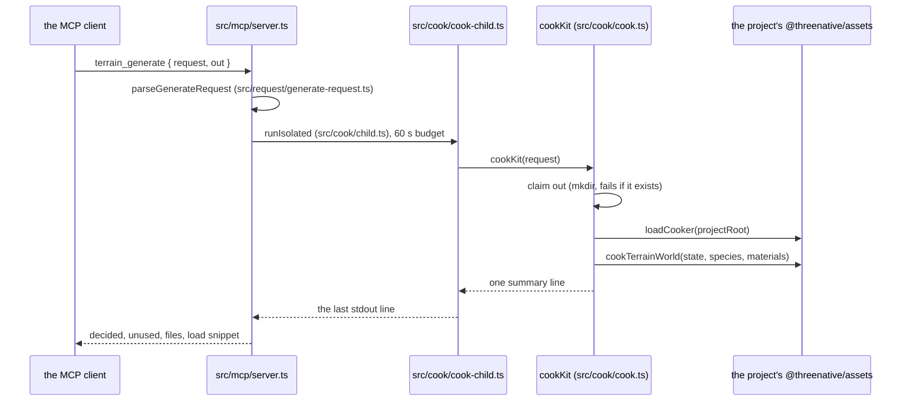
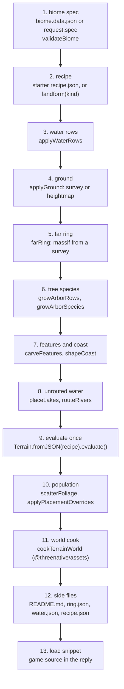

# Terrain: inside the cook

`terrain_generate` turns one request into one world package. Every stage below is a function in
[`packages/terrain/src/cook/cook.ts`](../../src/cook/cook.ts) unless the table says otherwise; the stage
functions themselves live in the folder its own row names. Read
[`architecture.md`](architecture.md) first: it says which of the three producers you are looking at.
This file covers only the MCP producer.

## The process

The MCP server does not cook in its own process. It starts a child, so a slow or crashing cook
cannot take the server down.

Three guards hold before any evaluation:

- `out` must be under the project's `assets.source`, so the build lists it in the asset manifest.
- `out` must not exist. The cook claims it with a non-recursive `mkdir`, so two cooks cannot share it.
- On any failure the cook removes `out`, so a failed cook leaves nothing partial.

## The stage order

`cookInto` runs these stages in this order. The recipe is a list of layers. Every stage before the
evaluator edits that list, and the evaluator runs once.

| Stage | Function | Reads | Changes | Folder |
| --- | --- | --- | --- | --- |
| 1. Biome spec | `validateBiome` (`packages/terrain/src/biome/biome.ts`) | `starter/<kit>/biome.data.json`, or the request's own spec; request `water` rows replace the file's | nothing yet; a bad spec fails here | `biome/` |
| 2. Recipe | `landform` (`packages/terrain/src/ground/presets.ts`) | the kit's `recipe.json` when no landform is named | the layer list; `seed` and `sizeMeters` overrides go into `config` | `ground/` |
| 3. Water rows | `applyWaterRows` | request `water` rows | resizes the recipe's own river and lake layers; adds ocean layers; returns rows with no layer | `water/` |
| 4. Ground | `applyGround`, `readGroundHeightmap`, `forestFloor` (`packages/terrain/src/ground/ground.ts`) | a survey (`packages/terrain/src/ground/survey.ts`) or a heightmap file | the base height layer | `ground/` |
| 5. Far ring | `farRing`, `massifBearing` (`packages/terrain/src/ground/ground.ts`; `packages/terrain/src/ground/massif.ts` holds the placement) | the survey row and the camera offset | nothing in the recipe; returns the `ring.json` bytes | `ground/` |
| 6. Tree species | `growArborRows`, `growArborSpecies` (`packages/terrain/src/population/arbor-species.ts`) | `assets.json` `arbor` rows, `treeSpecies` | adds baked Arbor GLBs to the asset table | `population/` |
| 7. Features and coast | `carveFeatures`, `shapeCoast` (`packages/terrain/src/water/stages.ts`) | request `features` (canyon, fjord), the sea level | adds mesa stamps before the first erosion | `water/` |
| 8. Unrouted water | `placeLakes`, `routeRivers` (`packages/terrain/src/water/stages.ts`) | rows that step 3 returned | adds lake and river layers on the finished drainage | `water/` |
| 9. Evaluate | `Terrain.fromJSON(...).evaluate()` (`packages/terrain/src/core/terrain.ts`) | the edited recipe | produces `ITerrainState`: heights, splat, waters, rivers | `core/` |
| 10. Population | `scatterFoliage` (`packages/terrain/src/population/foliage.ts`), `applyPlacementOverrides` (`packages/terrain/src/population/placements.ts`) | the biome's foliage rows and the asset table | fills `state.instances` | `population/` |
| 11. World cook | `cookTerrainWorld` (`packages/assets/src/world/terrain-world.ts`) | the state, the species and the surface layers | writes `world.glb`, `world.json` and the binary files | stays in `@threenative/assets` |
| 12. Side files | `cookInto` (`packages/terrain/src/cook/cook.ts`) | the state and the ring | writes `README.md`, `ring.json`, `water.json`, `recipe.json` | `cook/` |
| 13. Load snippet | `worldReply`, `grassSnippet` (`packages/terrain/src/cook/reply.ts`) | the output path and the decisions | returns the game source the reply carries | `cook/` |

Each function sits in the folder its stage names, and `cookInto` in `packages/terrain/src/cook/cook.ts`
calls them in this order. The split is [PRD-886](../PRDs/P2/PRD-886-terrain-code-sits-in-one-folder-per-stage-with-an-architecture-map.md).

## Where to change what

- **A stage gives the wrong result.** Change its function. Run `pnpm --filter @threenative/terrain test`,
  which includes `packages/terrain/__tests__/terrain-mcp.spec.ts`.
- **A stage runs in the wrong order.** Change `cookInto`. Water, ground and features must stay before
  step 9, because the evaluator floods and erodes them in one pass.
- **The cook is too slow.** The child has a 60 s budget (`packages/terrain/src/mcp/server.ts`). The
  ground survey (step 4) and the world cook (step 11) are the usual cost.
- **The game cannot load the result.** The format is in [`world-package.md`](world-package.md).
  The load snippet (step 13) is the only code the game gets.
