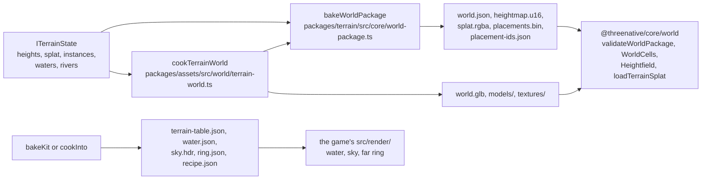

# Terrain: the world package

A bake writes a world package: one folder that a game loads with no terrain code. This file says what
each file holds and which code writes and reads it. Read [`architecture.md`](architecture.md) first.

The contract is one declaration, `IWorldPackage` in `packages/core/src/world-package.ts`, and one
validator, `validateWorldPackage` in the same file. The terrain package imports that type and never
declares a second one (`packages/terrain/src/core/world-package.ts`). A format change starts in core.

## Who writes, who reads

`cookTerrainWorld` calls `bakeWorldPackage` for the binary files and adds the GLB. A starter bake
with no cook passed to `bakeKit` writes the binary files alone and copies the models as they are.

## The files

Numbers in the "Forest" column come from `pnpm --filter @threenative/terrain bake:forest` on
2026-11-13: 257 × 257 heights at 2 m spacing, 34 720 placements in 62 cells.

| File | Holds | Forest | Written by | Read by |
| --- | --- | --- | --- | --- |
| `world.json` | the manifest: `version`, `extent`, `cellSize`, `terrain`, `assets`, `placements`, `placementIds`, `cells` | 51 KB | `bakeWorldPackage` | `validateWorldPackage`, `WorldCells.load` |
| `heightmap.u16` | one unsigned 16-bit height per vertex, row-major Z then X | 132 KB | `bakeWorldPackage` | `loadWorldHeightmap`, `Heightfield` |
| `splat.rgba` | eight material weights per vertex, in two RGBA8 planes | 528 KB | `bakeWorldPackage` | `loadTerrainSplat` |
| `placements.bin` | one 32-byte record per placement, grouped by cell then asset | 1.1 MB | `bakeWorldPackage` (`writePlacementRecord`) | `cellPlacements`, `WorldCells` |
| `placement-ids.json` | the stable semantic ID of each record, in record order | 1.3 MB | `bakeWorldPackage` | `addStarterWorld` (`packages/terrain/src/starter.ts`) and the full-world export (`packages/terrain/src/export.ts`) |
| `world.glb` | the streamed ground and every species' models and LOD levels | 16 MB | `cookTerrainWorld` | `WorldCells` |
| `models/`, `textures/` | the source models and ground layer maps | | the cook or `bakeKit` | the GLB build; the game's ground material |
| `terrain-table.json` | the ground layers: `base`, `layers`, `breakup`, `macro`, `splat`, `textures`; `sources` is for the bake only | 2 KB | `bakeKit` or the cook | the game's ground material, `loadTerrainSplat` |
| `water.json` | `lakes` (`id`, `kind`, `at`, `radius`, `level`) and `rivers` (`id`, `width`, `points`) | 9 KB | `bakeKit` or `cookInto` | the game's water, such as `starter/<world>/water.ts` |
| `sky.hdr` | the sky the props are lit by | 1.6 MB | `bakeKit` copies it | the game's `sky.ts` |
| `ring.json` | the far-ring massif heights past the playable square (MCP cook only) | | `farRing` | the game's horizon, such as the preview's `src/render/horizon.ts` |
| `recipe.json` | the edited recipe with the heightmap inlined (MCP cook only) | | `cookInto` | `terrain_patch`, and the preview through `STRATA_WORLD` |
| `README.md` | the survey and far-ring attribution (MCP cook only) | | `cookInto` | a person |

## The byte layouts

**Heights.** A vertex value `v` decodes to `heightMin + v / 65535 * (heightMax - heightMin)`, with
both bounds in `world.json` `terrain`. Vertex `(column, row)` sits at
`extent.minX + column * spacing`, `extent.minZ + row * spacing`. The file length is
`columns * rows * 2`, and `validateWorldPackage` checks it.

**Placements.** Each record is eight `float32` values:

| Index | 0 to 2 | 3 to 6 | 7 |
| --- | --- | --- | --- |
| Value | position x, y, z in metres | rotation quaternion x, y, z, w, normalized | one uniform scale |

A placement with a non-uniform scale, a non-finite position, a zero quaternion or a position
outside `extent` fails the bake by name. A record has no room for a second scale, so the bake refuses
it rather than average it.

**Cells.** `cells` lists square cells of `cellSize` metres. Each cell holds `runs`: one
`{ asset, count, offset }` per asset, where `offset` counts records, not bytes. The bake sorts cells
by x then z, and runs by asset ID, so the same recipe writes the same bytes.

## Changing the format

1. Change `IWorldPackage` and `validateWorldPackage` in `packages/core/src/world-package.ts`.
2. Change the writer in `packages/terrain/src/core/world-package.ts`, and the cook in
   `packages/assets/src/world/terrain-world.ts` if it writes the new field.
3. Rebuild `@threenative/assets` with `pnpm --filter @threenative/assets build` when step 2 touched
   it, then run `pnpm --filter strata-terrain-preview dev:fresh` (it rebuilds terrain and core). An
   old `dist` writes or reads the old format.
4. The validator accepts only `version` 1 and names any other version it finds. A change that stops
   an old package from loading raises the version in the same commit.
