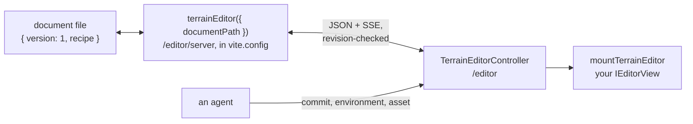

# Terrain: the live editor

The optional editor lets an agent and a person edit one terrain document at the same time. It is
authoring tooling: keep its imports, worker, watcher and document out of the game runtime. Read
[`../../README.md`](../../README.md) first. This file ships in the npm package.

## How it connects

- `terrainEditor({ documentPath })` from `@threenative/terrain/editor/server` mounts revisioned JSON and
  SSE endpoints on the project's existing loopback Vite server. Agent patches and GUI changes share the
  one document file.
- An invalid external save keeps the last valid document and shows a diagnostic. A write with a stale
  `baseRevision` returns 409 and changes nothing.
- The loopback API is not a public write service. For remote access, configure a forwarded viewer URL.

## The browser side

The project provides `/terrain-editor/index.html` and calls `mountTerrainEditor` from
`@threenative/terrain/editor` with its own `IEditorView` and material colours. The addon creates no
renderer or scene. `mountTerrainEditor` passes `(host, controller)` to `createView`. The view implements
`setDocument(document, revision)` for changes that need no evaluation, and `update(state)`, which may
return the resolved state for inspection and data bakes.

`TerrainEditorController(editorUrl)` exposes `activate`, `snapshot` and atomic `commit`. The activation
result names the bound URL, project, session and revision.

## Environment, assets and surfaces

Each operation below is revision-checked and has a GUI panel that calls the same code.

- `controller.environment({ op: "get" | "patch" | "reset" }, revision)`: sun azimuth, elevation, intensity
  and colour, sky fill, sky colour or image, `exp2` haze, exposure, sea colours, and a separate `lighting`
  image. `null` returns a field to the project's own value. Another fog mode is refused by name. The
  project's `src/render/` decides what each value does. Nothing here evaluates the terrain.
- `controller.asset({ op: "register" | "upload" | "adjust" | "remove" | "list" | "map" | "unmap" }, revision)`:
  - `register` takes an absolute local path (for example an asset-MCP download); `upload` takes base64 bytes.
  - Files are stored as `<kind>/<sha12>-<id>.<ext>`, so a replacement gets a new URL. GLB, PNG, JPEG, WebP,
    HDR and EXR are recognised by their bytes. A damaged file, a file over the project's limits, or a GLB
    that points outside itself is refused by name. The same ID with other bytes needs `replace: true`.
  - `remove` drops the entry, not the file, and is refused while a surface or the environment uses it.
  - `map` binds an image to a `<surface>.<channel>` input the project exposes (`bark.albedo`,
    `stone.normal`). Albedo is read as sRGB; every other channel is linear data.
  - `adjust` sets a model's unit scale and pivot without editing the file. To place a model, add a
    `scatter` layer whose `asset` is its ID.

## Placement overrides

A scatter placement `id` names the layer, the unsigned seed and the candidate attempt, not the array
index. A mask or spacing change can remove candidates, but the surviving keys keep their seeded scale and
yaw. A new seed makes new identities. Save keys, not mesh instance indices.

The document may hold `placementOverrides`, keyed by those IDs:

- `validatePlacementOverrides()` checks a finite position and quaternion and a positive scale, and sets
  an omitted `grounding` to true.
- `applyPlacementOverrides(state, overrides)` attaches each transform to its placement and reports the
  keys that matched nothing. `bakeTerrain()` keeps those records.
- The game grounds each override against its real mesh bounds and terrain triangles. With grounding off,
  the measured clearance stays.

## Footprint edits

Stamp, paste and heightmap layers are selected by stable ID. One proxy edits a footprint (`at`, `size`,
degree `rotation`, `falloff`) and its vertical `scale` and `offset`. X and Z rotation is off, because a
heightfield cannot overhang. A heightmap with no footprint fields samples the whole world, as before.
