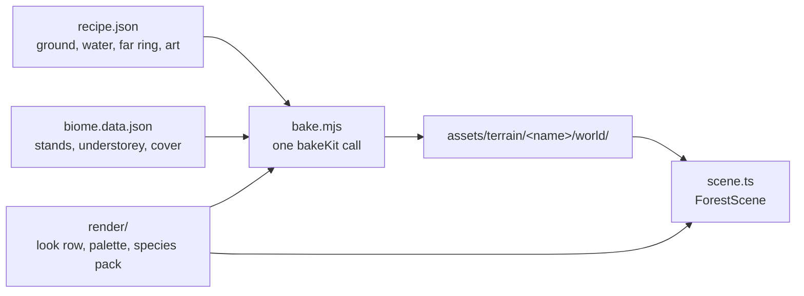

# Terrain: making a new environment from the forest kit

How to make a new playable environment (a desert, a taiga, a coast, a place on a map) on the
forest kit's stack: real ground, streamed props, far forest, a sky and a walking player. Read
[`../../README.md`](../../README.md) first. This file ships in the npm package.

The forest kit is one stack, and an environment is the data it reads. Do not write a new bake, a
new streaming loop or a new scene. Copy the kit, then change its data and its look.



## 1. Copy the kit and name the environment

```sh
cp -r node_modules/@threenative/terrain/starter/forest src/terrain/taiga
npm install --save-dev @threenative/terrain tsx
```

The name is in two places, and they must be equal:

- `recipe.json`: `world.name`. Every baked file is `world/<name>.*`.
- `render/worldNames.ts`: `WORLD`. The scene, the asset root (`terrain/<name>/`) and the look rows read it.

After you rename `WORLD`, the type checker names each look row that still has the old key.

## 2. The ground: `recipe.json`

`recipe.recipe` is an ordinary terrain recipe ([Authoring a recipe](recipes.md)): the heightmap,
erosion, surfaces, roads, pads, rivers and lakes, in order.

- **A real place.** Call the MCP tool `terrain_generate` with `ground: { location: [lat, lon] }`, or
  with a region word. Copy the heightmap layer of the `recipe.json` it returns into your recipe. A
  heightmap layer takes inline `values` or a `raw16` file of 0.1 m steps.
- **A generated shape.** Use a `landform(kind, …)` heightmap ([Authoring a recipe](recipes.md)).
- **Surfaces.** The `materials` rules paint the splat channels. The ground shader draws what a
  channel means (moss, litter, sand), so a look with no rule for a channel draws none of it.

The `world` row holds what the bake makes beyond the terrain:

| Field | What it decides |
| --- | --- |
| `name` | The baked file names. |
| `ground` | The base layer, the blended layers and their roughness, by material id. The maps come from the kit's `world/terrainAssets.ts`. |
| `farRing` | The ring past the playable square: a surveyed grid from the starter assets (`survey`), a generated `backdrop` on its relief, extra recipe `layers`, and an optional surveyed `massif`. Omit it for no ring. |
| `art` | The starter-asset paths copied into the output as named. |

## 3. What grows: `biome.data.json`

The biome file lists the tree stands, understorey, rocks, deadfall and ground cover, with density,
slope, height and spacing for each. The forest's own file is the worked example; `validateBiome`
names every field (`engine_capability_detail validateBiome`). The bake validates the file before it
places anything, and an unknown field fails by name.

Every plant comes from one of two sources, in this order:

1. A CC0 Poly Haven scan. Search with the asset MCP tool `polyhaven_search_assets`.
2. A `bakeVegetation` preset from `@threenative/procedural-environment`. A dwarf or krummholz tree is a
   `form` change on an existing preset, not a new species.

Name each species and its scan or preset in `render/props/pack.ts`. A species with neither source
becomes a new `@threenative/procedural-environment` preset. Do not model it by hand.

## 4. The look: `render/`

The look is your source. Change it freely.

| File | What it decides |
| --- | --- |
| `render/biomes.ts` | The look row: sun, sky, haze, exposure, tints, snow and tree-line bands. |
| `render/ground/palette.js` | The baked ground's vertex colours. |
| `render/ground/terrain.ts` | The ground material, and `CANOPY_CROWN`: the crown radius that shades the ground under each tree. |
| `world/terrainAssets.ts` | Every ground map and its tile size. |
| `render/props/pack.ts`, `render/props/props.ts` | The species pack, its variants, draw reach and shadows. |
| `render/sky/`, `render/water/` | The sky, the atmosphere, the lake and the river surfaces. |

`bake.mjs` passes the palette, ground maps, canopy crowns and prop policy to `bakeKit` as `look`.
Edit those files, not the bake.

## 5. Bake and play

```sh
node src/terrain/taiga/bake.mjs
```

The bake writes `assets/terrain/<name>/` (`--out <dir>` moves it). The same kit always bakes the
same bytes. Start the game on `ForestScene` from the kit's `scene.ts`, as the kit's `README.md` shows.

Before you call the environment done, play it from the spawn and read `TN_FRAME_BUDGET`,
`TN_SCENE_WARNING` and `TN_RENDER_PROJECTION`.
