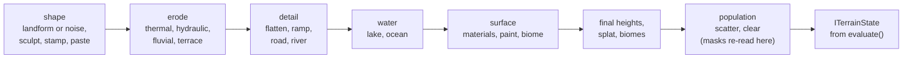

# Terrain: authoring a recipe

The reference for writing a terrain recipe with `@threenative/terrain`. Read
[`../../AGENTS.md`](../../AGENTS.md) first. This file ships in the npm package.

## Units and identity

- Metres, Y up. X and Z run from `-size/2` to `+size/2`. Brushes and masks take `[x,z]`; splines take `[x,y,z]`.
- Rotations and slope thresholds are degrees. **Placement output yaw is radians.** Heights are absolute metres.
- An operation records intent; `evaluate()` returns disposable arrays. Editing them does not edit the recipe.
- Use stable semantic IDs (`base`, `north-peak`, `river-main`). Reusing an ID replaces that layer in place.
  `label` is the display name in fluent calls and `name` in saved JSON; in `biome()`, `name` is the biome key.
- A scatter placement `id` encodes layer, seed and candidate, not the array index. Save IDs, not instance indices.

## Workflow

1. Set size, seed and a preview resolution (129 or 257). For real relief, start from `landform(kind, { size, seed,
   relief })` (`alpine`, `temperateMountains`, `rollingHills`, `desertMesa`, `coastalCliffs`, `tundra`, `volcanic`).
   Its heights are absolute, so read `terrainStats()` before you choose height masks or water levels.
2. Erode before fine roads and pads. Add surface rules and population after the shape they read.
3. Inspect with `t.inspect()`, change known IDs, then verify the final resolution: erosion and population change with it.

Layers run in the order you add them, and each one reads the ground that the layers before it left.
The diagram is the recommended order. Population is the one fixed stage: it runs last, on the final ground.



A height or slope mask on a surface rule reads the ground at that rule's place in the order. A scatter mask is
read again on the final ground, so a later height edit does not leave a tree in the air.

```js
import { Terrain, Mask } from '@threenative/terrain';
const t = new Terrain({ size: 512, resolution: 129, seed: 73 }).noise({ id: 'base', base: 15, amplitude: 20, scale: 140 });
t.flatten({ id: 'camp-pad', at: [-70, 50], radius: 28 });            // no height: a bench at ground level
t.road({ id: 'access-road', points: [[-220, null, 100], [-70, null, 50]], width: 12, shoulder: 8 });
t.river({ id: 'river-main', points: [[20, 14, -240], [80, 3, 240]], width: 18, depth: 4, enforceDownhill: true });
t.water({ id: 'lake', kind: 'lake', at: [80, 210], radius: 75, level: 4 });
t.materials({ id: 'surfaces', base: 'grass', rules: [{ material: 'rock', mask: Mask.slope(42, 90, 8) }] });
t.scatter({ id: 'trees', asset: 'pine', count: 900, minDistance: 5, maxSlope: 35,
  mask: Mask.and(Mask.height(8, 85, 10), Mask.not(Mask.material('road'))) });
const state = t.evaluate({ resolution: 257 }); // 900 placements on 2026-11-13
```

## Operations

Other operations: `noise`, `sculpt`, `smooth`, `ramp`, `stamp`, `paste`, `heightmap`, `erode` (`thermal`,
`hydraulic`, `fluvial`), `terrace`, `paint`, `biome`, `clear`, `copyRegion`. Every layer takes `opacity`.
There is no `terrain.generate()`, `terrain.bake()` or `terrain.saveGLB()`.

- **Edits.** `transaction()` groups synchronous edits into one undo; a validation failure rolls back all of it.
  `applyPatch([...])` takes JSON commands: `upsert` (`layer`), `update` (`id`, `patch`), `remove` (`id`),
  `move` (`id`, zero-based `index`), `toggle` (`id`, optional `enabled`).
- **Brushes.** `radius` is a radius. Sculpt strength is signed metres; smooth, flatten and paint take `0..1`.
  A stationary brush does not keep adding height.
- **Masks** are data, not callbacks: `height`, `slope`, `material`, `biome`, `circle`, `rectangle`, `noise`,
  `and`, `or`, `not`, `all`, `none`. Height and slope masks read the terrain at their own stage.
- **Population** samples the final ground, so later height edits leave no floating trees. `minDistance`
  holds within one rule only, and a rule can place fewer than `count`: read the diagnostics.
- **Materials** are `grass`, `dirt`, `rock`, `snow`, `sand`, `mud`, `road`, `moss`. Splat is sample-major
  (`splat[i * 8 + channel]`) and sums to one. Read it as linear data (NoColorSpace), not as a colour image.
- **Roads, rivers, ramps** grade to the ground where a point's Y is `null` or `followTerrain: true`, within
  `maxGrade` (0.12), `maxCut` (2.5 m) and `maxFill` (1.5 m). River carving only lowers. A lake floods from
  `at` below `level` and digs no basin; an ocean floods from the borders. Scatter avoids water by default.
- **Heightfields.** Paste, stamp and heightmap data is `{ width, height, values }` in metres. Footprints take
  `at`, `radius` or `size`, `rotation` (degrees) and `falloff`. PNG import is grayscale 8/16-bit only; RAW
  carries no size or range, so keep its sidecar. Read PNG16 with the supplied decoder, not a canvas.

## Export

- `t.toJSON()` and `Terrain.fromJSON()` round-trip the recipe. Save the recipe, not only the mesh.
- `makeExport(state, recipe, kind)` with `project`, `png`, `raw`, `splat`, `glb` or `runtime` returns
  `{ name, type, bytes }`. Its `glb` is terrain only.
- `bakeTerrain(state, { chunkCells, lodSteps, skirtDepth })` makes LOD chunks. Heights are row-major,
  Z then X; vertex `(x, z)` sits at `((x/(N-1) - .5) * size, height[z*N + x], (z/(N-1) - .5) * size)`.
- `toGeometry(bakeMesh(state))` from `/three` gives indexed geometry. Your `src/render/` makes the mesh
  and material, and disposes the geometry.
- A full world (terrain, props, water) goes through `prepareWorldGLTF` from `/export` in the browser, then
  `cookTerrainWorld` from `@threenative/assets` in Node. Its input contract is in `dist/export.d.ts`.
- Not provided: navmesh, EXR, mixed-LOD stitching, caves, water simulation, materials or colours.

## Limits

- Resolutions: 17, 33, 65, 129, 257, 513, 1025 vertices per side. At most 512 layers, 20 000 instances per
  scatter rule, 200 000 droplets, 128 steps per droplet, 200 thermal or smooth iterations, 10 octaves,
  8 192 input points and 65 536 interpolated brush centres. These are guards, not performance targets.
- `evaluate()` is synchronous and checks an `AbortSignal` only between operations. To cancel, run it in a
  worker or child process and end that. The prefix cache holds 48 MiB by default (`cacheMB`).
- Recipes are data. Run no JavaScript from a recipe. A failed validation keeps the previous valid recipe.
