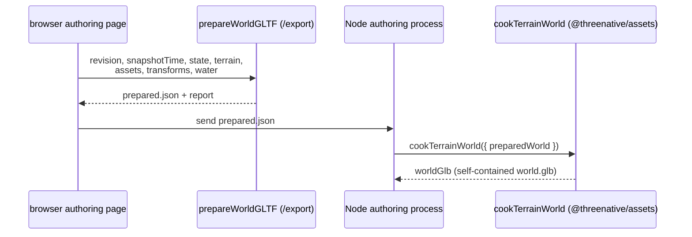

# Terrain: exporting a resolved static world

`makeExport(state, recipe, "glb")` exports the terrain alone. To export a full world (terrain, models,
final transforms, water and embedded PBR maps) as one GLB, use `prepareWorldGLTF` from
`@threenative/terrain/export`. Read [`../../README.md`](../../README.md) first. This file ships in the
npm package.



```ts
import { prepareWorldGLTF } from '@threenative/terrain/export';
const prepared = await prepareWorldGLTF({
  revision,     // the accepted document's 64-character content hash
  snapshotTime, // finite seconds, the same for every baked deformation
  state,        // the evaluated recipe with its placement overrides applied
  terrain,      // a metre-frame Mesh with UVs and prepared PBR maps
  assets,       // Map<assetId, Object3D>: the real static models
  transforms,   // Map<placementId, Matrix4>: the final grounded root matrices
  water,        // [{ id, object, time: snapshotTime, staleFrames: 0 }]
});
// In Node: const { worldGlb } = await cookTerrainWorld({ preparedWorld: prepared.json });
// Write world.glb only after the call succeeds.
```

The import itself has no DOM. Preparing a scene needs browser `FileReader` and canvas. The root and
`/three` entries stay headless.

## What the caller supplies

- **Materials.** `MeshStandardMaterial` metallic-roughness only. The terrain needs `map`, `normalMap`,
  `roughnessMap` and `aoMap`; vertex colours alone are not enough. Colour and emissive images are sRGB;
  data maps are `NoColorSpace`.
- **Images.** Decoded byte images of at most 16 megapixels. A `DataTexture` needs complete RGBA bytes.
  Bake alpha into the colour image.
- **Static geometry.** Bake displacement, bump and light maps, node shaders, skinning, morphing and wind
  into the geometry and material first. Normal maps are tangent-space with equal X and Y scale.
  `MeshPhysicalMaterial` extensions are not supported.
- **Transforms.** Metres, Y up, positive scale, no shear. Keys are placement IDs, not instance indices.
  A matrix that matches no placement fails.
- **Water.** Every evaluated water body and river needs its baked object at exactly `snapshotTime`, with
  `staleFrames: 0`. A low-resolution or stale ocean height sample does not qualify.

## What you get

- Ordinary glTF nodes that share model mesh data, with no `EXT_mesh_gpu_instancing`. A vanilla Three.js
  `GLTFLoader` or a normal game model loader reads the result without this package.
- A copy of the source geometry, images and materials taken before encoding, so later edits cannot leak
  into the export. The input objects stay yours.
- `report` with the revision, resolution, time, and placement and water IDs.
- No model cameras, lights or source `userData`. The game supplies its own lighting, sky, fog, exposure,
  post-processing and live water or wind.

Missing or unbaked content fails before any bytes are written. Keep the previous valid export and document.
The encoder does not run the project's material bake, re-evaluate at a chosen resolution, or read the
ocean back for you.
