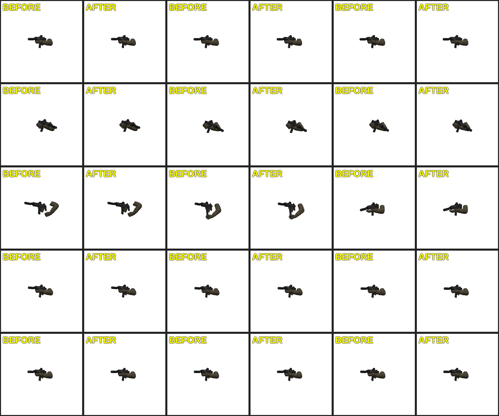

# PRD-729 shared-transcoder accounting visual proof

- Before: `2c0dbb927ac75db57a71fe14b43d69d6e7320f19` (before per-image accounting).
- After: `5a566981ec2ec54f57f7d59bf6a0307cbc2e30e4` (with per-image accounting).

The fixture cooks `player-viewmodel.glb` twice. The second GLB differs only in `asset.generator`, so model-level dedupe keeps both model outputs while the shared image keys are identical. Captures used headed Chromium/WebGPU with adapter.info `vendor=nvidia`, `architecture=turing`, 640×640, two runs per arm, 15 poses per run. Each sheet has five animation rows; the three columns are 20%, 50%, and 80% of clip duration, with BEFORE/AFTER side by side in each cell.

Independent visual judge: **NEUTRAL** across all 30 matched poses. No visible change to model detail, color, alpha, silhouette, or pose; no inconsistent frame. Raw pose hashes and adapter metadata are in `poses.json`.

## Run 1

## Run 2

