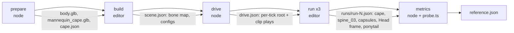

# Character dynamics: the Unreal 5.8.3 reference (PRD-910 Phase 3)

This folder holds the Unreal side of `examples/character-dynamics`. A stock Chaos Cloth cape and a ponytail on stock `FAnimNode_SpringBone` nodes ride on the same mannequin, which runs the same eight-phase script at a fixed 1/60 s step. The game's probe math scores it, and three runs go to `reference.json`. `examples/character-dynamics/__tests__/reference.spec.ts` reads that record and fails closed.



| File | Job |
|---|---|
| `reference.ts` | Node stages `prepare`, `build`, `drive`, `run`, `metrics` (`all` runs them in order). It holds the game.ts `SCRIPT` and frame loop, and it imports `examples/character-dynamics/src/probe.ts` for the metrics. |
| `build_scene.py` | Editor Python. `TN_UE_MODE=build` imports the GLBs, makes the cloth and writes `scene.json`. `TN_UE_MODE=run` plays `drive.json` 3 times. |
| `Source/CharDynProbe` | The C++ editor module. `CreateCapeCloth` is the editor's "Create Clothing Data from Section" plus "Apply" path. `RunDrive` creates a game world and ticks it by hand. `UCharDynAnimInstance` replays the game's crossfade, and its proxy runs the ponytail springs. Python cannot create cloth from a section or read the simulated positions. |
| `build_module.py` | Compiles the module against `$UE_ROOT` through a symlink shadow of the engine. See "Why a shadow engine". |
| `scene.json`, `reference.json` | Committed outputs. `Binaries/`, `Intermediate/`, `Saved/`, `Content/` and `DerivedDataCache/` are rebuilt and git-ignored. |

## Rebuild and rerun

```sh
export UE_ROOT=$HOME/UnrealEngine-5.8.3
python3 tools/unreal-reference/character-dynamics/build_module.py      # once, ~1 min (+1 min UHT on a fresh shadow)
pnpm exec tsx tools/unreal-reference/character-dynamics/reference.ts   # = all: prepare, build, drive, run, metrics
cd examples/character-dynamics && pnpm exec vitest run __tests__/reference.spec.ts
```

The editor runs as `UnrealEditor CharacterDynamicsReference.uproject -RenderOffscreen -unattended -nosplash -nosound -stdout -FullStdOutLogOutput "-ExecCmds=py build_scene.py"`. Its verdict is `Saved/<mode>.exit` (`0` or the error), not the editor's exit status. The first `build` on a cold cache compiles the global shaders, and that takes tens of minutes. One stage reruns alone with `reference.ts <stage>`.

## What is the same as the game

- **Mannequin.** `examples/character-dynamics/public/mannequin.glb`, dequantized. Its bind pose is baked to the rest pose in metres, because gltfpack folds the dequantization into the inverse bind matrices. `prepare` fails if a joint's bind pose differs from its rest pose. Interchange glTF imports it with the stock pipeline.
- **Cape.** The game.ts grid: 0.5 m x 0.62 * height, 10 x 18 segments, placed on `spine_03` in the `Idle_Loop` t = 0 pose (back offset 0.09 * height, up 0.08 * height) and skinned 100% to `spine_03`. It is a third section (`M_Cape`) of the same skeletal mesh. UV0 holds each vertex's grid (column, row), so every Chaos particle maps to its game vertex.
- **Pins.** The max distance mask is 0 on the top row (11 vertices) and 1000 cm elsewhere.
- **Script.** The same `SCRIPT`, acceleration 8 m/s², braking 12 m/s², jump at 4.2 m/s with the clip switch at phase tick 6, snap turn pi and teleport +8 m x. They are applied in the game's order: root motion first, then the clip plays, then the anim step. The three.js root path maps into Unreal with an affine fit over all 65 rest-pose bones. `drive` fails if the fit is not a scaled isometry, if the residual exceeds 0.1 cm, or if three +Y does not map to Unreal +Z.
- **Clips.** `UCharDynAnimInstance` follows `AnimationPlayer` (`packages/core/src/animation.ts`). A play fades every contributing clip out from its weight with a smoothstep. A clip that already plays in the same mode keeps playing. Loops wrap and `once` clamps. Each tick samples with the weights from before that tick's fade step.
- **Ponytail.** The game.ts chain: `ponytail_1` to `ponytail_6` under `Head`, placed on the `Idle_Loop` t = 0 pose. The root is 12 cm back and 15 cm up from `Head`, and each next bone is 5 cm back and 6 cm down, with its parent's rotation. `prepare` adds the bones to `mannequin_cape.glb` only, so the body-only physics asset does not change. No vertex is skinned to them.
- **Hair probe.** game.ts `measureHair`: `hairTipOffset` is the largest distance of `ponytail_6` in the `Head` bone frame from its spot at the end of settle. `hairStretch` is the largest |segment / rest - 1| over the 6 bones, with the rest lengths on the t = 0 pose. `hairInsideHead` counts `ponytail_2` to `ponytail_6` inside the stock capsules of `Head`, `spine_03`, `spine_02`, `upperarm_l` and `upperarm_r` plus 0.5 cm. `RunDrive` writes the `Head` frame, the 6 bones and these capsules every tick.
- **Probe.** The definitions and the math come from `probe.ts`: the hem row and the top row, the body frame (game.ts `capeMatrix`: the `spine_03` rigid frame times the t = 0 cape offset), and `bodyPenetration`, the free cape vertices (rows 1 to 18) deeper than the 1 cm collider thickness inside the posed capsules that the cloth collides with (game.ts `countInsideCapsules(free, pose.capsules, COLLIDER_THICKNESS)`). `RunDrive` writes those capsules every tick. One sample comes per tick.

## Stock defaults and named overrides

The solver is Chaos Cloth with the configs that the clothing factory creates. The values are in `scene.json` `cloth.configs`. For the stock values, see `Engine/Plugins/ChaosCloth/Source/ChaosCloth/Public/ChaosCloth/ChaosClothConfig.h`. The component keeps its stock teleport guard: 300 cm, rotation threshold off, reset after teleport (`SkeletalMeshComponent.cpp:471-473`). Gravity is the world default, -980 cm/s².

The ponytail is one stock `FAnimNode_SpringBone` per simulated bone (`ponytail_2` to `ponytail_6`), parent first. Each node reads the pose that the node before it wrote, as a chain of SpringBone nodes in an AnimGraph does. `ponytail_1` rides `Head`, as the root of the game's `SpringBoneChain3D` does. `SpringBoneChain3D` cites this node, so this node is the reference. Its stock values (UE 5.8.3: `Engine/Source/Runtime/AnimGraphRuntime/Private/BoneControllers/AnimNode_SpringBone.cpp:16-38`): `SpringStiffness` 50, `SpringDamping` 4, `ErrorResetThresh` 256 cm, `bLimitDisplacement` false, translation on all axes, rotation off. The fixed step is 1/120 s (`:62-63`). The node has no gravity and no collider. `FCharDynAnimProxy` calls `PreUpdate` and `UpdateInternal` per tick (`:55-64`, `:242-271`), and it applies each node at alpha 1 in component space (`AnimNode_SkeletalControlBase.cpp:191-197`).

| Override | Value | Why |
|---|---|---|
| Max distance mask | 0 cm top row, 1000 cm elsewhere | The factory creates an all-0 mask (fully kinematic). This is the paint the game's pin row asks for. |
| Collision physics asset | The physics asset that Interchange generates for the body-only import | A physics asset generated on the caped mesh sizes `spine_03`'s body to wrap the cape that is skinned to it. |
| Capsule rest clearance | Each capsule radius = min(stock radius, distance to the nearest rest cape vertex - 1 cm), on the `Idle_Loop` t = 0 pose. A capsule under 0.1 cm is dropped. `RunDrive` applies it in memory, recreates the clothing actors and restores the asset after the run. | The game applies the same rule (`measureBodyCapsules(capeSkin, 16, restWorld, COLLIDER_THICKNESS)`). Without it, the stock capsules hold 61 rest cape vertices (see Status) and the settled cape stretches 253%. |
| `VisibilityBasedAnimTickOption` | `AlwaysTickPoseAndRefreshBones` | Harness only: nothing renders offscreen, so the bones must refresh without a render. |
| `bWaitForParallelClothTask` | true | Harness only: `GetCurrentClothingData_GameThread` requires it. |
| Spring start | `RunDrive` resets each spring (`RemainingTime` 0, `:46`) and evaluates once with a zero delta on the `Idle_Loop` t = 0 pose | The world's zero-length setup ticks still advance 0.5 ms (`AWorldSettings::FixupDeltaSeconds` clamps to `MinUndilatedFrameTime`). A node that first evaluates with time pending keeps its constructor `BoneLocation`, the world origin (`:117-122`), and flies in from there. The reset is InitAnim's zero tick (`SkeletalMeshComponent.cpp:1213-1216`) with `Idle_Loop` as the entry pose. The game builds `SpringBoneChain3D` on the same pose. |

## Known differences from the game

- **Pose blend.** Unreal blends poses with `FAnimationRuntime::BlendPosesTogether`, a normalized quaternion blend, and samples the clips that Interchange resampled. three.js accumulates slerps on the raw glTF keys.
- **Read-out.** Unreal reads the simulated positions every tick for that tick's pose. The game reads a GPU readback every 2 frames and matches it to the pose of the step that produced it.
- **Gravity.** -9.80 m/s² in Unreal, -9.81 m/s² in the game.
- **Hair solver.** `SpringBoneChain3D` keeps each segment at its rest length, turns the bones toward the particles and pushes them out of the body capsules. The stock SpringBone moves the bone only, so the segments stretch, and it has no collider. Its damping acts on the world velocity. `OwnerVelocity` is 0 for an actor's own component (`AnimNode_SpringBone.cpp:257-266`). Each spring therefore trails its target by damping x speed / stiffness, 27 cm at 3.4 m/s, and the 5 springs add up. Teleport: SpringBone resets past 256 cm of error, `SpringBoneChain3D` past 1.5 m of root move or 1 m of error.
- **Hair colliders.** The game uses 6 capsules, including `neck_01`. The generated physics asset has no `neck_01` body, so the Unreal probe uses 5.
- **Capsules.** Unreal uses the 14 capsules of the generated physics asset (`bodies` in `scene.json`). The game measures up to 16 capsules from the skin by the same generator rule, so the capsule shapes are close but not equal.

## Why a shadow engine

`$UE_ROOT` is an installed build (`Engine/Build/InstalledBuild.txt`). Its `Engine/Intermediate/Build` has neither `BuildRules/UE5Rules.dll` nor the UHT headers of the engine modules. For that reason, UBT stops with "Precompiled rules assembly ... UE5Rules.dll does not exist", and an Engine header cannot find its `*.generated.h`. `build_module.py` mirrors the engine as symlinks in `${UE_ROOT}-chardyn-shadow`. The mirror is a sibling, so the relative includes that UHT writes from `Engine/Source` still resolve. The mirror gives the shadow its own `Intermediate`, `Saved`, UBT copy, receipt and plugin `Intermediate` folders. It leaves out `Plugins/Online/Microsoft`, because those rules need the GDK platform extension. Then the script runs the following:

1. With no installed marker: `Build.sh UnrealEditor Linux Development -SkipBuild -IgnoreJunk -NoUBA`. This step compiles the rules assembly and runs UHT for every engine module. It compiles no engine code.
2. With the installed marker: `Build.sh CharacterDynamicsReferenceEditor Linux Development -Project=... -NoUBA`. This step compiles only `CharDynProbe` and links it against the installed libraries. UBA stays off, because its file virtualization breaks header identity across the symlinks.

## Status (2026-11-23)

`reference.json` holds 3 runs. Each number is the same in all 3 runs, so the spread is 0.

| Phase | hemOffset (m) | hemTrail (deg) | maxStretch | bodyPenetration |
|---|---|---|---|---|
| settle | 0.000 | 2.5 | 0.117 | 0 |
| jog | 1.048 | 93.2 | 0.668 | 0 |
| jogTurn | 0.987 | 88.4 | 1.170 | 0 |
| sprint | 1.264 | 124.4 | 1.250 | 0 |
| hardStop | 0.417 | 30.9 | 0.846 | 0 |
| jump | 0.572 | 51.6 | 0.576 | 0 |
| snapTurn | 1.828 | 176.3 | 3.222 | 1 |
| teleport | 0.016 | 2.8 | 0.084 | 0 |

The re-import with the 6 ponytail bones moved the cape numbers from jogTurn on by up to 2% (sprint maxStretch 1.270 to 1.250, jump hemOffset 0.585 to 0.572, snapTurn maxStretch 3.256 to 3.222). Settle, jog and teleport did not change. A second full rebuild gave byte-identical run files, so the build is deterministic. The cause of the shift is not attributed. One clue: `scene.json` `cloth.referenceBone` now reads `spine_03`, where the build without the bones read `?`.

### Ponytail (PRD-912 AC-3)

Stock `FAnimNode_SpringBone` chain, 3 runs, spread 0 (byte-identical runs).

| Phase | hairTipOffset (m) | hairStretch | hairInsideHead |
|---|---|---|---|
| settle | 0.000 | 0.599 | 1 |
| jog | 2.272 | 11.134 | 0 |
| jogTurn | 2.004 | 11.866 | 0 |
| sprint | 2.918 | 12.181 | 0 |
| hardStop | 1.905 | 14.460 | 3 |
| jump | 3.281 | 17.402 | 1 |
| snapTurn | 3.676 | 29.602 | 2 |
| teleport | 0.057 | 0.180 | 0 |

Side and rear views of the chain at the end of settle, the hard-stop peak and the snap-turn peak: `~/Downloads/character-dynamics-unreal-reference/unreal-ponytail-settle-hardstop-snapturn.png` (made from `Saved/runs/run-1.json`).

**This is not a usable AC-3 bound.** The stock node keeps no segment length, so the 31 cm chain stretches to metres. Each spring trails its moving target by 27 cm at jog speed (see "Hair solver"), and 5 lightly damped springs in series amplify each other. In settle, the idle sway alone stretches the tip segment 60%. The teleport resets correctly (0.057 m). The game's `SpringBoneChain3D` holds the segment lengths and swings its tip 0.30 to 0.59 m (PRD-912 Status). A tip offset of 2 to 3.7 m cannot bound it.

Side view of the cape at the end of settle, the hard-stop peak and the snap-turn peak: `~/Downloads/character-dynamics-unreal-reference/unreal-cape-settle-hardstop-snapturn.png` (made from `Saved/runs/run-1.json`).

### What changed in the second pass, and why

1. **The settled cape stretched 253%. Cause: stock capsules overlap the rest cape.** The particle map was correct. At tick 1, 141 of 209 particles sat within 0.2 cm of their grid position (177 after the fix), and the pinned row followed `spine_03` within 0.09 cm in every tick. The displaced particles sat in patches next to capsules. The generated `spine_03` capsule has a radius of 19.96 cm. The cape hangs 13.79 cm from the capsule axis, so 34 rest vertices were inside it. Pelvis held 7, `upperarm_r` 13, `hand_r` 3 and `calf_r` 4 (`restClearance` in `reference.json`). Collision and the pins fought from the first step. Edge 23-34 measured 3.3 times its rest length at tick 1. Fix: the capsule rest-clearance override, which is the game's rule. Settle stretch went from 2.533 to 0.117. Teleport stretch went from 2.754 to 0.084. Tick 1 now shows 1.7%.
2. **bodyPenetration counted a different capsule than the game.** The old metric counted all 209 vertices against a capsule from `pelvis` to `neck_01` with a radius of 0.075 * height. game.ts now counts only the free rows against the capsules that the solver collides with, minus the 1 cm thickness. `reference.ts` now does the same with the capsules that Unreal collides with. Result: 0 in every phase, except 1 vertex in snapTurn.
3. **Byte-identical runs are honest.** `run` makes 3 separate simulations. Each call to `RunDrive` creates a new world and new clothing actors, and `Saved/run.log` shows three "Recreating Clothing Actors" lines and three tick-1 diagnostics at frame counters 0, 617 and 1234. Chaos Cloth at a fixed 1/60 s step with the same inputs gives the same bits. The spread of 0 is the measured result. Do not add noise to it.
4. **hemOffset of 1.0 to 1.8 m and the 177° trail are physics, not a map bug.** The trail changes smoothly from tick to tick. In jog, it climbs from 0° to 93° in 42 ticks and falls back to 21° (the acceleration swing of a lightly damped cape). PRD-911 reports the same swing past 120° in the game. In snapTurn, the 180° turn in one tick lets 75% of the rotation through (`angularVelocityScale` 0.75, `fictitiousForcesModel` FullScale). The stock `TeleportRotationThreshold` is 0, which is off. The hem swings over the shoulder (177° at tick 533) and settles in 24 ticks. Stretch in moving phases is stock Chaos with 1 iteration and 1 substep. Most peak edges touch a leg capsule within 1 to 2 cm, and Chaos resolves collision after the edge constraints. The jog peak (0.668) sits 39 cm from all capsules, in free air.

### Not done

- **A length-keeping Unreal ponytail for AC-3.** Next step: run `FAnimNode_AnimDynamics` in chain mode (`bChain`, `ponytail_1` to `ponytail_6`) with its stock defaults beside the SpringBone chain, as a second `hair` block. AnimDynamics keeps the segment lengths with its constraints and has gravity, so its tip swing is comparable with `SpringBoneChain3D`. The harness is ready: the bones, the per-tick Head frame and tip, and the metrics exist. Only the node in `FCharDynAnimProxy::Evaluate` and its stock settings are new. Owner decision first: which Unreal node is the AC-3 reference.
- **The cape shift after the re-import** (up to 2%, see above) is not attributed. A build without the ponytail bones, compared run file against run file, would show whether the bones or the reference bone cause it.
